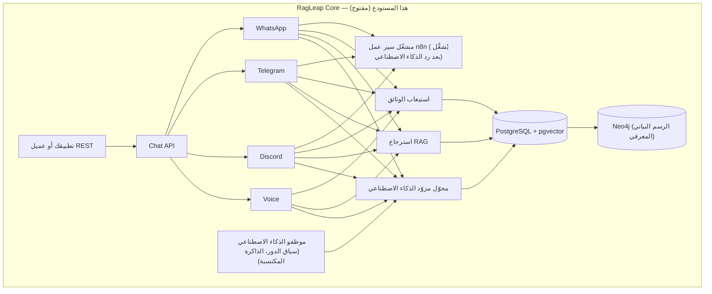
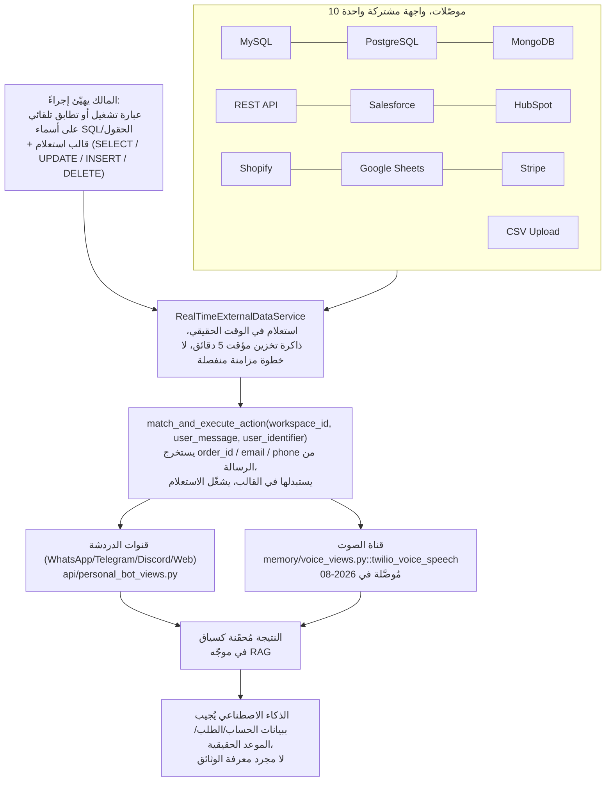

<div align="center">


# RagLeap Core

**موظفون ذكاء اصطناعي مفتوحو المصدر — يسألون قبل أن يتصرفوا.**

[](../LICENSE) [](https://github.com/ragleap/ragleap-core/releases) [](https://github.com/ragleap/ragleap-core) [](https://github.com/ragleap/ragleap-core) [](https://github.com/ragleap/ragleap-core)
[](https://pypi.org/project/ragleap-rag/) [](https://pypi.org/project/ragleap-rag/)
[](https://pypi.org/project/ragleap-graph/) [](https://pypi.org/project/ragleap-graph/)
[](https://pypi.org/project/ragleap-vectorstores/) [](https://pypi.org/project/ragleap-vectorstores/)
[](https://pypi.org/project/ragleap-tools/) [](https://pypi.org/project/ragleap-tools/)
[](https://pypi.org/project/ragleap-integrations/) [](https://pypi.org/project/ragleap-integrations/)
[](https://pypi.org/project/ragleap-agents/) [](https://pypi.org/project/ragleap-agents/)
[](https://pypi.org/project/ragleap-ops/) [](https://pypi.org/project/ragleap-ops/)
[](https://pypi.org/project/ragleap-app-chart/) [](https://pypi.org/project/ragleap-app-chart/)
[](https://pypi.org/project/ragleap-observability/) [](https://pypi.org/project/ragleap-observability/)
[](https://pypi.org/project/ragleap-terraform/) [](https://pypi.org/project/ragleap-terraform/)
[](https://pypi.org/project/ragleap-ansible/) [](https://pypi.org/project/ragleap-ansible/)
[](https://pypi.org/project/ragleap-voice/) [](https://pypi.org/project/ragleap-voice/)
[)](https://central.sonatype.com/artifact/io.github.antonyrag/ragleap-rag)
[)](https://central.sonatype.com/artifact/io.github.antonyrag/ragleap-graph)
[](https://github.com/ragleap/ragleap-core) [](https://discord.gg/mQwJuQDVrA) [](https://github.com/ragleap/ragleap-core/pulse)

[English](../README.md) · [Afrikaans](README.af.md) · **العربية** · [Български](README.bg.md) · [বাংলা](README.bn.md) · [Català](README.ca.md) · [Čeština](README.cs.md) · [Cymraeg](README.cy.md) · [Dansk](README.da.md) · [Deutsch](README.de.md) · [Ελληνικά](README.el.md) · [Español](README.es.md) · [Eesti](README.et.md) · [فارسی](README.fa.md) · [Suomi](README.fi.md) · [Français](README.fr.md) · [ગુજરાતી](README.gu.md) · [עברית](README.he.md) · [हिन्दी](README.hi.md) · [Hrvatski](README.hr.md) · [Magyar](README.hu.md) · [Bahasa Indonesia](README.id.md) · [Italiano](README.it.md) · [日本語](README.ja.md) · [ಕನ್ನಡ](README.kn.md) · [한국어](README.ko.md) · [Lietuvių](README.lt.md) · [Latviešu](README.lv.md) · [Македонски](README.mk.md) · [മലയാളം](README.ml.md) · [मराठी](README.mr.md) · [नेपाली](README.ne.md) · [Nederlands](README.nl.md) · [Norsk](README.no.md) · [ਪੰਜਾਬੀ](README.pa.md) · [Polski](README.pl.md) · [Português](README.pt.md) · [Română](README.ro.md) · [Русский](README.ru.md) · [Slovenčina](README.sk.md) · [Slovenščina](README.sl.md) · [Soomaali](README.so.md) · [Shqip](README.sq.md) · [Svenska](README.sv.md) · [Kiswahili](README.sw.md) · [தமிழ்](README.ta.md) · [తెలుగు](README.te.md) · [ไทย](README.th.md) · [Tagalog](README.tl.md) · [Türkçe](README.tr.md) · [Українська](README.uk.md) · [اردو](README.ur.md) · [Tiếng Việt](README.vi.md) · [简体中文](README.zh-cn.md) · [繁體中文](README.zh-tw.md)

</div>

RagLeap Core هو المحرك مفتوح المصدر الذي يشغّل منصة RagLeap — نظام ذكاء اصطناعي مستضاف ذاتياً يدير أعمالك انطلاقاً من وثائقك الخاصة وعلى خوادمك أنت، دون أي ارتباط بمورّد خارجي.

**46 موظفاً بالذكاء الاصطناعي لكل دور وظيفي:** 9 أدوار عامة أساسية (مدير، سكرتير، مدير تنفيذي، مبيعات، دعم عملاء، موارد بشرية، مالية، تسويق، عمليات) إضافةً إلى 37 دوراً متخصصاً عالمياً (موظف توظيف، وكيل عقارات، استقبال قانوني، استقبال رعاية صحية، وكيل تأمين، وغيرها) — القائمة الكاملة في [`core/employees/defaults.py`](core/employees/defaults.py).

**ماذا يفعل:**
- ذاكرة ذاتية التعلم مرجّحة بالنتائج
- تفعيل تلقائي لسير العمل والتصعيد
- أوضاع الاستقلالية: `off` (الوضع الافتراضي، يتصرف الذكاء الاصطناعي فقط عند تشغيلك له)، `semi` (تعتمد كل إجراء بنفسك)، و`full` (بالاشتراك الاختياري؛ الأدوار الحساسة لا تكون أبداً مستقلة كلياً)
- حلقة تفكير-تصرف-قرار، لا مجرد استرجاع معلومات
- حلقة عمل-مراقبة للوكيل (اختيارية): يقترح النموذج إجراءً واحداً في كل مرة، يمر عبر بوابة الموافقة، ثم تعود النتيجة كنص غير موثوق
- أدوات آمنة كلها اختيارية: Python وshell في بيئة معزولة بلا شبكة، جلب صفحات للقراءة فقط، عميل MCP مع قائمة مسموحات، تذاكر مهام وجلسات مجدولة
- **لوحة تحكم AI Office** على `/office`: موافقات، موظفون حسب القسم، مهام، تشغيلات الوكيل، نشاط، إعدادات، وقائمة إعداد مرجعية
- يمكن تشغيله محلياً بالكامل عبر Ollama للدردشة والتضمين (النماذج الصغيرة على CPU أبطأ وأقل دقة من النماذج المستضافة)، أو مع أي من 19 خياراً للمزوّدين بمفتاحك الخاص
- ميزانيات رموز اختيارية، وتقييد تسجيل الدخول الفاشل، وسجل مراجعة لكل إجراء

**التثبيت بأمر واحد** (يحتاج Docker Desktop على macOS وWindows، أو Docker Engine على Linux؛ يسألك السكريبت عن الذكاء الاصطناعي الذي تريد استخدامه ولا يعدّل ملف `.env` الموجود):

```bash
curl -fsSL https://raw.githubusercontent.com/ragleap/ragleap-core/main/install.sh | bash
```

تفضّل قراءته أولاً؟ راجع [install.sh](../install.sh). للإعداد المحلي الكامل بدون مفتاح API، أضف `bash -s -- --ollama` في نهاية الأمر السابق.

**Windows:** ثبّت [Docker Desktop](https://www.docker.com/products/docker-desktop) (يحتاج WSL 2 وتفعيل المحاكاة الافتراضية للمعالج) و[Git for Windows](https://git-scm.com/download/win)، ثم افتح نافذة PowerShell واكتب:

```powershell
irm https://raw.githubusercontent.com/ragleap/ragleap-core/main/install.ps1 | iex
```

يسألك عن الذكاء الاصطناعي الذي تريد استخدامه، يبني RagLeap ويشغّله، ويفتح لوحة التحكم في متصفحك دون طباعة مفتاح تسجيل الدخول في الطرفية. اكتبه مباشرة في PowerShell؛ أما بصيغة `powershell -c "..."` فقد أوقفها Windows Defender على الجهاز الذي اختبرناه. لقراءة السكريبت أولاً، شغّل `$s = irm` مع نفس العنوان، تفحّص `$s`، ثم شغّل `iex $s`. بعد التثبيت، شغّل أوامر RagLeap في Git Bash من مجلد التثبيت، مثلاً: `bash scripts/ragleap key`.

إذا كان المنفذ 8000 أو 5433 مشغولاً على جهازك (مثلاً بـ PostgreSQL محلي)، فإن التثبيت الجديد يختار تلقائياً أول منفذ حر ويكتبه في `.env` (مثل `APP_PORT` و`DB_PORT`). `ragleap key --rotate` يستبدل مفتاح API الخاص بك ويعيد تشغيل التطبيق؛ المفتاح القديم يتوقف عن العمل فوراً.

صراحة تامة: مثبّت Windows جرى على جهاز واحد فقط حتى الآن، وخيار Ollama المحلي لم يُختبر بعد على Windows.

[البدء السريع](#البدء-السريع) · [التوثيق](https://docs.ragleap.com) · [الموقع](https://ragleap.com) · [الحزم](https://packages.ragleap.com/)

---

> **مفتوح المصدر، مستضاف ذاتياً.** `ragleap-core` (هذا المستودع) مرخّص بـ MIT، مجاني تماماً، ولا يحتاج أي مفتاح ترخيص. نسخة سحابية مُدارة من RagLeap مخطط لها مستقبلاً؛ في الوقت الحالي RagLeap مفتوح المصدر فقط.

## التثبيت

```bash
pip install ragleap-rag
```

> ⭐ إذا أفادك هذا المشروع، ضع له نجمة في المستودع — هذا يساعد فعلاً في وصوله إلى المزيد من الناس.

تفضّل Java؟ `ragleap-rag` متوفر أيضاً على Maven Central:
```xml
<dependency>
    <groupId>io.github.antonyrag</groupId>
    <artifactId>ragleap-rag</artifactId>
    <version>0.13.0</version>
</dependency>
```
إصداره مستقل عن حزمة Python أعلاه — راجع [`java/ragleap-rag`](../java/ragleap-rag) للنطاق الحالي.

فهرس الرسم البياني Neo4j متوفر بنسخة Java أيضاً، عبر HTTP Query API (تعبيرات نمطية أو، اختيارياً، استخراج كيانات وعلاقات بالذكاء الاصطناعي، إزالة التكرار، فهرسة الوثائق وعمليات البحث، `GraphRetriever`، عمليات الترقية والتهجير؛ كاتب مراجعة Postgres لم يُنقل بعد):
```xml
<dependency>
    <groupId>io.github.antonyrag</groupId>
    <artifactId>ragleap-graph</artifactId>
    <version>0.2.0</version>
</dependency>
```
راجع [`java/ragleap-graph`](../java/ragleap-graph) للنطاق الحالي.

أضف `ragleap-graph` إذا أردت استرجاع قائم على الرسم البياني المعرفي عبر Neo4j:
```bash
pip install ragleap-rag ragleap-graph
```

أضف `ragleap-vectorstores` إذا أردت واجهات متجهات إضافية تتجاوز الستة المدمجة في ragleap-rag (Chroma وLanceDB وRedis وUpstash Vector وOpenSearch):
```bash
pip install ragleap-rag ragleap-vectorstores[chroma]
# أو مع uv
uv add ragleap-rag ragleap-vectorstores[chroma]
```

أضف `ragleap-tools` إذا أردت أدوات جاهزة لاستدعاء أدوات الذكاء الاصطناعي (حاسبة، عمليات ملفات معزولة، تاريخ/وقت، تحويل وحدات، تحليل JSON/CSV، أدوات نصية):
```bash
pip install ragleap-rag ragleap-tools
# أو مع uv
uv add ragleap-rag ragleap-tools
```

تنشر على Kubernetes؟ تتضمن `ragleap-ops` مانيفستات مُختبرة ورسماً بيانياً Helm لكامل المنظومة:

```bash
pip install ragleap-ops
# أو مع uv
uv add ragleap-ops
```

تريد رسماً بيانياً عاماً وقابلاً لإعادة الاستخدام لتطبيقك الخاص (غير مرتبط بـ RagLeap)؟ تأخذ `ragleap-app-chart` قائمة `services:` اعتباطية وليست أسماء مشفّرة:

```bash
pip install ragleap-app-chart
# أو مع uv
uv add ragleap-app-chart
```

تريد مقاييس وسجلات لنشر `ragleap-ops`؟ تتضمن `ragleap-observability` Prometheus وGrafana وLoki + Promtail وAlertManager، مُتحقَّق منها بالكامل على عنقود حقيقي:

```bash
pip install ragleap-observability
# أو مع uv
uv add ragleap-observability
```

تريد وكلاءك أن يستدعوا أدوات على خوادم MCP بعيدة؟ `ragleap-integrations` هو عميل MCP يحوّل الأدوات المسموح بها على الخوادم البعيدة إلى كائنات Tool من `ragleap-tools` (Streamable HTTP فقط، في مرحلة ألفا):

```bash
pip install ragleap-integrations
# أو مع uv
uv add ragleap-integrations
```

تحتاج حلقة وكيل صغيرة لنموذجك الخاص؟ تشغّل `ragleap-agents` إجراءً واحداً مقترحاً في كل مرة عبر كائنات Tool من `ragleap-tools`، مع بوابات موافقة، بلا كود مزوّد ولا قاعدة بيانات (في مرحلة ألفا):

```bash
pip install ragleap-agents
# أو مع uv
uv add ragleap-agents
```

تفضّل Terraform لعنقود محلي؟ `ragleap-terraform` وحدة Terraform تنشئ عنقود kind وتثبّت رسوم RagLeap البيانية Helm (لعنقود kind المحلي فقط في الوقت الحالي):

```bash
pip install ragleap-terraform
# أو مع uv
uv add ragleap-terraform
```

تفضّل Ansible لخادم Ubuntu جديد؟ `ragleap-ansible` مجموعة أدوار Ansible تنشئ مستخدم نشر، وتعدّ sudo والترقيات التلقائية، ويمكنها اختيارياً تصليب SSH وتفعيل جدار الحماية. لا تثبّت k3s أو Helm أو الرسوم البيانية بعد، وقد اختُبرت في حاوية فقط:

```bash
pip install ragleap-ansible
# أو مع uv
uv add ragleap-ansible
```

تنظر في نماذج الكلام المفتوحة والمحلية؟ `ragleap-voice` مدير نماذج في مرحلة ما قبل الألفا: قائمة مرخّصة من نماذج تحويل الكلام إلى نص والعكس، مع تنزيلات مُتحقَّق منها بالتجزئة من Hugging Face. لا يتضمن محركات كلام بعد، فلا يستطيع النسخ أو تركيب الصوت، وكل مدخل في القائمة لا يزال غير مُتحقَّق منه:

```bash
pip install ragleap-voice
# أو مع uv
uv add ragleap-voice
```

أو شغّل التطبيق المستضاف ذاتياً بالكامل (القنوات، لوحة AI Office، Docker Compose) — راجع [البدء السريع](#البدء-السريع) أدناه. تصفّح كل الحزم على [packages.ragleap.com](https://packages.ragleap.com). جرّبها عملياً مع السكريبتات القابلة للتشغيل في [examples/](../examples/) — `01_ingest_and_query.py` (رفع وثيقة وطرح سؤال عبر API) و`02_test_channel_directly.py` (اختبار منطق الإجابة عبر القنوات دون بيانات اعتماد حقيقية للبوت).

## إذا كان شات-بوت RAG يجيب على الأسئلة، فإن RagLeap يدير عملك

معظم مشاريع RAG مفتوحة المصدر تعطيك أدوات — ولا تزال أنت من يبني التطبيق، ويربط الواجهة، ويضيف الذاكرة، ويوصّل كل قناة بنفسك. RagLeap Core يعطيك ذكاءً اصطناعياً واحداً عبر WhatsApp وTelegram وDiscord والمكالمات الصوتية، بدلاً من بوت مختلف منفصل لكل قناة. الذاكرة تستمر عبر الجلسات والقنوات، فلا يعيد تعلّم من هو العميل في كل مرة. الصوت هو معالج مكالمات واردة حقيقي وعامل (Twilio Media Streams، Whisper STT، OpenAI TTS) — ليس مجرد إجابة على أسئلة الوثائق برقم هاتف مُضاف — ويمكن تشغيل أتمتة سير عمل n8n مباشرةً من أي محادثة.

ما لا يتضمنه هذا المستودع: لوحة تحكم إدارة متعددة المستأجرين (إعدادات، تحليلات، فريق، فوترة) وطبقة المساعد التنفيذي (Manager AI). لكنه يتضمن لوحة تحكم لمستأجر واحد: AI Office على `/office` (موافقات، موظفون حسب القسم، مهام، تشغيلات الوكيل، نشاط، إعدادات وقائمة إعداد مرجعية). RagLeap Core نفسه لمستأجر واحد، مستضاف ذاتياً، ويُهيَّأ عبر `.env`.

## ما الذي يميّز RagLeap Core تحديداً

هذا المستودع ليس إطار عمل RAG عاماً تجمّعه بنفسك — إنه محرك حقيقي وعامل يمكنك تشغيله اليوم. الكود هنا صريح في كونه في مراحله الأولى.

## لماذا وُجد RagLeap

مشاريع وكلاء الذكاء الاصطناعي مفتوحة المصدر كـ OpenClaw انتشرت لسبب محدد: أراد الناس مساعداً يعمل على **بنيتهم التحتية الخاصة**، بـ**مفاتيحهم الخاصة**، يجيب من **تطبيقات الدردشة التي يستخدمونها أصلاً** — لا صندوق أسود مستضاف عند شخص آخر. هذا المبدأ بالضبط هو ما بُني عليه RagLeap Core للذكاء الاصطناعي للأعمال تحديداً.

**مفاتيحك، بنيتك التحتية، بياناتك.** لا يطلب RagLeap Core مفتاح API للنظام. أنت تُحضر مفتاح الذكاء الاصطناعي الخاص بك (أو تستخدم Ollama المحلي بلا مفتاح)، وتشغّل قاعدة بيانات PostgreSQL الخاصة بك، وتُخزَّن وثائقك على خادمك الخاص، ولا يُرسَل النص إلا إلى مزوّدي الذكاء الاصطناعي الذين تختارهم (نموذج الدردشة ومزوّد التضمين؛ مع Ollama المحلي للاثنين، يبقى نص وثيقتك على خادمك).

**الدردشة هي الواجهة، لا لوحة تحكم منفصلة تحتاج تعلّمها.** كما يلتقي OpenClaw بالناس على WhatsApp وTelegram وSlack، تلتقي منصة RagLeap الكاملة بأصحاب الأعمال على القنوات التي يستخدمونها أصلاً — WhatsApp وTelegram وDiscord والمكالمات الهاتفية الحقيقية — لا تطبيق جديد يجب عليهم متابعته.

**نظام حقيقي وعامل — لا مجرد إطار مجرّد.** هذا ليس مجموعة أدوات كـ LangChain تبني منها تطبيقك من الأساسيات. RagLeap Core هو خط أنابيب التقطيع ← التضمين ← الاسترجاع ← التوليد المستخرج من نظام إنتاجي يجيب على أسئلة عملاء حقيقيين، في شركة تعمل عليه بالفعل.

**بُني علناً وبصدق.** يقول هذا المستودع بوضوح ما تم وما لم يتم بعد. لا ادعاءات مضخّمة، لا أوامر Quickstart وهمية لا تعمل بعد — خارطة الطريق تعكس الحالة الفعلية للكود وتُحدَّث مع التقدم.

## ما هو RagLeap Core

RagLeap Core محرك دردشة مرتكز على الوثائق. ارفع وثائقك، اطرح أسئلة، احصل على إجابات مُستشهَد بها — مستضاف ذاتياً، على بنيتك التحتية الخاصة، بمفتاح API الخاص بك.

بوتات WhatsApp وTelegram وDiscord مدرجة في هذا المستودع أيضاً — محوّلات قنوات لمستأجر واحد مُهيَّأة بـ .env، تجيب من نفس قاعدة المعرفة الوثائقية.

## RagLeap Core مناسب لك إذا

- ✅ تريد شات-بوت RAG مستضاف ذاتياً مع تحكم كامل في بياناتك
- ✅ تريد فهم كيفية عمل استرجاع الوثائق والاستشهاد بالمصادر بدقة، لا مجرد استخدام صندوق أسود
- ✅ أنت مرتاح لتشغيل خادمك الخاص ومفتاح مزوّد الذكاء الاصطناعي الخاص بك
- ✅ تريد المساهمة في محرك QA على الوثائق مفتوح المصدر أو توسيعه
- ✅ تفضّل رؤية الكود على الثقة بكلام أي مورّد في شأن خصوصية البيانات

## ما ليس عليه RagLeap Core

| ليس... | لكنه... |
|---|---|
| منتج مستضاف | برنامج تستضيفه وتشغّله بنفسك |
| متعدد المستأجرين بذاكرة مستمرة عبر الجلسات | لمستأجر واحد — بوت واحد، مجموعة وثائق واحدة، لكل نشر |
| منصة متعددة المستأجرين | محوّلات قنوات WhatsApp/Telegram/Discord/Voice مدرجة، لمستأجر واحد |
| لوحة SaaS بدون كود | قاعدة كود تنشرها وتهيّئها |
| مكتمل الميزات | المجموعة الأساسية التأسيسية — راجع [خارطة الطريق](#خارطة-الطريق) |

## الميزات

| | |
|---|---|
| 📄 **استيعاب الوثائق** | رفع 28 نوع ملف (PDF، Word، Excel، PowerPoint، CSV، HTML، EPUB وغيرها) أو إضافة صفحة ويب عامة بعنوانها |
| 🔍 **استرجاع RAG** | بحث متجهي على وثائقك عبر pgvector |
| 💬 **دردشة مع استشهادات** | الإجابات تُحيل إلى الوثيقة المصدر، لا صندوق أسود |
| 🔌 **أحضر مفتاح AI الخاص بك** | OpenAI أو Gemini أو Anthropic أو أي نقطة نهاية متوافقة مع OpenAI |
| 🌐 **ويدجت دردشة على الويب (مخطط)** | لم يُبنَ بعد: ويدجت مضمّن لمواقع العملاء في [خارطة الطريق](#خارطة-الطريق) |
| 🐳 **إعداد قائم على Docker** | نشر محلي بأمر واحد |
| 🕸️ **الرسم البياني المعرفي (Neo4j)** | استخراج الكيانات واسترجاع مُعزَّز بالرسم البياني بجانب البحث المتجهي |
| 🌍 **اكتشاف اللغة** | يكتشف تلقائياً لغة الوثيقة والاستعلام، مُطبَّق عبر كل القنوات |
| 🔗 **التكاملات** | ربط MySQL وPostgreSQL وMongoDB وREST APIs وSalesforce وHubSpot وShopify وGoogle Sheets وStripe |
| 🔀 **البحث الهجين** | يجمع الاسترجاع الكثيف (المتجهي) والمتناثر (النص الكامل) عبر Reciprocal Rank Fusion |
| ⚡ **ردود بث مباشر** | الإجابات تتدفق رمزاً برمز بدلاً من الانتظار للرد الكامل |
| 🔁 **احتياطي المزوّد** | إعادة المحاولة تلقائياً مع مزوّد LLM احتياطي إذا فشل الأساسي |
| 💰 **تقارير استخدام الرموز** | أعداد رموز حقيقية لكل استدعاء من المزوّد، مع تشذيب ميزانية حجم السياق |
| 🧑‍💼 **موظفو الذكاء الاصطناعي** | وكلاء بدور وظيفي (46 دوراً افتراضياً) بذاكرة سياق أعمال مستمرة، مربوطون بـ `/chat` عبر `role=<role>` |
| 🖥️ **لوحة تحكم AI Office** | صندوق الموافقات، الموظفون حسب القسم، المهام، تشغيلات الوكيل، النشاط، الإعدادات (المفاتيح مُشفَّرة وللكتابة فقط) وقائمة إعداد مرجعية على `/office` |
| 🛡️ **استقلالية بمراحل موافقة** | أوضاع `off` و`semi` و`full`؛ الأدوار الحساسة دائماً تحتاج موافقة؛ بعد قراءة الوكيل لمحتوى الويب أو MCP، تحتاج الإجراءات الصادرة موافقتك حتى في وضع `full`؛ كل إجراء مُسجَّل |
| 🔁 **حلقة عمل-مراقبة للوكيل** | اختيارية: اقتراح إجراء، اعتماده، مراقبة النتيجة، المتابعة (حتى 4 خطوات افتراضياً) |
| 🧰 **أدوات في بيئة معزولة (اختيارية)** | Python وshell في حاوية بلا شبكة، جلب صفحات للقراءة فقط مع حماية SSRF، عميل MCP مع قائمة مسموحات، تذاكر مهام |
| ⏰ **جلسات مجدولة** | تشغيل استباقي كل N دقيقة أو بجدول cron مع منطقة زمنية |
| 💸 **ميزانيات وحدود** | حدود رموز يومية وشهرية اختيارية (عامة أو لكل دور) وتقييد تسجيل الدخول الفاشل |
| 🦙 **الوضع المحلي** | دردشة وتضمين عبر Ollama؛ `ragleap launch --ollama` |
| 🛠️ **ابنِ موظفك الخاص بالذكاء الاصطناعي** | عرّف دوراً مخصصاً كلياً (أي اسم، شخصية، قنوات، وسوم مهارات) عبر `PATCH /employees/{role}` - بلا تفريع ولا تغيير كود. مُتحقَّق منه مباشرةً: إنشاء دور جديد واسترجاعه وإدراجه من البداية للنهاية. |
| 🔗 **أتمتة سير عمل n8n** | تشغيل webhook بعد رد الذكاء الاصطناعي على WhatsApp/Telegram/Discord — أتمتة بلا كود تُشغَّل مباشرةً من محادثة |

## البنية المعمارية

كيف يُجمَّع RagLeap Core:



**طابور مهام خلفي اختياري.** مهمة المزامنة الدورية للتكاملات تعمل ضمن عملية API بشكل افتراضي. تعيين `REDIS_URL` يحوّلها إلى طابور Redis حقيقي (RQ) بدلاً من ذلك، تُعالجه عملية (عمليات) `worker` منفصلة تتوسّع باستقلالية — أفقياً عبر `docker compose up -d --scale worker=N`، أو في Kubernetes عبر موسّع تلقائي بعمق الطابور كـ KEDA (راجع `examples/keda-scaledobject-worker.yaml` كمرجع `ScaledObject`). اختياري بالكامل — لا شيء يتغير إذا ترك `REDIS_URL` بدون تعيين.

### هيكل المستودع

```
ragleap-core/
├── core/                  # محرك RAG — التقطيع، التضمين، الاسترجاع، التوليد
│   ├── chunker.py
│   ├── embedding.py       # التضمينات: Gemini (افتراضي، 3072 بُعداً) أو Ollama/OpenAI/Mistral/...
│   ├── retrieval.py       # البحث بتشابه جيب التمام عبر pgvector
│   ├── generation.py      # توليد BYOK لـ 19 مزوّداً (Gemini، OpenAI، Anthropic، إلخ.)
│   ├── ingest.py          # خط أنابيب تقطيع -> تضمين -> تخزين
│   ├── parsers.py         # استخراج نص PDF/DOCX/TXT
│   ├── employees/         # موظفو الذكاء الاصطناعي — الأدوار، الملف التجاري، الذاكرة المكتسبة
│   ├── workflows.py       # أتمتة سير عمل n8n — مشغّلات webhook
│   └── api.py             # تطبيق FastAPI — /health، /upload، /chat، /profile، /employees، /n8n-workflows، /webhook/*
├── channels/              # محوّلات قنوات المراسلة والصوت
│   ├── whatsapp/          # Twilio + Gupshup
│   ├── telegram/
│   ├── discord/
│   └── voice/             # Twilio Media Streams، خادم WebSocket
├── db/
│   └── schema.sql         # جداول documents + chunks، فهرس pgvector
├── examples/              # سكريبتات أمثلة قابلة للتشغيل
├── sandbox/               # مشغّل كود وshell مقيّد (اختياري)
├── scripts/               # أمر `ragleap`
├── skills/ragleap/        # مهارة للقراءة فقط لوكلاء البرمجة
├── .codex-plugin/         # مانيفست الإضافة لتلك المهارة
├── packages/              # حزم pip مستقلة (ragleap-rag, -graph, -tools, ...)
├── java/                  # منافذ Java لـ ragleap-rag و ragleap-graph
├── .github/workflows/     # CI: فحص الترجمة، بناء Docker، اختبارات دخان
├── docker-compose.yml     # app + db + voice، وملفات تعريف neo4j وredis وworker وsandbox وollama اختيارية
└── Dockerfile
```

## البدء السريع

> ✅ **الحالة: خط الأنابيب الأساسي مُتحقَّق منه ويعمل.** الاستيعاب ← التضمين ← الاسترجاع ← التوليد يعمل من البداية للنهاية عبر Docker Compose، بما في ذلك اختبار استنساخ نظيف. راجع [خارطة الطريق](#خارطة-الطريق) لما هو قادم (دعم PDF/DOCX، مزوّدو BYOK البديلون).

**أسرع طريقة لتجربته** — أمر واحد يتحقق من Docker، يستنسخ المستودع، ويعدّ `.env` لك:

```bash
curl -fsSL https://raw.githubusercontent.com/ragleap/ragleap-core/main/install.sh | bash
```

(مستخدمو Windows: شغّل هذا في Git Bash، ليس في Command Prompt أو PowerShell.)

يسألك المثبّت عن الذكاء الاصطناعي الذي تريد استخدامه (Gemini، أو Ollama المحلي الكامل بدون مفتاح API)، ينشئ مفتاح API والأسرار الخاصة بك، يشغّل كل شيء ويطبع رابطاً مباشراً للوحة التحكم. للذكاء الاصطناعي المحلي شغّل `curl -fsSL https://raw.githubusercontent.com/ragleap/ragleap-core/main/install.sh | bash -s -- --ollama` (النماذج المحلية الصغيرة على CPU أبطأ وأقل دقة من Gemini). للتثبيت التلقائي دون تدخل عيّن `RAGLEAP_PROVIDER` (`gemini` أو `ollama` أو `skip`) و`GEMINI_API_KEY`. ملف `.env` الموجود لا يُعدَّل أبداً.

بعد التثبيت، تحكّم في RagLeap بأمر `ragleap`: `ragleap launch` (تشغيل؛ `--ollama` يشغّل خدمة الذكاء الاصطناعي المحلي أيضاً ويتحول إليها)، `ragleap stop`، `ragleap status`، `ragleap logs`، `ragleap update` (يحتاط بنسخة من قاعدة البيانات أولاً) و`ragleap key` (يطبع رابطك المباشر للوحة التحكم).

**أو، الطريقة اليدوية** — أفضل إذا أردت قراءة الكود قبل تشغيل أي شيء:

```bash
git clone https://github.com/ragleap/ragleap-core.git
cd ragleap-core
cp .env.example .env
# أضف مفتاح Gemini API إلى .env
docker compose up --build -d
```

المتطلبات: Docker وDocker Compose وإما مفتاح Gemini API (الافتراضي) أو إعداد Ollama محلي بدون مفتاح (استخدم `ragleap launch --ollama`، أو عيّن `EMBEDDING_PROVIDER=ollama` للتضمينات). للدردشة يمكن استخدام Gemini أو أي من الـ 19 مزوّداً المدرجة تحت [مزوّدو LLM المدعومون](#مزوّدو-llm-المدعومون-byok)، بما فيهم نموذج Ollama المحلي وأي نقطة نهاية متوافقة مع OpenAI.

**جرّبه في 30 ثانية** — مع تشغيل المنظومة، راجع [examples/](../examples/) لسكريبتَين مُتحقَّق منهما وقابلتَين للتشغيل:
- `examples/01_ingest_and_query.py` — رفع وثيقة وطرح سؤال عبر API
- `examples/02_test_channel_directly.py` — اختبار منطق الإجابة عبر WhatsApp/Telegram/Discord بدون بيانات اعتماد حقيقية للبوت

## تريد محرك RAG فقط كمكتبة Python؟

إذا لم تكن تحتاج التطبيق الكامل على Docker — محوّلات WhatsApp/Telegram/Discord/Voice، لوحة تحكم AI Office، كل شيء — فمحرك الاسترجاع الأساسي متاح أيضاً كحزم Python مستقلة قابلة للتثبيت بـ pip:

```bash
pip install ragleap-rag
```

- **`ragleap-rag`** — خط أنابيب التقطيع ← التضمين ← الاسترجاع ← التوليد كمكتبة. تضمينات قابلة للتوصيل (8 مزوّدين: Gemini وOpenAI وMistral وTogether وOllama وCohere وVoyage ونقطة نهاية مخصصة)، 6 واجهات متجهات (FAISS وPgVector وPinecone وWeaviate وQdrant وMilvus)، إعادة ترتيب بـ cross-encoder، والمزيد.
- **`ragleap-graph`** — استرجاع الرسم البياني المعرفي القائم على Neo4j، يمكن استخدامه مستقلاً أو بجانب `ragleap-rag`.
- **`ragleap-vectorstores`** — واجهات متجهات إضافية تتجاوز الستة الأساسية في `ragleap-rag`. الواجهات: Chroma وLanceDB (مضمنة/محلية)، Redis (RediSearch/Redis Stack)، Upstash Vector (مُدارة بدون خادم) وOpenSearch (k-NN). ثبّت بـ `pip install ragleap-vectorstores[chroma]` أو `uv add ragleap-vectorstores[chroma]`.
- **`ragleap-tools`** — أدوات خفيفة مستقلة لاستدعاء أدوات الذكاء الاصطناعي. 12 أداة عديمة الحالة (حاسبة، تاريخ/وقت، تحويل وحدات، تحليل JSON/CSV، أدوات نصية)، عمليات ملفات في بيئة معزولة (محمية من هروب الروابط الرمزية)، `search_documents` (بحث هجين متجه+كلمات مفتاحية)، `search_web` (مزوّدون BYOK قابلون للتوصيل كـ Tavily وSerper)، `search_github_repositories`، `describe_image` (مزوّدو رؤية BYOK لـ Gemini وAnthropic؛ Gemini وحده تحقق منه مباشرةً)، واستيعاب وثائق اختياري قائم على `ragleap-rag`. كل مزوّد HTTP لديه حد لحجم الاستجابة وموعد نهائي صارم كلي. لا يمتلك حلقة تنفيذ استدعاء أدوات — يوفّر كائنات `Tool` لحلقتك الخاصة أو لـ `ragleap-agents`. اكتب أدواتك الخاصة بمزخرف `@tool` وانقل استدعاء النموذج بأمان عبر `Toolkit` (تُتحقق الوسائط قبل تشغيل كودك). ثبّت بـ `pip install ragleap-tools` أو `uv add ragleap-tools`.
- **`ragleap-integrations`** — عميل MCP (Model Context Protocol) عبر Streamable HTTP يعيد كائنات `Tool` من `ragleap-tools`. المالك يهيّئ الخوادم وقائمة مسموحات دقيقة من `server.tool`؛ النموذج يوفّر الوسائط فقط. نقل HTTPS فقط مع تثبيت DNS وموعد نهائي صارم. تُحقِّق منه مباشرةً على خوادم عامة: DeepWiki على مسار البروتوكول القديم، ونقاط نهاية MCP من Google Cloud على أحدث إصدار (2026-07-28؛ الاكتشاف فقط، `tools/call` على هذا المسار لم يُتحقَّق منه بعد مباشرةً). الحد الافتراضي للاستجابة 1 MiB (256 KiB في 0.1.0، الذي تجاوزه نقطة نهاية Pub/Sub MCP من Google Cloud)؛ ارفع `max_response_bytes` إذا فشل الاكتشاف. لا موصّلات أعمال مُنظَّمة ولا حلقة وكيل بعد. ثبّت بـ `pip install ragleap-integrations` أو `uv add ragleap-integrations`.
- **`ragleap-ops`** — مانيفستات نشر Kubernetes لـ RagLeap Core، مُختبرة بالكامل من البداية للنهاية على عنقود حقيقي. ثبّت بـ `pip install ragleap-ops` أو `uv add ragleap-ops`.
- **`ragleap-app-chart`** — رسم بياني Helm عام وقابل لإعادة الاستخدام لنشر خدمات اعتباطية على Kubernetes، غير مرتبط بـ RagLeap. وجّهه لتطبيقك الخاص عبر قائمة `services:`. ثبّت بـ `pip install ragleap-app-chart` أو `uv add ragleap-app-chart`.
- **`ragleap-observability`** — Prometheus وGrafana وLoki + Promtail لـ `ragleap-ops`، مُتحقَّق منه بالكامل من البداية للنهاية على عنقود حقيقي (اتصال حقيقي مؤكد، مقاييس حقيقية غير صفرية مُعادة؛ أكثر من 21 تدفق سجل حقيقي بتسميات namespace/pod/container صحيحة). AlertManager مربوط بـ Prometheus مع أول قاعدة تنبيه حقيقية، وإضافة مستقبلات Slack/بريد إلكتروني اختيارية (مغلقة افتراضياً؛ التسليم مُتحقَّق منه على بديل، الإرسال الحقيقي لم يُؤكَّد بعد). ثبّت بـ `pip install ragleap-observability` أو `uv add ragleap-observability`.
- **`ragleap-terraform`** — وحدة Terraform تنشئ عنقود kind محلياً وتثبّت رسوم RagLeap Helm البيانية، مُطبَّقة ومُدمَّرة على عنقود حقيقي (لا وحدات سحابية بعد). ثبّت بـ `pip install ragleap-terraform` أو `uv add ragleap-terraform`.
- **`ragleap-ansible`** — أدوار Ansible تُعدّ وتُصلّب خادم Ubuntu جديداً: مستخدم النشر، sudo، الترقيات التلقائية، تصليب SSH اختياري وجدار حماية اختياري (مُختبر في حاوية؛ لا يثبّت k3s أو Helm أو الرسوم البيانية بعد). ثبّت بـ `pip install ragleap-ansible` أو `uv add ragleap-ansible`.
- **`ragleap-voice`** — مدير نماذج في مرحلة ما قبل الألفا للنماذج المفتوحة والمحلية لتحويل الكلام إلى نص والعكس: قائمة مرخَّصة، ملفات قفل بـ SHA-256 وتنزيلات مُتحقَّق منها بالتجزئة من Hugging Face. لا محركات كلام بعد، فلا يستطيع النسخ أو تركيب الصوت. ثبّت بـ `pip install ragleap-voice` أو `uv add ragleap-voice`.

جميعها الاثنا عشر مرخَّصة بـ MIT. تصفّح فهرس الحزم الكامل على [packages.ragleap.com](https://packages.ragleap.com).

## استخدام RagLeap من وكيل برمجة (إضافة للقراءة فقط)

إذا كنت تشغّل خادم RagLeap بالفعل، يتيح لك مهارة صغيرة للقراءة فقط أن يتحقق منه وكيل البرمجة ويطرح عليه أسئلة. المهارة في `skills/ragleap` والمانيفست في `.codex-plugin/plugin.json`. هي عميل لخادم تشغّله أنت، ليست طريقة لتثبيت RagLeap، وتستخدم مكتبة Python القياسية فقط.

عيّن URL الخادم ومفتاح API في البيئة:

```bash
export RAGLEAP_URL=http://127.0.0.1:8000
export RAGLEAP_API_KEY=your-key-here
```

الأوامر:

```bash
python3 skills/ragleap/scripts/ragleap_client.py health
python3 skills/ragleap/scripts/ragleap_client.py employees --active-only
python3 skills/ragleap/scripts/ragleap_client.py ask "ما هي سياسة الاسترداد لدينا؟" --role support --top-k 5
```

خيارات الأمان: للقراءة فقط (لا رفع ولا حذف)، المفتاح يُقرأ فقط من البيئة ويُرسَل كعنوان رأس، ويرفض إرسال المفتاح عبر `http` عادي لمضيف غير محلي، ولا يتبع عمليات إعادة التوجيه، والاستجابات محدودة بـ 2 MB. تعامل مع الإجابات كنص غير موثوق. راجع `skills/ragleap/SKILL.md` للتفاصيل.

## مزوّدو LLM المدعومون (BYOK)

RagLeap Core قائم على إحضار مفتاحك الخاص فقط — لا يوجد مفتاح نظام لأي مزوّد. عيّن `LLM_PROVIDER` في `.env` لاختيار المزوّد في خطوة التوليد (الدردشة). التضمينات تُهيَّأ منفصلةً بـ `EMBEDDING_PROVIDER` (افتراضي `gemini` باستخدام `gemini-embedding-001`؛ `ollama` و`openai` و`mistral` و`together` و`openrouter` و`qwen` و`zhipu` و`custom` مدعومة أيضاً). حجم المتجه يجب أن يتطابق مع نموذج التضمين (`EMBEDDING_DIMENSIONS`): الجداول الفارغة تُعاد تهيئتها عند البدء، الجداول التي تحتوي تضمينات بالفعل لا تُغيَّر أبداً.

| قيمة `LLM_PROVIDER` | متغيرات البيئة المطلوبة | ملاحظات |
|---|---|---|
| `gemini` (افتراضي) | `GEMINI_API_KEY` | احصل على مفتاح من aistudio.google.com/apikey |
| `anthropic` | `ANTHROPIC_API_KEY`، `ANTHROPIC_MODEL` (اختياري) | احصل على مفتاح من console.anthropic.com |
| `openai` | `OPENAI_API_KEY`، `OPENAI_MODEL` | |
| `mistral` | `MISTRAL_API_KEY`، `MISTRAL_MODEL` | |
| `groq` | `GROQ_API_KEY`، `GROQ_MODEL` | مستوى مجاني متاح |
| `together` | `TOGETHER_API_KEY`، `TOGETHER_MODEL` | |
| `openrouter` | `OPENROUTER_API_KEY`، `OPENROUTER_MODEL` | |
| `ollama` | `OLLAMA_MODEL` (لا يحتاج مفتاح API) | مستضاف ذاتياً؛ يتطلب تشغيل Ollama محلياً |
| `deepseek` | `DEEPSEEK_API_KEY`، `DEEPSEEK_MODEL` | |
| `demonroute` | `DEMONROUTE_API_KEY`، `DEMONROUTE_MODEL` | نماذج مفتوحة الوزن مستضافة؛ تُفيد DemonRoute بعدم الاحتفاظ بالمطالبات — [الخصوصية](https://demonroute.com/privacy) |
| `xai` | `XAI_API_KEY`، `XAI_MODEL` | |
| `cohere` | `COHERE_API_KEY`، `COHERE_MODEL` | |
| `perplexity` | `PERPLEXITY_API_KEY`، `PERPLEXITY_MODEL` | |
| `qwen` | `QWEN_API_KEY`، `QWEN_MODEL` | |
| `moonshot` | `MOONSHOT_API_KEY`، `MOONSHOT_MODEL` | |
| `zhipu` | `ZHIPU_API_KEY`، `ZHIPU_MODEL` | |
| `yi` | `YI_API_KEY`، `YI_MODEL` | |
| `baidu` | `BAIDU_API_KEY`، `BAIDU_MODEL` | |
| `minimax` | `MINIMAX_API_KEY`، `MINIMAX_MODEL` | |
| `custom` | `CUSTOM_API_KEY`، `CUSTOM_MODEL`، `CUSTOM_BASE_URL` | أي نقطة نهاية متوافقة مع OpenAI |

مثال، التبديل إلى Groq في `.env`:

```
LLM_PROVIDER=groq
GROQ_API_KEY=your-groq-key
GROQ_MODEL=llama-3.3-70b-versatile
```

### Ollama في Docker: مشكلات معروفة

تشغيل Ollama كمزوّد احتياطي/محلي من داخل حاوية Docker هذا التطبيق (لا على الجهاز مباشرةً) لديه خطوات إعداد حقيقية ومُتحقَّق منها تتجاوز مجرد تعيين `OLLAMA_MODEL`:

1. **`host.docker.internal` ليس موثوقاً على Linux Docker Engine العادي** (خلافاً لـ Docker Desktop) — قد يُحوَّل إلى عنوان البوابة الخاطئ في شبكة الجسر. إذا فشلت اتصالات Ollama مع هذا الاسم المستعار، تجاوز `OLLAMA_BASE_URL` بعنوان IP لبوابة شبكة compose الفعلية للحاوية مباشرةً، مثلاً `OLLAMA_BASE_URL=http://172.18.0.1:11434/v1` (ابحث عن بوابتك الحقيقية بـ `docker network inspect <network> | grep Gateway`).
2. **Ollama يربط بـ `127.0.0.1` افتراضياً**، وهو ما لا تصله الحاوية حتى مع عنوان IP الصحيح للبوابة. تجاوزه للاستماع على جميع الواجهات:
```bash
   mkdir -p /etc/systemd/system/ollama.service.d
   cat > /etc/systemd/system/ollama.service.d/override.conf << 'EOF'
   [Service]
   Environment="OLLAMA_HOST=0.0.0.0:11434"
   EOF
   systemctl daemon-reload && systemctl restart ollama
```
3. **جدار الحماية على المضيف قد يسقط حركة مرور الحاوية→المضيف بصمت** حتى بعد ما سبق — حركة مرور الحاوية إلى بوابة الجسر تُصيب سلسلة `INPUT` في ufw، ليس `FORWARD/DOCKER-USER`. اسمح بها صراحةً: `ufw allow from 172.18.0.0/16 to any port 11434 proto tcp` (عدّل الشبكة الفرعية لتتطابق مع شبكة Docker الفعلية).

## قناة الصوت (Twilio)

يتضمن RagLeap Core قناة صوتية في الوقت الحقيقي: يتصل Twilio Media Streams عبر WebSocket، يُنسخ كلامك بـ OpenAI Whisper، يُجيب عليه خط أنابيب RAG الأساسي، ويُعاد قراءته بـ OpenAI TTS. منطق كشف نشاط الصوت وإخماد الصدى منقول من نظام إنتاجي مضبوط على حركة مكالمات حقيقية.

يعمل كخدمة منفصلة على المنفذ 8765 (راجع `docker-compose.yml`)، لأن بروتوكول صوت Twilio في الوقت الحقيقي يحتاج خادم WebSocket خاماً، لا مسار HTTP.

**الإعداد:**
1. عيّن `OPENAI_API_KEY` في `.env` (يُستخدم لكل من Whisper STT وTTS في v1)
2. يمكن اختيارياً تعيين `VOICE_BOT_NAME` و`VOICE_GREETING` و`VOICE_TTS_VOICE`
3. وجّه TwiML الخاص برقم هاتف Twilio `<Connect><Stream>` إلى `wss://your-domain.com:8765`

**الحالة الصادقة:** خادم WebSocket، ومعالجة بروتوكول حدث Twilio، ومعالجة الأخطاء — كلها مُتحقَّق منها وتعمل. الرحلة الكاملة Whisper/TTS لم تُختبر من البداية للنهاية بعد (تتطلب رصيداً في OpenAI API). إذا جرّبتها وواجهت مشكلات، افتح تذكرة — هذا بالضبط نوع الاختبار الواقعي الذي يحتاجه المشروع.

**قيود معروفة، منقولة من الإنتاج ولم تُحل بعد هنا:**
- فقط OpenAI Whisper (STT) وOpenAI TTS مدعومان في v1 — Deepgram وElevenLabs (دعم متعدد اللغات) مرشّحان كـ good-first-issue
- جودة TTS غير الإنجليزية تتفاوت لأن أصوات TTS من OpenAI مضبوطة للإنجليزية
- الكمون المعتاد في الذهاب والإياب في الإنتاج كان 6-8 ثواني

## الرسم البياني المعرفي (Neo4j)

يبني RagLeap Core رسماً بيانياً خفيفاً لتواجد الكيانات معاً بجانب فهرسه المتجهي. عندما تستوعب وثيقة، تُستخرج الكيانات (أسماء المنتجات، الاختصارات، الأسماء الخاصة) وتُربط في Neo4j. عندما تطرح سؤالاً، يُشغَّل الاستخراج نفسه على استعلامك، وتحصل الوثائق المرتبطة بالكيانات المطابقة على دعم في التشابه أثناء الاسترجاع — إضافةً إلى، لا بديلاً عن، البحث العادي بـ pgvector.

يعمل كرابع خدمة في Docker Compose على المنافذ `7475`/`7688` (مُعاد تعيينها من قيم Neo4j الافتراضية لتجنب التعارض مع نسخة Neo4j أخرى على نفس المضيف). إذا تعذّر الوصول إلى Neo4j أو كان `NEO4J_PASSWORD` غير مُعيَّن، يتدهور الرسم البياني بأمان — يعود الاسترجاع إلى البحث المتجهي الخالص، والاستيعاب غير متأثر.

**الإعداد:**
1. عيّن `NEO4J_URI` و`NEO4J_USER` و`NEO4J_PASSWORD` في `.env` (مطابقاً لقيمة `NEO4J_AUTH` في `docker-compose.yml`)
2. يمكن اختيارياً تعيين `DOMAIN_TERMS` — قائمة مفصولة بفواصل من المصطلحات الخاصة بمجالك لتعزيزها أثناء الاستخراج (مثلاً `DOMAIN_TERMS=API,SDK,RAG`)

**الحالة الصادقة:** استخراج الكيانات، كتابة الرسم البياني للوثيقة، البحث القائم على الكيانات، واسترجاع الدردشة المُعزَّز بالرسم البياني — كلها مُتحقَّق منها من البداية للنهاية، بما في ذلك في CI (بناء نظيف، استيعاب حقيقي، استعلام حقيقي، بحث حقيقي في الرسم البياني). دعم الرسم البياني هو حالياً زيادة تراكمية بسيطة في الدرجة، لا معيد ترتيب مرجّح كامل — نظام ترتيب هجين أغنى خطوة منطقية تالية لمن يريد التعمق فيه.

**قيود معروفة:**
- استخراج الكيانات قائم على تعبيرات نمطية (CamelCase، اختصارات، عبارات بحرف كبير، وإضافة مصطلحات المجال) — ليس نموذج NER مدرّباً، لذا قد يفوته بعض الكيانات ويضمّ أحياناً ضوضاء
- `search_related_entities()` (اجتياز الرسم البياني متعدد القفزات) مُنفَّذ لكن لم يُربط بعد بخط أنابيب الاسترجاع — مرشّح كـ good-first-issue لمن يريد مشروعاً

## اكتشاف اللغة

يكتشف RagLeap Core اللغة تلقائياً أثناء استيعاب الوثائق (لكل قطعة) وأثناء الدردشة (لكل استعلام)، باستخدام مكتبة `langdetect` إضافةً إلى استدلال قائم على النص لـ CJK وHangul ونص Kana. بما أن كل قناة (WhatsApp وTelegram وDiscord وVoice والAPI مباشرةً) تمر عبر نفس خط أنابيب الدردشة الأساسي، يُطبَّق الاكتشاف باتساق في كل مكان دون توصيل خاص بكل قناة.

**الإعداد:** يعمل جاهزاً بلا إعداد. يمكن اختيارياً تعيين `DEFAULT_LANGUAGE` (احتياطي عند فشل الاكتشاف أو قصر النص)، `LANGUAGE_DETECTION_CONFIDENCE_THRESHOLD` (افتراضي `0.7`)، و`LANGUAGE_DETECTION_SUPPORTED_LANGUAGES` (قائمة مسموحات مفصولة بفواصل، فارغة = غير مقيّد).

**الحالة الصادقة:** مُتحقَّق منه من البداية للنهاية — الاكتشاف على مستوى الوثيقة اختُبر بثقة عالية (0.9999) على وثيقة متعددة اللغات حقيقية، والاكتشاف على مستوى الاستعلام مؤكد عبر كل من API وCLI.

**قيود معروفة:**
- `langdetect` يغطي نحو 55 لغة — أقل بوضوح من 222+ في المنصة المستضافة، التي تضيف اكتشافاً إضافياً وتفضيلات لغة لكل مستخدم فوق ذلك
- الاستعلامات القصيرة في اللغات المتقاربة قد تُكتشف خطأً (في الاختبار، استعلام فرنسي قصير اكتُشف كإيطالي) — هذا قيد متأصّل في الاكتشاف الإحصائي على النصوص القصيرة، لا خاص بهذا المنفذ. مرشّح كـ good-first-issue لمن يريد تحسين دقة الاستعلامات القصيرة
- الاكتشاف في اتجاه واحد فقط: يكتشف RagLeap Core لغة الاستعلام ويعرضها، لكنه لا يوجّه بعد لغة رد الذكاء الاصطناعي لتتطابق معها — هذه خطوة منطقية تالية لأي مساهم

## التكاملات



**مُتحقَّق منه مباشرةً**، يُقرأ من `RealTimeExternalDataService` في `api/addon_realtime.py`. أمران يستحقان التوضيح المباشر: `match_and_execute_action` يدعم حقيقةً استعلامات الكتابة (`UPDATE`/`INSERT`/`DELETE`)، لا مجرد عمليات بحث للقراءة فقط — مُهيَّأ من المالك، لذا حدود الأمان هي أي SQL يكتبه المالك في القالب، لا شيء يقيّده الإطار من تلقاء نفسه. وحتى 2026-08، كانت خطوة تطابق الإجراء هذه تعمل فقط على قنوات الدردشة؛ المكالمات الصوتية لم يكن لها ما يعادلها، وهي الفجوة التي سُدّت في مخطط توجيه قناة الصوت أعلاه.

يتصل RagLeap Core بقواعد البيانات الخارجية وأدوات الأعمال، يزامن سياق لكل مستخدم لتخصيص ردود RAG. تسعة موصّلات مدرجة: MySQL وPostgreSQL وMongoDB وREST APIs العامة وSalesforce وHubSpot وShopify وGoogle Sheets وStripe. كود موصّلات أحدث لـ CSV Upload وAirtable وBigQuery وSnowflake وWooCommerce وNotion وSlack وGmail وRazorpay موجود أيضاً في المستودع؛ تعامل معها كتجريبية حتى تتحقق منها على حسابك الخاص (متتبّعة في #27).

كل موصّل CRM/SaaS يستخدم بيانات اعتماد تُقدّمها مباشرةً — اسم مستخدم/كلمة مرور، رمز تطبيق خاص، رمز مسؤول API، ملف JSON لحساب خدمة، أو مفتاح سري، حسب الخدمة. لا شيء يتطلب تسجيل تطبيق OAuth؛ لا شيء هنا يعتمد على امتلاك RagLeap أي حساب مطوّر خارجي.

بيانات الاعتماد مُشفَّرة في حالة السكون (Fernet/AES-128) قبل تخزينها.

**الإعداد:**
1. أنشئ مفتاح تشفير: `python3 -c "from cryptography.fernet import Fernet; print(Fernet.generate_key().decode())"` ثم عيّن النتيجة في `ENCRYPTION_KEY` في `.env`
2. أضف تكاملاً: `POST /integrations/` مع نوع الموصّل وبيانات الاعتماد المناسبة
3. زامن يدوياً: `POST /integrations/{id}/sync`

**الحالة الصادقة:** مُتحقَّق منه من البداية للنهاية على API عام حقيقي — اختبار الاتصال، المزامنة، تطابق حقل المعرّف الصحيح، وتشفير بيانات الاعتماد (مُتحقَّق منها كنص مُشفَّر فعلي في قاعدة البيانات، لا مجرد افتراض) — كل ذلك مؤكد.

**قيود معروفة:**
- 9 من 18 نوع مصدر مدرجاً في واجهة المنصة المستضافة لها موصّلات حقيقية هنا. CSV Upload وSnowflake وBigQuery وWooCommerce وAirtable وNotion وRazorpay وSlack وGmail مرشّحون كـ good-first-issue لمن يريد إضافة موصّل
- المزامنة عند الطلب فقط (`POST /integrations/{id}/sync`) — لا مزامنة خلفية مجدولة بعد، رغم أن المخطط يتتبع `sync_interval_minutes` لمعادل Celery-beat مستقبلي
- السياق المُزامَن لا يُحقَن تلقائياً في ردود الدردشة بعد — كل محوّل قناة يحتاج معرفة معرّف مستخدمه الخاص أولاً، وهي مساهمة منطقية تالية

## الاسترجاع والتوليد والموثوقية

بعيداً عن خط أنابيب RAG الأساسي، تدعم `/chat` (والدالة الأساسية `core.chat.ask()`) عدة ضوابط تستهدف الاستخدام الإنتاجي: جودة الاسترجاع، كمون الاستجابة، موثوقية المزوّد، والتكلفة.

**البحث الهجين (كثيف + متناثر).** افتراضياً، يجمع الاسترجاع تشابه جيب التمام بـ pgvector مع البحث في النص الكامل بـ Postgres (`tsvector`/فهرس `GIN`)، مُدمَجاً عبر Reciprocal Rank Fusion — يلتقط التطابقات الدلالية والمطابقات الدقيقة للكلمات المفتاحية/المعرّفات التي قد يفوّتها البحث المتجهي الخالص. مرّر `hybrid=false` لاستخدام الاسترجاع الكثيف فقط (أرخص — استعلام واحد بدلاً من اثنين).

**البث المباشر.** تبثّ `POST /chat/stream` الإجابة أثناء توليدها (`text/plain`، نقل مجزّأ) بدلاً من الانتظار للرد الكامل. مُنفَّذ أصلاً لكل مزوّد (Gemini وAnthropic والمتوافقون مع OpenAI لكل منهم API بث مختلف — الثلاثة حقيقيون، لا أي منهم مزيّف).

**احتياطي المزوّد.** عيّن `LLM_FALLBACK_PROVIDERS` (مفصولة بفواصل) لإعادة المحاولة تلقائياً مع مزوّدين احتياطيين إذا فشل الأساسي — حد المعدل أو الانقطاع أو مفتاح خاطئ على مزوّدك الأساسي لا يجب أن يعني طلباً فاشلاً. كل احتياطي يحتاج مفتاح API الخاص به مُهيَّأ بشكل طبيعي. البث يمكنه الاحتياط فقط *قبل* إرسال أي نص للمستدعي — فشل في منتصف البث يظهر كخطأ بدلاً من التحوّل الصامت للمزوّد وإرباك المخرجات.

**ضوابط التوليد.** `temperature` و`system_prompt` و`max_tokens` كلها معاملات حقيقية لكل استدعاء (لا مجرد قيم افتراضية لمتغيرات البيئة) — ابنِ سلوك وكيلك الخاص فوق استرجاع RagLeap دون تفريع المكتبة.

**استخدام الرموز وميزانية السياق.** كل استدعاء `/chat` حاجز يعيد استخدام رموز حقيقياً (`prompt_tokens` و`completion_tokens` و`total_tokens`) مسحوباً مباشرةً من رد المزوّد — لا تقديراً. السياق المُسترجَع يُقلَّص أيضاً إلى `MAX_CONTEXT_CHARS` (افتراضي 12000، نحو 4 محارف لكل رمز للنص الإنجليزي) قبل إرساله، بحذف القطع الأدنى تصنيفاً أولاً، لذا لا تدفع لسياق أكثر مما تحتاج. عيّن `MAX_CONTEXT_CHARS=0` لتعطيل التقليص.

**الحالة الصادقة:** رياضيات دمج RRF للبحث الهجين مُتحقَّق منها يدوياً. البث مُتحقَّق منه من البداية للنهاية للمزوّد الافتراضي. احتياطي المزوّد مُتحقَّق منه باختبار أساسي معطوب حقيقي — مفتاح API غير صالح عمداً، تأكّد الاحتياط لمزوّد ثانوي يعمل مع إجابة صحيحة. استخدام الرموز والتقليص مُتحقَّق منه بأرقام حقيقية: استرجاع 3 قطع تقلّص إلى قطعة واحدة تحت ميزانية ضيقة قلّل `prompt_tokens` الفعلية بـ 38% على نفس API المباشر.

**قيود معروفة:**
- تقارير استخدام الرموز غير متاحة لردود البث — API البث لكل مزوّد يعرض الاستخدام بشكل مختلف، وعمل الثلاثة بشكل صحيح عمل منفصل لم يُنجَز بعد
- `MAX_CONTEXT_CHARS` تقريب بعدد المحارف (~4 محارف/رمز للإنجليزية)، لا عدد دقيق بـ tokenizer كل مزوّد
- البحث الهجين لم يُقيَّم لتحسين جودة الترتيب الفعلي على مجموعة وثائق متعددة بترتيبات كثيفة ومتناثرة متعارضة حقيقياً — الصحة فقط (رياضيات الدمج، الترميز لمعرّفات غير عادية) هي المُتحقَّق منها حتى الآن

## خارطة الطريق

- [x] إنشاء المستودع العام
- [x] استخراج محرك RAG الأساسي وتنظيفه من قاعدة الكود الإنتاجية
- [x] إعداد Docker Compose مستقل (بلا تبعية لمشروع Django خارجي)
- [x] استيعاب الوثائق في التطبيق: 28 نوع ملف وصفحات ويب بالعنوان
- [ ] استيعاب الصوت والفيديو والصور في التطبيق (موجودة في حزمة `ragleap-rag`؛ الصوت والفيديو يحتاجان مزوّد نسخ مستضافاً لأن تحويل الكلام إلى نص المحلي غير مدعوم بعد)
- [ ] ويدجت دردشة ويب مضمّن (مخطط؛ لم يُبنَ بعد)
- [x] دعم إحضار مفتاح API الخاص (20 مزوّداً)
- [x] محوّلات قنوات WhatsApp وTelegram وDiscord وVoice (لمستأجر واحد)
- [x] الرسم البياني المعرفي (Neo4j)، اكتشاف اللغة، تكاملات قواعد البيانات/CRM
- [x] دليل المساهمة وتسميات good-first-issue — أكثر من 8 مشكلات مُسمَّاة، مع مساهم خارجي حقيقي نشط على #134
- [x] Discord للمجتمع
- [x] لوحة تحكم AI Office مع الإعدادات وقائمة إعداد مرجعية (v0.9.0)
- [x] حلقة وكيل بمراحل موافقة، أدوات معزولة، عميل MCP وجلسات مجدولة
- [x] مثبّت بأمر واحد وأمر `ragleap`، وضع Ollama المحلي (لم يُختبر بعد على جهاز نظيف)
- [x] تقييد تسجيل الدخول الفاشل وميزانيات رموز اختيارية
- [ ] صور Docker مسبقة البناء (GHCR) لتثبيت أسرع
- [ ] ضوابط المشغّلات والاستقلالية في لوحة التحكم
- [ ] Slack والبريد الإلكتروني الوارد، SMS، وويدجت الويب (تحتاج عنوان HTTPS عاماً)
- [ ] التحقق المباشر من المزيد من مزوّدي LLM (راجع #10)

راجع [ROADMAP.md](../ROADMAP.md) للتاريخ الكامل مرحلة بمرحلة.

## اختُبر من قِبَل آخرين

نعتبر الميزة مُثبَتة فقط عندما يشغّلها شخص غير القائمين على الصيانة ويُبلّغ عن النتيجة. هذا الجدول يبدأ فارغاً عن قصد. يُملأ من التقارير على [مشكلات الاختبار المجتمعي](https://github.com/ragleap/ragleap-core/issues/787)، ولا شيء يُحسَب مُختبَراً حتى يُدرَج تقرير هنا.

لا تحتاج كتابة كود للمساعدة: اختر اختباراً، شغّل بضع خطوات على ملفات نموذجية، وعلّق بما حدث، حتى لو سارت الأمور على ما يرام. من فضلك لا تشارك أبداً مفاتيح أو بيانات حقيقية.

| المجال | اختُبر بواسطة | النظام / الإعداد | النتيجة | المشكلة |
|---|---|---|---|---|
| (لا تقارير بعد) | | | | |

## المساهمة

RagLeap Core يعمل ومُختبَر ومفتوح للمساهمات الآن. راجع [CONTRIBUTING.md](../CONTRIBUTING.md) لكيفية البدء، وتحقق من تسمية [good first issue](../../issues?q=is%3Aissue+is%3Aopen+label%3A%22good+first+issue%22) للمهام المحددة النطاق.

تريد معرفة ما يُعمل عليه بالضبط وما هو متاح للمطالبة به؟ تحقق من [لوحة المشروع](https://github.com/users/antonyrag/projects/1) — المشكلات مُرتَّبة كـ Good First Issue وReady (Scoped) أو Needs Scoping، حتى تختار شيئاً يناسب مقدار عمل التصميم الذي تريد القيام به مقارنةً بالبناء فقط.

**طالب أو أستاذ أو تبحث عن مشروع تخرج/أطروحة؟** راجع [STUDENT_PROJECTS.md](../STUDENT_PROJECTS.md) لأفكار مشاريع محددة النطاق على مستويات مبتدئ وفصل دراسي وبحث.

## المجتمع

- [GitHub Issues](../../issues) — الأخطاء وطلبات الميزات
- [GitHub Discussions](../../discussions) — الأفكار والأسئلة
- [ragleap.com](https://ragleap.com) — موقع المشروع

## الترخيص

MIT © 2026 RagLeap

## استكشاف الأخطاء وإصلاحها

**خطأ "could not translate host name 'db'" بعد فشل `docker compose up`:**
إذا فشلت محاولتك الأولى بـ `docker compose up` (مثلاً تعارض منفذ على 5433 أو 8000)، قد تترك إعادة المحاولة أحياناً حاوية قاعدة البيانات مربوطة بشبكة Docker يتيمة ومهجورة. الإصلاح:
```bash
docker compose down
docker network prune -f
docker compose up --build -d
```

**المنفذ 5433 أو 8000 مستخدم بالفعل:**
نسخة أخرى من هذا المشروع (أو شيء آخر، كـ PostgreSQL محلي على 5433) تستخدم المنفذ. التثبيت الجديد بـ `install.sh` أو `install.ps1` يختار تلقائياً أول منفذ حر ويكتبه في `.env`. إذا بدأت بـ `docker compose up` بنفسك، أو أعدت استخدام `.env` موجود، عيّن منفذ المضيف هناك بدلاً من ذلك: `APP_PORT` (افتراضي 8000)، `DB_PORT` (5433)، `VOICE_PORT` (8766)، `NEO4J_HTTP_PORT` (7475)، `NEO4J_BOLT_PORT` (7688) أو `REDIS_PORT` (6380)، مثلاً `DB_PORT=5434`، ثم شغّل `docker compose up -d` مجدداً. عنوان لوحة التحكم يتبع `APP_PORT`، مثلاً `http://localhost:8001/office`.
