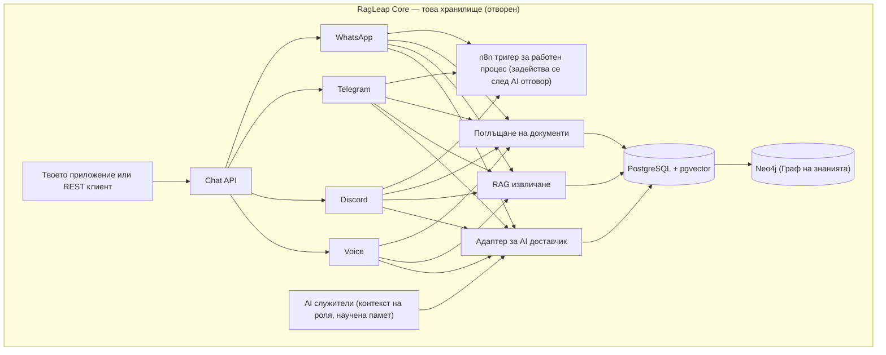
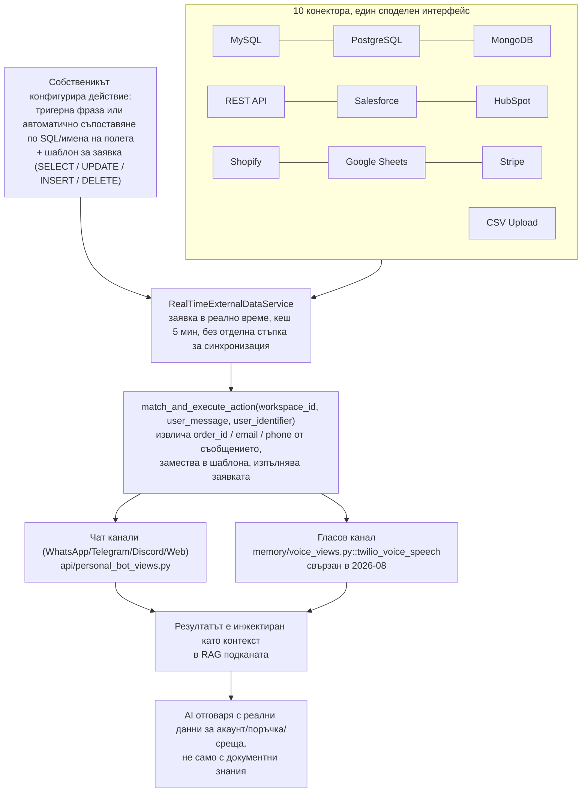

<div align="center">


# RagLeap Core

**AI служители с отворен код — питат, преди да действат.**

[](../LICENSE) [](https://github.com/ragleap/ragleap-core/releases) [](https://github.com/ragleap/ragleap-core) [](https://github.com/ragleap/ragleap-core) [](https://github.com/ragleap/ragleap-core)
[](https://pypi.org/project/ragleap-rag/) [](https://pypi.org/project/ragleap-rag/)
[](https://pypi.org/project/ragleap-graph/) [](https://pypi.org/project/ragleap-graph/)
[](https://pypi.org/project/ragleap-vectorstores/) [](https://pypi.org/project/ragleap-vectorstores/)
[](https://pypi.org/project/ragleap-tools/) [](https://pypi.org/project/ragleap-tools/)
[](https://pypi.org/project/ragleap-integrations/) [](https://pypi.org/project/ragleap-integrations/)
[](https://pypi.org/project/ragleap-agents/) [](https://pypi.org/project/ragleap-agents/)
[](https://pypi.org/project/ragleap-ops/) [](https://pypi.org/project/ragleap-ops/)
[](https://pypi.org/project/ragleap-app-chart/) [](https://pypi.org/project/ragleap-app-chart/)
[](https://pypi.org/project/ragleap-observability/) [](https://pypi.org/project/ragleap-observability/)
[](https://pypi.org/project/ragleap-terraform/) [](https://pypi.org/project/ragleap-terraform/)
[](https://pypi.org/project/ragleap-ansible/) [](https://pypi.org/project/ragleap-ansible/)
[](https://pypi.org/project/ragleap-voice/) [](https://pypi.org/project/ragleap-voice/)
[)](https://central.sonatype.com/artifact/io.github.antonyrag/ragleap-rag)
[)](https://central.sonatype.com/artifact/io.github.antonyrag/ragleap-graph)
[](https://github.com/ragleap/ragleap-core) [](https://discord.gg/mQwJuQDVrA) [](https://github.com/ragleap/ragleap-core/pulse)

[English](../README.md) · [Afrikaans](README.af.md) · [العربية](README.ar.md) · **Български** · [বাংলা](README.bn.md) · [Català](README.ca.md) · [Čeština](README.cs.md) · [Cymraeg](README.cy.md) · [Dansk](README.da.md) · [Deutsch](README.de.md) · [Ελληνικά](README.el.md) · [Español](README.es.md) · [Eesti](README.et.md) · [فارسی](README.fa.md) · [Suomi](README.fi.md) · [Français](README.fr.md) · [ગુજરાતી](README.gu.md) · [עברית](README.he.md) · [हिन्दी](README.hi.md) · [Hrvatski](README.hr.md) · [Magyar](README.hu.md) · [Bahasa Indonesia](README.id.md) · [Italiano](README.it.md) · [日本語](README.ja.md) · [ಕನ್ನಡ](README.kn.md) · [한국어](README.ko.md) · [Lietuvių](README.lt.md) · [Latviešu](README.lv.md) · [Македонски](README.mk.md) · [മലയാളം](README.ml.md) · [मराठी](README.mr.md) · [नेपाली](README.ne.md) · [Nederlands](README.nl.md) · [Norsk](README.no.md) · [ਪੰਜਾਬੀ](README.pa.md) · [Polski](README.pl.md) · [Português](README.pt.md) · [Română](README.ro.md) · [Русский](README.ru.md) · [Slovenčina](README.sk.md) · [Slovenščina](README.sl.md) · [Soomaali](README.so.md) · [Shqip](README.sq.md) · [Svenska](README.sv.md) · [Kiswahili](README.sw.md) · [தமிழ்](README.ta.md) · [తెలుగు](README.te.md) · [ไทย](README.th.md) · [Tagalog](README.tl.md) · [Türkçe](README.tr.md) · [Українська](README.uk.md) · [اردو](README.ur.md) · [Tiếng Việt](README.vi.md) · [简体中文](README.zh-cn.md) · [繁體中文](README.zh-tw.md)

</div>

RagLeap Core е двигателят с отворен код зад RagLeap — самостоятелно хостван агентски система, която управлява бизнеса ти от твоите собствени документи, на твой собствен сървър, без обвързване с доставчик.

**46 AI служители по роля:** 9 основни универсални роли (AI мениджър, секретар, CEO, продажби, поддръжка, HR, финанси, маркетинг, операции) плюс 37 специализирани глобални роли (рекрутьор, агент по недвижими имоти, юридически прием, здравен прием, застрахователен агент и още) — пълният списък е в [`core/employees/defaults.py`](core/employees/defaults.py).

**Какво прави:**
- Самообучаваща се памет, претеглена по резултати
- Автоматично задействане на работни процеси и ескалация
- Режими на автономност: `off` (по подразбиране, AI действа само когато го стартираш), `semi` (одобряваш всяко действие) и `full` (по избор; чувствителните роли никога не са напълно автономни)
- Цикъл мисли-действай-реши, не само извличане на информация
- Цикъл действай-наблюдавай за агента (по избор): моделът предлага едно действие наведнъж, то минава през портата за одобрение, а резултатът се връща като ненадежден текст
- Безопасни инструменти, всички по избор: Python и shell в изолирана среда без мрежа, извличане на страници само за четене, MCP клиент с разрешителен списък, задачи и планирани проверки
- **Табло AI Office** на `/office`: одобрения, служители по отдел, задачи, изпълнения на агента, активност, настройки и контролен списък за настройка
- Може да работи напълно локално с Ollama за чат и вграждания (малките модели на CPU са по-бавни и по-малко точни от хостваните), или с някой от 19-те доставчика с твой собствен ключ
- Незадължителни бюджети за токени, ограничаване при неуспешен вход и одитен журнал на всяко действие

**Инсталация с една команда** (изисква Docker Desktop на macOS и Windows, или Docker Engine на Linux; скриптът пита кой AI да се използва и никога не променя съществуващ `.env`):

```bash
curl -fsSL https://raw.githubusercontent.com/ragleap/ragleap-core/main/install.sh | bash
```

Предпочиташ да го прочетеш първо? Виж [install.sh](../install.sh). За напълно локална настройка без API ключ добави `bash -s -- --ollama` в края на командата.

**Windows:** инсталирай [Docker Desktop](https://www.docker.com/products/docker-desktop) (изисква WSL 2 и включена CPU виртуализация) и [Git for Windows](https://git-scm.com/download/win), след което въведи това в отворен PowerShell прозорец:

```powershell
irm https://raw.githubusercontent.com/ragleap/ragleap-core/main/install.ps1 | iex
```

Пита кой AI да се използва, изгражда и стартира RagLeap, и отваря таблото в браузъра, без да отпечатва ключа за вход в терминала. Въведи го директно в PowerShell: в обвивката `powershell -c "..."` Windows Defender спря тази форма на машината, която тествахме. За да прочетеш скрипта първо, изпълни `$s = irm` със същия адрес, разгледай `$s`, след което изпълни `iex $s`. След инсталацията изпълнявай командите на RagLeap в Git Bash от папката с инсталацията, например `bash scripts/ragleap key`.

Ако порт 8000 или 5433 вече е зает на компютъра ти (например от локален PostgreSQL), нова инсталация автоматично избира следващия свободен порт и го записва в `.env` (`APP_PORT`, `DB_PORT` и т.н.). `ragleap key --rotate` сменя API ключа ти и рестартира приложението; старият ключ спира да работи незабавно.

Честно казано: инсталаторът за Windows е тестван само на една Windows машина, а локалната опция с Ollama не е тествана на Windows.

[Бърз старт](#бърз-старт) · [Документация](https://docs.ragleap.com) · [Уебсайт](https://ragleap.com) · [Пакети](https://packages.ragleap.com/)

---

> **С отворен код, самостоятелно хостван.** `ragleap-core` (това хранилище) е лицензиран по MIT, напълно безплатен и никога не изисква лицензен ключ. Планира се управлявана облачна версия на RagLeap; засега RagLeap е само с отворен код.

## Инсталация

```bash
pip install ragleap-rag
```

> ⭐ Ако това ти помага, помисли дали да не дадеш звезда на хранилището — наистина помага на повече хора да го намерят.

Предпочиташ Java? `ragleap-rag` е наличен и в Maven Central:
```xml
<dependency>
    <groupId>io.github.antonyrag</groupId>
    <artifactId>ragleap-rag</artifactId>
    <version>0.13.0</version>
</dependency>
```
Версионира се независимо от Python пакета по-горе — виж [`java/ragleap-rag`](../java/ragleap-rag) за текущия обхват.

Графовият индекс Neo4j има Java порт също, по HTTP Query API (регулярни изрази или, по избор, извличане на LLM обекти и връзки, премахване на дублирания, индексиране на документи и търсения, `GraphRetriever`, допълнения и миграции; Postgres audit writer все още не е пренесен):
```xml
<dependency>
    <groupId>io.github.antonyrag</groupId>
    <artifactId>ragleap-graph</artifactId>
    <version>0.2.0</version>
</dependency>
```
Виж [`java/ragleap-graph`](../java/ragleap-graph) за текущия обхват.

Добави `ragleap-graph` ако искаш извличане чрез граф на знанията, подкрепен от Neo4j:
```bash
pip install ragleap-rag ragleap-graph
```

Добави `ragleap-vectorstores` ако искаш сменяеми векторни бекендове извън шестте вградени в ragleap-rag (Chroma, LanceDB, Redis, Upstash Vector и OpenSearch):
```bash
pip install ragleap-rag ragleap-vectorstores[chroma]
# или с uv
uv add ragleap-rag ragleap-vectorstores[chroma]
```

Добави `ragleap-tools` ако искаш готови инструменти за извикване на LLM инструменти (калкулатор, файлови операции в изолирана среда, дата/час, конвертиране на единици, парсване на JSON/CSV, текстови помощни средства):
```bash
pip install ragleap-rag ragleap-tools
# или с uv
uv add ragleap-rag ragleap-tools
```

Разгръщаш на Kubernetes? `ragleap-ops` включва тествани на живо манифести и Helm chart за целия стек:

```bash
pip install ragleap-ops
# или с uv
uv add ragleap-ops
```

Нужен ти е универсален, многократно използваем chart за собственото ти приложение (не специфичен за RagLeap)? `ragleap-app-chart` приема произволен списък `services:`, не твърдо кодирани имена:

```bash
pip install ragleap-app-chart
# или с uv
uv add ragleap-app-chart
```

Искаш метрики и логове за разгръщането ти с `ragleap-ops`? `ragleap-observability` включва Prometheus, Grafana, Loki + Promtail и AlertManager, проверени от край до край на реален клъстер:

```bash
pip install ragleap-observability
# или с uv
uv add ragleap-observability
```

Искаш агентите ти да извикват инструменти на отдалечени MCP сървъри? `ragleap-integrations` е MCP клиент, който превръща разрешените инструменти на отдалечени сървъри в Tool обекти на `ragleap-tools` (само Streamable HTTP, алфа):

```bash
pip install ragleap-integrations
# или с uv
uv add ragleap-integrations
```

Нужен ти е малък агентски цикъл за собствения ти модел? `ragleap-agents` изпълнява едно предложено действие наведнъж чрез Tool обекти на `ragleap-tools`, с порти за одобрение, без код за доставчик и без база данни (алфа):

```bash
pip install ragleap-agents
# или с uv
uv add ragleap-agents
```

Предпочиташ Terraform за локален клъстер? `ragleap-terraform` е Terraform модул, който създава kind клъстер и инсталира Helm chart-овете на RagLeap (засега само локален kind клъстер):

```bash
pip install ragleap-terraform
# или с uv
uv add ragleap-terraform
```

Предпочиташ Ansible за нов Ubuntu сървър? `ragleap-ansible` е набор от Ansible роли, които създават потребител за разгръщане, настройват sudo и автоматични ъпгрейди, и могат по избор да укрепят SSH и да активират защитна стена. Все още не инсталира k3s, Helm или chart-овете и е тестван само в контейнер:

```bash
pip install ragleap-ansible
# или с uv
uv add ragleap-ansible
```

Разглеждаш отворени, локални речеви модели? `ragleap-voice` е мениджър на модели в предалфа фаза: лицензно проверен манифест на кандидат-модели за реч-в-текст и текст-в-реч, с изтегляния от Hugging Face, проверени по хеш. Все още няма речеви двигатели, така че не може да транскрибира или синтезира аудио, а всеки запис в манифеста е все още непроверен:

```bash
pip install ragleap-voice
# или с uv
uv add ragleap-voice
```

Или стартирай цялото самостоятелно хоствано приложение (канали, табло AI Office, Docker Compose) — виж [Бърз старт](#бърз-старт) по-долу. Разгледай всички пакети на [packages.ragleap.com](https://packages.ragleap.com). Изпробвай на ръка с изпълнимите скриптове в [examples/](../examples/) — `01_ingest_and_query.py` (качи документ и задай въпрос чрез API) и `02_test_channel_directly.py` (тествай логиката за отговаряне на канала без реални идентификационни данни за бот).

## Ако RAG чатботът отговаря на въпроси, RagLeap управлява бизнеса ти

Повечето RAG проекти с отворен код ти дават инструментариум — все пак ти трябва да изградиш приложението, да свържеш интерфейса, да добавиш памет и сам да свържеш всеки канал. RagLeap Core ти дава един AI в WhatsApp, Telegram, Discord и гласови разговори, вместо различен, несвързан бот за всеки канал. Паметта се запазва между сесиите и каналите, така че не се налага да се учи повторно кой е клиентът всеки път. Гласът е реален, работещ обработчик на входящи обаждания (Twilio Media Streams, Whisper STT, OpenAI TTS) — не просто Q&A на документи с прикачен телефонен номер — и n8n автоматизацията на работни процеси може да се задейства директно от всеки разговор.

Какво не включва това хранилище: многотенантно административно табло (настройки, анализи, екип, фактуриране) и слой изпълнителен асистент (Manager AI). То включва еднотенантно табло — AI Office на `/office` (одобрения, служители по отдел, задачи, изпълнения на агента, активност, настройки и контролен списък за настройка). Самият RagLeap Core е еднотенантен, самостоятелно хостван и се конфигурира чрез `.env`.

## Какво прави RagLeap Core специфично различен

Това хранилище не е универсална RAG рамка, която сглобяваш сам — то е реален, работещ двигател, който можеш да стартираш днес. Кодът тук е честен, че е в ранен стадий.

## Защо съществува RagLeap

Проектите за AI агенти с отворен код като OpenClaw набраха скорост по конкретна причина: хората искаха асистент, работещ на **тяхната собствена инфраструктура**, с **техните собствени ключове**, отговарящ от **чат приложенията, които вече използват** — не черна кутия, хоствана от някой друг. Същият принцип е в основата на RagLeap Core, но специално за бизнес AI.

**Твоите ключове, твоята инфраструктура, твоите данни.** RagLeap Core никога не иска системен API ключ. Ти носиш своя собствен AI ключ (или използваш локален Ollama без ключ), работиш с твоя собствена PostgreSQL база данни, документите ти се съхраняват на твой собствен сървър, а текстът се изпраща само до AI доставчиците, които конфигурираш (твоят чат модел и твоят доставчик на вграждания; с локален Ollama и за двете, текстът на документите ти остава на сървъра ти).

**Чатът е интерфейсът, не отделно табло, което трябва да изучаваш.** Точно както OpenClaw среща хората в WhatsApp, Telegram и Slack, пълната платформа на RagLeap среща собствениците на бизнеси по каналите, които вече използват — WhatsApp, Telegram, Discord и реални телефонни обаждания — не ново приложение, което трябва да проверяват.

**Реална, работеща система — не абстрактна рамка.** Това не е инструментариум като LangChain, от който сглобяваш собственото си приложение от примитиви. RagLeap Core е действителният конвейер на разрязване → вграждане → извличане → генериране, извлечен от производствена система, която вече отговаря на реални клиентски въпроси в компания, която вече работи с него.

**Изграден публично и честно.** Това хранилище казва ясно какво е свършено и какво не е. Без надути твърдения, без фалшиви команди за Quickstart, които все още не работят — Пътната карта отразява реалното състояние на кода и се актуализира с напредъка.

## Какво представлява RagLeap Core

RagLeap Core е двигател за чат, базиран на документи. Качи документите си, задавай въпроси, получавай цитирани отговори — самостоятелно хостван, на твоя собствена инфраструктура, с твой собствен API ключ.

Ботовете за WhatsApp, Telegram и Discord са включени в това хранилище също — еднотенантни адаптери за канали, конфигурирани с .env, отговарящи от същата документна база знания.

## RagLeap Core е подходящ за теб, ако

- ✅ Искаш самостоятелно хостван RAG чатбот с пълен контрол над данните си
- ✅ Искаш да разбереш точно как работи извличането на документи и цитирането, а не да използваш черна кутия
- ✅ Удобно ти е да управляваш собствен сървър и собствен API ключ за AI доставчик
- ✅ Искаш да допринесеш или да разширяш отворен двигател за QA на документи
- ✅ Предпочиташ да видиш кода, вместо да вярваш на думата на доставчик относно поверителността на данните

## Какво не е RagLeap Core

| Не е... | Е... |
|---|---|
| Хостван продукт | Самостоятелно хоствани софтуер, който управляваш сам |
| Многотенантен, с постоянна памет между сесиите | Еднотенантен — един бот, един набор документи на разгръщане |
| Многотенантна платформа | Включва адаптери за WhatsApp/Telegram/Discord/Voice, еднотенантни |
| SaaS табло без код | Кодова база, която разгръщаш и конфигурираш |
| С пълни функции | Основното подмножество — виж [Пътна карта](#пътна-карта) |

## Функции

| | |
|---|---|
| 📄 **Поглъщане на документи** | Качи 28 типа файлове (PDF, Word, Excel, PowerPoint, CSV, HTML, EPUB и още) или добави публична уеб страница по адрес |
| 🔍 **RAG извличане** | Векторно търсене в документите ти чрез pgvector |
| 💬 **Чат с цитати** | Отговорите препращат към изходния документ, не черна кутия |
| 🔌 **Донеси свой AI ключ** | OpenAI, Gemini, Anthropic или всяка съвместима с OpenAI крайна точка |
| 🌐 **Уеб чат уиджет (планиран)** | Все още не е изграден: вграждаем уиджет за клиентски уебсайтове е в [Пътната карта](#пътна-карта) |
| 🐳 **Настройка базирана на Docker** | Локално разгръщане с една команда |
| 🕸️ **Граф на знанията (Neo4j)** | Извличане на обекти и извличане, засилено от граф, заедно с векторно търсене |
| 🌍 **Разпознаване на езика** | Автоматично разпознава езика на документа и заявката, приложено на всички канали |
| 🔗 **Интеграции** | Свързване с MySQL, PostgreSQL, MongoDB, REST API, Salesforce, HubSpot, Shopify, Google Sheets, Stripe |
| 🔀 **Хибридно търсене** | Комбинира плътно (векторно) и рядко (пълен текст) извличане чрез Reciprocal Rank Fusion |
| ⚡ **Поточни отговори** | Отговорите се предават токен по токен вместо да се чака целият отговор |
| 🔁 **Резервен доставчик** | Автоматично повторен опит с резервен LLM доставчик при неуспех на основния |
| 💰 **Отчитане на използването на токени** | Реален брой токени на извикване от доставчика, плюс изрязване на бюджета за размер на контекста |
| 🧑‍💼 **AI служители** | Агенти по роля (46 роли по подразбиране) с постоянна памет за бизнес контекст, свързани с `/chat` чрез `role=<role>` |
| 🖥️ **Табло AI Office** | Входяща кутия за одобрения, служители по отдел, задачи, изпълнения на агента, активност, Настройки (ключовете са криптирани и само за запис) и контролен списък за настройка на `/office` |
| 🛡️ **Автономност с порти за одобрение** | Режими `off`, `semi` и `full`; чувствителните роли винаги изискват одобрение; след като агентът прочете уеб или MCP съдържание, изходящите действия изискват одобрението ти дори в режим `full`; всяко действие се записва |
| 🔁 **Цикъл действай-наблюдавай за агента** | По избор: предложи действие, одобри го, наблюдавай резултата, продължи (до 4 стъпки по подразбиране) |
| 🧰 **Инструменти в изолирана среда (по избор)** | Python и shell в контейнер без мрежа, извличане на страници само за четене със SSRF защита, MCP клиент с разрешителен списък, задачи |
| ⏰ **Планирани проверки** | Проактивни задействания на всеки N минути или по cron с часова зона |
| 💸 **Бюджети и ограничения** | Незадължителни дневни и месечни лимити за токени (глобални или по роля) и ограничаване при неуспешен вход |
| 🦙 **Локален режим** | Чат и вграждания чрез Ollama; `ragleap launch --ollama` |
| 🛠️ **Изгради свой AI служител** | Дефинирай напълно персонализирана роля (всяко име, личност, канали, тагове за умения) чрез `PATCH /employees/{role}` — без fork, без промяна на код. Проверено на живо: създаване, извличане и изброяване на нова роля от край до край. |
| 🔗 **n8n автоматизация на работни процеси** | Задействай webhook след като AI отговори в WhatsApp/Telegram/Discord — автоматизации без код, задействани директно от разговор |

## Архитектура

Как е изграден RagLeap Core:



**Незадължителна опашка от фонови задачи.** Периодичната задача за синхронизация на интеграциите се изпълнява вградено в API процеса по подразбиране. Задаването на `REDIS_URL` я превключва към реална Redis опашка (RQ), обработвана от отделен(и) `worker` процес(и), мащабиращи се независимо — хоризонтално чрез `docker compose up -d --scale worker=N`, или в Kubernetes чрез автоматичен скалатор по дълбочина на опашката като KEDA (виж `examples/keda-scaledobject-worker.yaml` за референтен `ScaledObject`). Напълно незадължително — нищо не се променя, ако `REDIS_URL` не е зададен.

### Структура на хранилището

```
ragleap-core/
├── core/                  # RAG двигател — разрязване, вграждане, извличане, генериране
│   ├── chunker.py
│   ├── embedding.py       # Вграждания: Gemini (по подразбиране, 3072-изм.) или Ollama/OpenAI/Mistral/...
│   ├── retrieval.py       # pgvector косинусово търсене
│   ├── generation.py      # BYOK генериране с 19 доставчика (Gemini, OpenAI, Anthropic и др.)
│   ├── ingest.py          # конвейер разрязване -> вграждане -> съхранение
│   ├── parsers.py         # извличане на текст от PDF/DOCX/TXT
│   ├── employees/         # AI служители — роли, бизнес профил, научена памет
│   ├── workflows.py       # n8n автоматизация — webhook тригери
│   └── api.py             # FastAPI приложение — /health, /upload, /chat, /profile, /employees, /n8n-workflows, /webhook/*
├── channels/              # Адаптери за канали за съобщения и глас
│   ├── whatsapp/          # Twilio + Gupshup
│   ├── telegram/
│   ├── discord/
│   └── voice/             # Twilio Media Streams, WebSocket сървър
├── db/
│   └── schema.sql         # таблици documents + chunks, pgvector индекс
├── examples/              # Изпълними примерни скриптове
├── sandbox/               # Изолиран изпълнител на код и shell (по избор)
├── scripts/               # Командата `ragleap`
├── skills/ragleap/        # Умение само за четене за агенти за кодиране
├── .codex-plugin/         # Манифест на приставката за това умение
├── packages/              # Самостоятелни pip пакети (ragleap-rag, -graph, -tools, ...)
├── java/                  # Java портове на ragleap-rag и ragleap-graph
├── .github/workflows/     # CI: проверка на компилацията, Docker изграждане, smoke тестове
├── docker-compose.yml     # app + db + voice, плюс незадължителни профили neo4j, redis, worker, sandbox и ollama
└── Dockerfile
```

## Бърз старт

> ✅ **Статус: основният конвейер е проверен и работи.** Поглъщане → вграждане → извличане → генериране работи от край до край чрез Docker Compose, включително тест с чисто ново клониране. Виж [Пътната карта](#пътна-карта) за следващото (поддръжка на PDF/DOCX, алтернативни BYOK доставчици).

**Най-бързият начин да го изпробваш** — една команда проверява Docker, клонира хранилището и настройва `.env` вместо теб:

```bash
curl -fsSL https://raw.githubusercontent.com/ragleap/ragleap-core/main/install.sh | bash
```

(Потребители на Windows: изпълни това в Git Bash, не в Command Prompt или PowerShell.)

Инсталаторът пита кой AI да се използва (Gemini или напълно локален Ollama без API ключ), генерира твоя API ключ и тайни, стартира всичко и отпечатва линк с едно кликване до таблото. За локален AI изпълни `curl -fsSL https://raw.githubusercontent.com/ragleap/ragleap-core/main/install.sh | bash -s -- --ollama` (малките локални модели на CPU са по-бавни и по-малко точни от Gemini). За автоматизирани инсталации задай `RAGLEAP_PROVIDER` (`gemini`, `ollama` или `skip`) и `GEMINI_API_KEY`. Съществуващ `.env` никога не се модифицира.

След инсталацията управлявай RagLeap с командата `ragleap`: `ragleap launch` (стартирай; `--ollama` също стартира локалния AI сервиз и превключва към него), `ragleap stop`, `ragleap status`, `ragleap logs`, `ragleap update` (първо прави резервно копие на базата данни) и `ragleap key` (отпечатва твоя линк с едно кликване до таблото).

**Или, ръчният начин** — по-добре ако искаш да прочетеш кода, преди да стартираш нещо:

```bash
git clone https://github.com/ragleap/ragleap-core.git
cd ragleap-core
cp .env.example .env
# добави своя Gemini API ключ в .env
docker compose up --build -d
```

Изисквания: Docker, Docker Compose и или Gemini API ключ (по подразбиране), или локална настройка на Ollama без ключ (използвай `ragleap launch --ollama`, или задай `EMBEDDING_PROVIDER=ollama` за вграждания). За чат можеш да използваш Gemini или някой от 19-те доставчика, изброени в [Поддържани LLM доставчици](#поддържани-llm-доставчици-byok), включително локален Ollama модел и всяка съвместима с OpenAI крайна точка.

**Изпробвай го за 30 секунди** — с работещия стек, виж [examples/](../examples/) за два проверени, изпълними скрипта:
- `examples/01_ingest_and_query.py` — качи документ и задай въпрос чрез API
- `examples/02_test_channel_directly.py` — тествай логиката за отговаряне на WhatsApp/Telegram/Discord без реални идентификационни данни за бот

## Искаш само RAG двигателя като Python библиотека?

Ако не ти трябва пълното Docker приложение — адаптери за WhatsApp/Telegram/Discord/Voice, таблото AI Office, всичко — основният двигател за извличане е публикуван и като самостоятелни, инсталируеми с pip Python пакети:

```bash
pip install ragleap-rag
```

- **`ragleap-rag`** — конвейерът на разрязване → вграждане → извличане → генериране като библиотека. Сменяеми вграждания (8 доставчика: Gemini, OpenAI, Mistral, Together, Ollama, Cohere, Voyage и персонализирана крайна точка), 6 векторни бекендове (FAISS, PgVector, Pinecone, Weaviate, Qdrant, Milvus), прекласиране с кръстосан енкодер и още.
- **`ragleap-graph`** — извличане от граф на знанията, подкрепено от Neo4j, използваемо самостоятелно или заедно с `ragleap-rag`.
- **`ragleap-vectorstores`** — сменяеми векторни бекендове извън основните 6 на `ragleap-rag`. Бекендове: Chroma и LanceDB (вградени/локални), Redis (RediSearch/Redis Stack), Upstash Vector (управляван serverless) и OpenSearch (k-NN). Инсталирай с `pip install ragleap-vectorstores[chroma]` или `uv add ragleap-vectorstores[chroma]`.
- **`ragleap-tools`** — самостоятелни, леки инструменти за извикване на LLM инструменти. 12 инструмента без статус (калкулатор, дата/час, конвертиране на единици, парсване на JSON/CSV, текстови помощни средства), файлови операции в изолирана среда (защитени срещу escape на символни връзки), `search_documents` (хибридно векторно+ключово търсене), `search_web` (сменяеми BYOK доставчици като Tavily и Serper), `search_github_repositories`, `describe_image` (BYOK доставчици за визия за Gemini и Anthropic; само Gemini е проверен на живо) и незадължително поглъщане на документи, подкрепено от `ragleap-rag`. Всеки HTTP доставчик има ограничение за размера на отговора и твърд общ краен срок. Не притежава цикъл за изпълнение на извикване на инструменти — предоставя `Tool` обекти за твоя собствен цикъл или за `ragleap-agents`. Пиши свои инструменти с декоратора `@tool` и предавай извикването на модел безопасно с `Toolkit` (аргументите се валидират преди да се изпълни твоят код). Инсталирай с `pip install ragleap-tools` или `uv add ragleap-tools`.
- **`ragleap-integrations`** — MCP (Model Context Protocol) клиент по Streamable HTTP, който връща `Tool` обекти на `ragleap-tools`. Собственикът конфигурира сървърите и точен списък с разрешени `server.tool`; моделът предоставя само аргументи. Транспорт само по HTTPS с DNS фиксиране и твърд краен срок. Проверен на живо срещу публични сървъри: DeepWiki по пътя на наследения протокол и MCP крайните точки на Google Cloud при последната ревизия (2026-07-28; само открива, `tools/call` по този път не е проверен на живо). Ограничението по подразбиране за отговор е 1 MiB (256 KiB в 0.1.0, което MCP крайната точка на Pub/Sub на Google Cloud надхвърли); увеличи `max_response_bytes` ако откриването не успее. Все още няма подбрани бизнес конектори и агентски цикъл. Инсталирай с `pip install ragleap-integrations` или `uv add ragleap-integrations`.
- **`ragleap-ops`** — манифести за разгръщане на Kubernetes за RagLeap Core, тествани от край до край на реален клъстер. Инсталирай с `pip install ragleap-ops` или `uv add ragleap-ops`.
- **`ragleap-app-chart`** — универсален, многократно използваем Helm chart за разгръщане на произволни услуги в Kubernetes, не специфичен за RagLeap. Насочи го към собственото си приложение чрез списък `services:`. Инсталирай с `pip install ragleap-app-chart` или `uv add ragleap-app-chart`.
- **`ragleap-observability`** — Prometheus, Grafana, Loki + Promtail за `ragleap-ops`, проверен от край до край на реален клъстер (потвърдена реална връзка, върнати реални ненулеви метрики; 21+ реални потока от логове с правилни етикети namespace/pod/container). AlertManager е свързан с Prometheus с първо реално правило за предупреждение, плюс незадължителни получатели за Slack/имейл (изключени по подразбиране; доставката е проверена срещу заместник, реалното изпращане все още не е потвърдено). Инсталирай с `pip install ragleap-observability` или `uv add ragleap-observability`.
- **`ragleap-terraform`** — Terraform модул, който създава локален kind клъстер и инсталира Helm chart-овете на RagLeap, приложен и унищожен на реален клъстер (все още няма облачни модули). Инсталирай с `pip install ragleap-terraform` или `uv add ragleap-terraform`.
- **`ragleap-ansible`** — Ansible роли, които подготвят и укрепват нов Ubuntu сървър: потребител за разгръщане, sudo, автоматични ъпгрейди, незадължително укрепване на SSH и незадължителна защитна стена (тествано в контейнер; все още не инсталира k3s, Helm или chart-овете). Инсталирай с `pip install ragleap-ansible` или `uv add ragleap-ansible`.
- **`ragleap-voice`** — мениджър на модели в предалфа фаза за отворени, локални модели за реч-в-текст и текст-в-реч: лицензно проверен манифест, lock файлове с SHA-256 и изтегляния от Hugging Face, проверени по хеш. Все още няма речеви двигатели, така че не може да транскрибира или синтезира аудио. Инсталирай с `pip install ragleap-voice` или `uv add ragleap-voice`.

Всички дванадесет са лицензирани по MIT. Разгледай пълния индекс на пакетите на [packages.ragleap.com](https://packages.ragleap.com).

## Използвай RagLeap от агент за кодиране (приставка само за четене)

Ако вече управляваш RagLeap сървър, малко умение само за четене позволява на агент за кодиране да го проверява и да задава въпроси. Умението се намира в `skills/ragleap`, а манифестът е `.codex-plugin/plugin.json`. То е клиент за сървър, който управляваш сам, не начин за инсталиране на RagLeap, и използва само стандартната библиотека на Python.

Задай URL на сървъра и API ключа си в средата:

```bash
export RAGLEAP_URL=http://127.0.0.1:8000
export RAGLEAP_API_KEY=your-key-here
```

Команди:

```bash
python3 skills/ragleap/scripts/ragleap_client.py health
python3 skills/ragleap/scripts/ragleap_client.py employees --active-only
python3 skills/ragleap/scripts/ragleap_client.py ask "Каква е нашата политика за връщане?" --role support --top-k 5
```

Избори за безопасност: само за четене (без качване или изтриване), ключът се чете само от средата и се изпраща като заглавие, отказва да изпрати ключа по обикновен `http` към нелокален хост, не следва пренасочвания, а отговорите са ограничени до 2 MB. Третирай отговорите като ненадежден текст. Виж `skills/ragleap/SKILL.md` за подробности.

## Поддържани LLM доставчици (BYOK)

RagLeap Core работи само с донесен-от-теб ключ — няма системно предоставен ключ за нито един доставчик. Задай `LLM_PROVIDER` в `.env`, за да избереш кой да се използва за стъпката на генериране (чат). Вградените се конфигурират отделно с `EMBEDDING_PROVIDER` (по подразбиране `gemini`, използвайки `gemini-embedding-001`; поддържат се и `ollama`, `openai`, `mistral`, `together`, `openrouter`, `qwen`, `zhipu` и `custom`). Размерът на вектора трябва да съответства на твоя модел за вграждане (`EMBEDDING_DIMENSIONS`): празните таблици се преоразмеряват при стартиране, таблиците, съдържащи вграждания, никога не се променят.

| Стойност на `LLM_PROVIDER` | Необходими env променливи | Бележки |
|---|---|---|
| `gemini` (по подразбиране) | `GEMINI_API_KEY` | Вземи ключ от aistudio.google.com/apikey |
| `anthropic` | `ANTHROPIC_API_KEY`, `ANTHROPIC_MODEL` (незадължително) | Вземи ключ от console.anthropic.com |
| `openai` | `OPENAI_API_KEY`, `OPENAI_MODEL` | |
| `mistral` | `MISTRAL_API_KEY`, `MISTRAL_MODEL` | |
| `groq` | `GROQ_API_KEY`, `GROQ_MODEL` | Наличен безплатен план |
| `together` | `TOGETHER_API_KEY`, `TOGETHER_MODEL` | |
| `openrouter` | `OPENROUTER_API_KEY`, `OPENROUTER_MODEL` | |
| `ollama` | `OLLAMA_MODEL` (не е нужен API ключ) | Самостоятелно хостван; изисква работещ Ollama локално |
| `deepseek` | `DEEPSEEK_API_KEY`, `DEEPSEEK_MODEL` | |
| `demonroute` | `DEMONROUTE_API_KEY`, `DEMONROUTE_MODEL` | Хоствани модели с отворени тегла; DemonRoute заявява, че подканите не се запазват — [поверителност](https://demonroute.com/privacy) |
| `xai` | `XAI_API_KEY`, `XAI_MODEL` | |
| `cohere` | `COHERE_API_KEY`, `COHERE_MODEL` | |
| `perplexity` | `PERPLEXITY_API_KEY`, `PERPLEXITY_MODEL` | |
| `qwen` | `QWEN_API_KEY`, `QWEN_MODEL` | |
| `moonshot` | `MOONSHOT_API_KEY`, `MOONSHOT_MODEL` | |
| `zhipu` | `ZHIPU_API_KEY`, `ZHIPU_MODEL` | |
| `yi` | `YI_API_KEY`, `YI_MODEL` | |
| `baidu` | `BAIDU_API_KEY`, `BAIDU_MODEL` | |
| `minimax` | `MINIMAX_API_KEY`, `MINIMAX_MODEL` | |
| `custom` | `CUSTOM_API_KEY`, `CUSTOM_MODEL`, `CUSTOM_BASE_URL` | Всяка съвместима с OpenAI крайна точка |

Пример, превключване към Groq в `.env`:

```
LLM_PROVIDER=groq
GROQ_API_KEY=your-groq-key
GROQ_MODEL=llama-3.3-70b-versatile
```

### Ollama в Docker: известни клопки

Изпълнението на Ollama като резервен/локален доставчик от вътрешността на Docker контейнера на това приложение (а не директно на хардуера) има реални, проверени стъпки за настройка извън простото задаване на `OLLAMA_MODEL`:

1. **`host.docker.internal` не е надежден при обикновен Linux Docker Engine** (за разлика от Docker Desktop) — може да се разреши до грешния шлюз на мрежата на моста. Ако Ollama връзките не успяват с този псевдоним, замести `OLLAMA_BASE_URL` директно с действителния IP на шлюза на compose мрежата на контейнера, например `OLLAMA_BASE_URL=http://172.18.0.1:11434/v1` (намери реалния си шлюз с `docker network inspect <network> | grep Gateway`).
2. **Ollama се свързва с `127.0.0.1` по подразбиране**, до което контейнерът не може да достигне дори с правилния IP на шлюза. Замести го, за да слуша на всички интерфейси:
```bash
   mkdir -p /etc/systemd/system/ollama.service.d
   cat > /etc/systemd/system/ollama.service.d/override.conf << 'EOF'
   [Service]
   Environment="OLLAMA_HOST=0.0.0.0:11434"
   EOF
   systemctl daemon-reload && systemctl restart ollama
```
3. **Защитната стена на хоста може мълчаливо да отхвърля трафика контейнер→хост** дори след горното — трафикът от контейнера към шлюза на моста удря веригата `INPUT` на ufw, не `FORWARD`/`DOCKER-USER`. Разреши го изрично: `ufw allow from 172.18.0.0/16 to any port 11434 proto tcp` (коригирай подмрежата, за да съответства на действителната ти Docker мрежа).

## Гласов канал (Twilio)

RagLeap Core включва гласов канал в реално време: Twilio Media Streams се свързва чрез WebSocket, речта ти се транскрибира с OpenAI Whisper, отговаря й основният RAG конвейер и се изговаря обратно с OpenAI TTS. Логиката за разпознаване на гласова активност и потискане на ехото е пренесена от производствена система, настроена срещу реален трафик на обаждания.

Работи като отделна услуга на порт 8765 (виж `docker-compose.yml`), тъй като протоколът за аудио в реално време на Twilio изисква суров WebSocket сървър, а не HTTP маршрут.

**Настройка:**
1. Задай `OPENAI_API_KEY` в `.env` (използва се и за Whisper STT, и за TTS в v1)
2. По избор задай `VOICE_BOT_NAME`, `VOICE_GREETING`, `VOICE_TTS_VOICE`
3. Насочи TwiML `<Connect><Stream>` на телефонния номер на Twilio към `wss://your-domain.com:8765`

**Честен статус:** WebSocket сървърът, обработката на протокола на събитията на Twilio и обработката на грешки са проверени и работят. Пълният обмен Whisper/TTS все още не е тестван от край до край на живо (изисква кредити от OpenAI API). Ако го изпробваш и срещнеш проблеми, моля отвори такъв — точно такова тестване в реалния свят е нужно на проекта.

**Известни ограничения, пренесени от производство и все още неотстранени тук:**
- Само OpenAI Whisper (STT) и OpenAI TTS се поддържат в v1 — Deepgram и ElevenLabs (многоезична поддръжка) са кандидати за good-first-issue
- Качеството на TTS на неанглийски език варира, тъй като гласовете TTS на OpenAI са настроени за английски
- Типичното закъснение при обмен в производство беше 6-8 секунди

## Граф на знанията (Neo4j)

RagLeap Core изгражда лек граф на съвместна поява на обекти наред с векторния си индекс. Когато поглъщаш документ, обектите (имена на продукти, акроними, собствени имена) се извличат и свързват в Neo4j. Когато задаваш въпрос, същото извличане се изпълнява върху заявката ти и всички документи, свързани с намерените обекти, получават усилване на сходството при извличане — в допълнение към, а не вместо, нормалното pgvector търсене.

Работи като четвърта Docker Compose услуга на портове `7475`/`7688` (преназначени от стандартните на Neo4j, за да се избегне сблъсък с друга Neo4j инстанция на същия хост). Ако Neo4j е недостъпен или `NEO4J_PASSWORD` не е зададен, графът се деградира изящно — извличането се връща към чисто векторно търсене, поглъщането не е засегнато.

**Настройка:**
1. Задай `NEO4J_URI`, `NEO4J_USER` и `NEO4J_PASSWORD` в `.env` (съответстващи на стойността `NEO4J_AUTH` в `docker-compose.yml`)
2. По избор задай `DOMAIN_TERMS` — разделен със запетаи списък от специфични за домейна термини, които да се усилват при извличане (например `DOMAIN_TERMS=API,SDK,RAG`)

**Честен статус:** извличането на обекти, записите в графа на документите, търсенето базирано на обекти и извличането на чат, усилено от графа, са всички проверени от край до край, включително в CI (чисто изграждане, реално поглъщане, реална заявка, реално търсене в граф). Усилването от графа в момента е просто добавяне на точки към резултата, не пълен претеглен преранжиращ алгоритъм — по-богата хибридна система за класиране е добра следваща стъпка за всеки, който иска да се потопи.

**Известни ограничения:**
- Извличането на обекти е базирано на регулярни изрази (CamelCase, акроними, изписани с главна буква фрази, плюс незадължителни терминии от домейна) — не е трениран NER модел, така че ще пропуска някои обекти и понякога ще включва шум
- `search_related_entities()` (многостъпково обхождане на граф) е имплементиран, но все още не е свързан с конвейера за извличане — кандидат за good-first-issue за всеки, искащ проект

## Разпознаване на езика

RagLeap Core автоматично разпознава езика по време на поглъщане на документи (за всяко парче) и по време на чат (за всяка заявка), използвайки библиотеката `langdetect` плюс евристики базирани на скриптове за CJK, Hangul и Kana текст. Тъй като всеки канал (WhatsApp, Telegram, Discord, Voice и API директно) минава през същия основен конвейер за чат, разпознаването се прилага последователно навсякъде без специфично за канала свързване.

**Настройка:** работи веднага без конфигурация. По избор задай `DEFAULT_LANGUAGE` (резервен при неуспех на разпознаването или твърде кратък текст), `LANGUAGE_DETECTION_CONFIDENCE_THRESHOLD` (по подразбиране `0.7`) и `LANGUAGE_DETECTION_SUPPORTED_LANGUAGES` (разделен със запетаи разрешителен списък, празен = без ограничения).

**Честен статус:** проверено от край до край — разпознаването на ниво документ е тествано с висока увереност (0.9999) върху реален многоезичен документ, а разпознаването на ниво заявка е потвърдено чрез API и CLI.

**Известни ограничения:**
- `langdetect` покрива приблизително 55 езика — значително по-малко от 222+ на хостваната платформа, която наслоява допълнително разпознаване и езикови предпочитания за потребители
- Кратките заявки на близкородствени езици могат да бъдат неправилно разпознати (при тестване, кратка заявка на френски беше разпозната като италианска) — това е присъщо ограничение на статистическото разпознаване на кратък текст, не специфично за този порт. Кандидат за good-first-issue за всеки, искащ да подобри точността при кратки заявки
- Разпознаването е еднопосочно: RagLeap Core разпознава езика на заявката и го показва, но все още не насочва езика на отговора на AI да съответства — това е разумна следваща стъпка за сътрудник

## Интеграции



**Проверено на живо**, прочетено от `RealTimeExternalDataService` на `api/addon_realtime.py`. Две неща, за които си струва да сме директни: `match_and_execute_action` наистина поддържа заявки за запис (`UPDATE`/`INSERT`/`DELETE`), не само търсения само за четене — конфигуриран от собственика, така че границата за безопасност е каквото SQL напише собственикът в шаблона, не нещо, което рамката ограничава сама. И до 2026-08, тази стъпка за съпоставяне на действия работеше само на чат канали; гласовите обаждания нямаха еквивалент, което е пропускът, запълнен в диаграмата за маршрутизиране на гласовия канал по-горе.

RagLeap Core се свързва с външни бази данни и бизнес инструменти, синхронизирайки контекст за потребител, за да персонализира RAG отговорите. Включени са девет конектора: MySQL, PostgreSQL, MongoDB, общи REST API, Salesforce, HubSpot, Shopify, Google Sheets и Stripe. По-нов код на конектори за CSV upload, Airtable, BigQuery, Snowflake, WooCommerce, Notion, Slack, Gmail и Razorpay е също в хранилището; третирай ги като експериментални, докато не ги провериш срещу собствения си акаунт (проследявани в #27).

Всеки CRM/SaaS конектор използва идентификационни данни, предоставени директно от теб — потребителско ime/парола, токен за частно приложение, администраторски API токен, JSON файл за сервизен акаунт или таен ключ, в зависимост от услугата. Нито едно не изисква регистриране на OAuth приложение; нищо тук не зависи от RagLeap да притежава акаунт за разработчик от трета страна.

Идентификационните данни са криптирани в покой (Fernet/AES-128) преди съхранение.

**Настройка:**
1. Генерирай ключ за криптиране: `python3 -c "from cryptography.fernet import Fernet; print(Fernet.generate_key().decode())"` след което задай резултата в `ENCRYPTION_KEY` в `.env`
2. Добави интеграция: `POST /integrations/` с типа на конектора и съответните идентификационни данни
3. Синхронизирай ръчно: `POST /integrations/{id}/sync`

**Честен статус:** проверено от край до край срещу реален публичен API — тестване на връзката, синхронизация, правилно съпоставяне на полето с идентификатор и криптиране на идентификационните данни (проверено като действителен шифротекст в базата данни, не само предположено) — всичко потвърдено.

**Известни ограничения:**
- 9 от 18-те типа источника, изброени в UI на хостваната платформа, имат реални конектори тук. CSV Upload, Snowflake, BigQuery, WooCommerce, Airtable, Notion, Razorpay, Slack и Gmail са кандидати за good-first-issue за всеки, искащ да добави такъв
- Синхронизацията е само при поискване (`POST /integrations/{id}/sync`) — все още няма планирана фонова синхронизация, въпреки че схемата проследява `sync_interval_minutes` за бъдещ еквивалент на Celery-beat
- Синхронизираният контекст все още не се инжектира автоматично в чат отговорите — всеки адаптер на канал ще трябва да знае идентификатора на собствения си потребител, което е разумен следващ принос

## Извличане, генериране и надеждност

Извън основния RAG конвейер, `/chat` (и базовото `core.chat.ask()`) поддържат няколко контроли, насочени към производствена употреба: качество на извличане, латентност на отговора, надеждност на доставчика и разходи.

**Хибридно търсене (плътно + рядко).** По подразбиране извличането комбинира косинусово сходство на pgvector с пълнотекстово търсене в Postgres (`tsvector`/`GIN` индекс), слято чрез Reciprocal Rank Fusion — улавя семантични съвпадения и точни съвпадения на ключови думи/идентификатори, които чисто векторното търсене може да пропусне. Подай `hybrid=false`, за да използваш само плътно извличане (по-евтино — една заявка вместо две).

**Поточно предаване.** `POST /chat/stream` предава отговора докато се генерира (`text/plain`, прехвърляне на части) вместо да чака пълния отговор. Имплементирано нативно за всеки доставчик (Gemini, Anthropic и съвместимите с OpenAI всеки имат различни API за поточно предаване — и трите са реални, не един симулиран).

**Резервен доставчик.** Задай `LLM_FALLBACK_PROVIDERS` (разделени със запетаи), за да повтаряш автоматично с резервни доставчици при неуспех на основния — ограничение на скоростта, прекъсване или лош ключ при основния доставчик не трябва да означава неуспешна заявка. Всеки резервен се нуждае от собствен конфигуриран нормално API ключ. Поточното предаване може да прибегне до резервен само *преди* да е изпратен какъвто и да е текст на извикващия — неуспех в средата на поток се показва като грешка, вместо мълчаливо да превключва доставчиците и да обърква изхода.

**Контроли на генерирането.** `temperature`, `system_prompt` и `max_tokens` са всички реални параметри за всяко извикване (не просто стандартни стойности за env) — изгради поведението на собствения си агент върху извличането на RagLeap без да разклоняваш библиотеката.

**Използване на токени и бюджет за контекст.** Всяко блокиращо `/chat` извикване връща реално използване на токени (`prompt_tokens`, `completion_tokens`, `total_tokens`), изтеглено директно от отговора на доставчика — не оценка. Извлеченият контекст се изрязва и до `MAX_CONTEXT_CHARS` (по подразбиране 12000, приблизително 4 знака на токен за английски текст) преди да се изпрати, изпускайки първо парчетата с най-нисък ранг, така че да не плащаш за повече контекст от необходимото. Задай `MAX_CONTEXT_CHARS=0`, за да деактивираш изрязването.

**Честен статус:** RRF математиката на хибридното търсене е проверена ръчно. Поточното предаване е проверено от край до край за доставчика по подразбиране. Резервният доставчик е проверен с реален тест с повреден основен — умишлено невалиден API ключ, потвърден резервен към работещ вторичен доставчик с правилен отговор. Използването на токени и изрязването на контекста са проверени с реални числа: извличане на 3 парчета, изрязано до 1 парче при стегнат бюджет, намали реалните `prompt_tokens` с 38% на същия API на живо.

**Известни ограничения:**
- Отчитането на използването на токени не е налично за поточни отговори — API за поточно предаване на всеки доставчик показва използването по различен начин, а правилното обработване на трите е отделна, още незавършена работа
- `MAX_CONTEXT_CHARS` е приближение с брой знаци (~4 знака/токен за английски), не точен брой на tokenizer за всеки доставчик
- Хибридното търсене не е бенчмарквано за реално подобрение на качеството на класиране върху многодокументен корпус с реално конфликтни плътни срещу редки класирания — само коректността (математика на сливането, токенизиране на необичайни идентификатори) е проверена досега

## Пътна карта

- [x] Създадено публично хранилище
- [x] Основният RAG двигател е извлечен и изчистен от производствената кодова база
- [x] Самостоятелна настройка с Docker Compose (без зависимост от външен Django проект)
- [x] Поглъщане на документи в приложението: 28 типа файлове и уеб страници по адрес
- [ ] Поглъщане на аудио, видео и изображения в приложението (съществуват в пакета `ragleap-rag`; аудио и видео се нуждаят от хостван доставчик за транскрипция, тъй като локалното реч-в-текст все още не се поддържа)
- [ ] Вграждаем уеб чат уиджет (планиран; все още не е изграден)
- [x] Поддръжка на донесен-от-теб-API-ключ (20 доставчика)
- [x] Адаптери за канали WhatsApp, Telegram, Discord и Voice (еднотенантни)
- [x] Граф на знанията (Neo4j), разпознаване на езика, интеграции с бази данни/CRM
- [x] Ръководство за принос и етикети за good-first-issue — 8+ маркирани проблема, с реален zewnętrzный сътрудник активен по #134
- [x] Discord общност
- [x] Табло AI Office с настройки и контролен списък за настройка (v0.9.0)
- [x] Агентски цикъл с порти за одобрение, инструменти в изолирана среда, MCP клиент и планирани проверки
- [x] Еднокомандна инсталация и команда `ragleap`, локален режим с Ollama (все още не е тестван на чиста машина)
- [x] Ограничаване при неуспешен вход и незадължителни бюджети за токени
- [ ] Предварително изградени Docker изображения (GHCR) за по-бърза инсталация
- [ ] Тригери и контроли за автономност в таблото
- [ ] Входящи от Slack и имейл, SMS и уеб уиджет (изискват публичен HTTPS адрес)
- [ ] Проверка на живо на повече LLM доставчици (виж #10)

Виж [ROADMAP.md](../ROADMAP.md) за пълната история фаза по фаза.

## Тествано от други

Считаме дадена функция за доказана само когато някой различен от поддържащите я е стартирал и е докладвал резултата. Тази таблица започва намерено празна. Попълва се от доклади в [проблемите за тестване от общността](https://github.com/ragleap/ragleap-core/issues/787) и нищо не се счита за тествано, докато доклад не е изброен тук.

Не ти трябва да пишеш код, за да помогнеш: избери тест, изпълни няколко стъпки на примерни файлове и коментирай какво се е случило, дори ако всичко е работило. Моля, никога не споделяй ключове или реални данни.

| Область | Тествано от | OS / настройка | Резултат | Проблем |
|---|---|---|---|---|
| (все още няма доклади) | | | | |

## Принос

RagLeap Core работи, тестван е и е отворен за принос сега. Виж [CONTRIBUTING.md](../CONTRIBUTING.md) как да започнеш и провери етикета [good first issue](../../issues?q=is%3Aissue+is%3Aopen+label%3A%22good+first+issue%22) за ограничени задачи.

Искаш да видиш точно какво се работи и какво е отворено за поемане? Провери [дъската на проекта](https://github.com/users/antonyrag/projects/1) — проблемите са наредени като Good First Issue, Ready (Scoped) или Needs Scoping, така че можеш да изберете нещо, съответстващо на количеството дизайнерска работа, която искаш да вършиш, спрямо просто изграждане.

**Студент, преподавател или търсиш дипломен/дисертационен проект?** Виж [STUDENT_PROJECTS.md](../STUDENT_PROJECTS.md) за ограничени идеи за проекти на нива начинаещ, семестриален и изследователски.

## Общност

- [GitHub Issues](../../issues) — бъгове и заявки за функции
- [GitHub Discussions](../../discussions) — идеи и въпроси
- [ragleap.com](https://ragleap.com) — уебсайтът на проекта

## Лиценз

MIT © 2026 RagLeap

## Отстраняване на проблеми

**Грешка "could not translate host name 'db'" след неуспешен `docker compose up`:**
Ако първият ти опит с `docker compose up` се провали (например конфликт на порт на 5433 или 8000), повторен опит понякога може да остави контейнера на базата данни прикачен към остаряла, осиротяла Docker мрежа. Решение:
```bash
docker compose down
docker network prune -f
docker compose up --build -d
```

**Порт 5433 или 8000 вече е зает:**
Друга инстанция на този проект (или нещо друго, като локален PostgreSQL на 5433) използва порта. Нова инсталация с `install.sh` или `install.ps1` сама избира следващия свободен порт и го записва в `.env`. Ако си стартирал сам с `docker compose up` или използваш повторно съществуващ `.env`, задай порта на хоста там: `APP_PORT` (по подразбиране 8000), `DB_PORT` (5433), `VOICE_PORT` (8766), `NEO4J_HTTP_PORT` (7475), `NEO4J_BOLT_PORT` (7688) или `REDIS_PORT` (6380), например `DB_PORT=5434`, след което изпълни `docker compose up -d` отново. Адресът на таблото следва `APP_PORT`, например `http://localhost:8001/office`.
