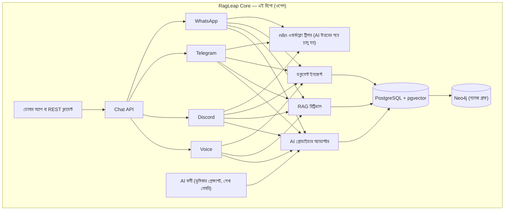
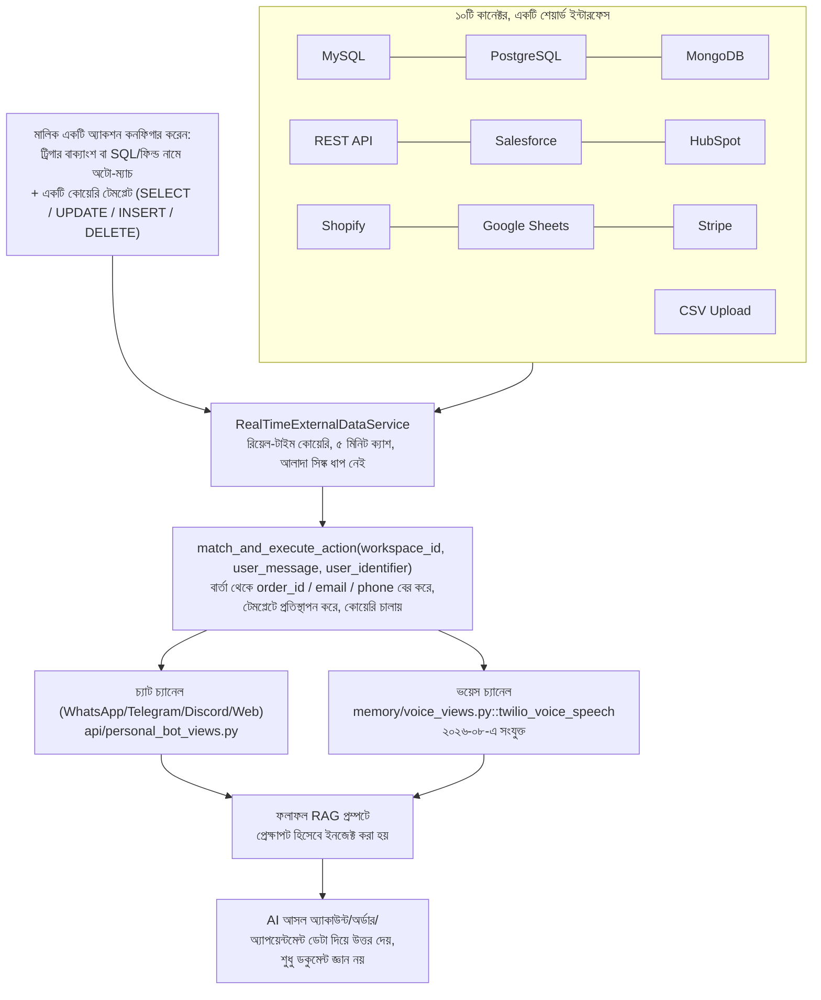

<div align="center">


# RagLeap Core

**ওপেন-সোর্স AI কর্মী — কাজ করার আগে জিজ্ঞেস করে।**

[](../LICENSE) [](https://github.com/ragleap/ragleap-core/releases) [](https://github.com/ragleap/ragleap-core) [](https://github.com/ragleap/ragleap-core) [](https://github.com/ragleap/ragleap-core)
[](https://pypi.org/project/ragleap-rag/) [](https://pypi.org/project/ragleap-rag/)
[](https://pypi.org/project/ragleap-graph/) [](https://pypi.org/project/ragleap-graph/)
[](https://pypi.org/project/ragleap-vectorstores/) [](https://pypi.org/project/ragleap-vectorstores/)
[](https://pypi.org/project/ragleap-tools/) [](https://pypi.org/project/ragleap-tools/)
[](https://pypi.org/project/ragleap-integrations/) [](https://pypi.org/project/ragleap-integrations/)
[](https://pypi.org/project/ragleap-agents/) [](https://pypi.org/project/ragleap-agents/)
[](https://pypi.org/project/ragleap-ops/) [](https://pypi.org/project/ragleap-ops/)
[](https://pypi.org/project/ragleap-app-chart/) [](https://pypi.org/project/ragleap-app-chart/)
[](https://pypi.org/project/ragleap-observability/) [](https://pypi.org/project/ragleap-observability/)
[](https://pypi.org/project/ragleap-terraform/) [](https://pypi.org/project/ragleap-terraform/)
[](https://pypi.org/project/ragleap-ansible/) [](https://pypi.org/project/ragleap-ansible/)
[](https://pypi.org/project/ragleap-voice/) [](https://pypi.org/project/ragleap-voice/)
[)](https://central.sonatype.com/artifact/io.github.antonyrag/ragleap-rag)
[)](https://central.sonatype.com/artifact/io.github.antonyrag/ragleap-graph)
[](https://github.com/ragleap/ragleap-core) [](https://discord.gg/mQwJuQDVrA) [](https://github.com/ragleap/ragleap-core/pulse)

[English](../README.md) · [Afrikaans](README.af.md) · [العربية](README.ar.md) · [Български](README.bg.md) · **বাংলা** · [Català](README.ca.md) · [Čeština](README.cs.md) · [Cymraeg](README.cy.md) · [Dansk](README.da.md) · [Deutsch](README.de.md) · [Ελληνικά](README.el.md) · [Español](README.es.md) · [Eesti](README.et.md) · [فارسی](README.fa.md) · [Suomi](README.fi.md) · [Français](README.fr.md) · [ગુજરાતી](README.gu.md) · [עברית](README.he.md) · [हिन्दी](README.hi.md) · [Hrvatski](README.hr.md) · [Magyar](README.hu.md) · [Bahasa Indonesia](README.id.md) · [Italiano](README.it.md) · [日本語](README.ja.md) · [ಕನ್ನಡ](README.kn.md) · [한국어](README.ko.md) · [Lietuvių](README.lt.md) · [Latviešu](README.lv.md) · [Македонски](README.mk.md) · [മലയാളം](README.ml.md) · [मराठी](README.mr.md) · [नेपाली](README.ne.md) · [Nederlands](README.nl.md) · [Norsk](README.no.md) · [ਪੰਜਾਬੀ](README.pa.md) · [Polski](README.pl.md) · [Português](README.pt.md) · [Română](README.ro.md) · [Русский](README.ru.md) · [Slovenčina](README.sk.md) · [Slovenščina](README.sl.md) · [Soomaali](README.so.md) · [Shqip](README.sq.md) · [Svenska](README.sv.md) · [Kiswahili](README.sw.md) · [தமிழ்](README.ta.md) · [తెలుగు](README.te.md) · [ไทย](README.th.md) · [Tagalog](README.tl.md) · [Türkçe](README.tr.md) · [Українська](README.uk.md) · [اردو](README.ur.md) · [Tiếng Việt](README.vi.md) · [简体中文](README.zh-cn.md) · [繁體中文](README.zh-tw.md)

</div>

RagLeap Core হলো RagLeap-এর পেছনের ওপেন-সোর্স ইঞ্জিন — একটি সেলফ-হোস্টেড, এজেন্টিক সিস্টেম যা তোমার নিজস্ব ডকুমেন্ট থেকে, তোমার নিজস্ব সার্ভারে তোমার ব্যবসা পরিচালনা করে — কোনো ভেন্ডরের উপর নির্ভরতা ছাড়াই।

**৪৬টি ভূমিকাভিত্তিক AI কর্মী:** ৯টি মূল সাধারণ ভূমিকা (AI ম্যানেজার, সেক্রেটারি, CEO, সেলস, সাপোর্ট, HR, ফাইন্যান্স, মার্কেটিং, অপারেশনস) এবং ৩৭টি বিশেষায়িত গ্লোবাল ভূমিকা (রিক্রুটার, রিয়েল এস্টেট এজেন্ট, লিগাল ইনটেক, হেলথকেয়ার ইনটেক, ইন্স্যুরেন্স এজেন্ট, আরও অনেক) — সম্পূর্ণ তালিকা [`core/employees/defaults.py`](core/employees/defaults.py)-তে।

**এটি কী করে:**
- স্ব-শিক্ষামূলক, ফলাফল-ভারিত মেমরি
- স্বয়ংক্রিয়ভাবে ওয়ার্কফ্লো চালু ও এস্কেলেশন করে
- স্বায়ত্তশাসন মোড: `off` (ডিফল্ট, AI কেবল তখনই কাজ করে যখন তুমি শুরু করো), `semi` (প্রতিটি কাজ তুমি অনুমোদন করো) এবং `full` (ঐচ্ছিক; সংবেদনশীল ভূমিকাগুলো কখনই পুরোপুরি স্বায়ত্তশাসিত নয়)
- শুধু তথ্য খোঁজা নয় — ভাবো-করো-সিদ্ধান্ত নাও চক্র
- অ্যাক্ট-অবজার্ভ এজেন্ট লুপ (ঐচ্ছিক): মডেল একবারে একটি কাজ প্রস্তাব করে, সেটি অনুমোদন গেটের মধ্য দিয়ে যায়, এবং ফলাফল অবিশ্বস্ত টেক্সট হিসেবে ফেরত আসে
- নিরাপদ টুল, সব ঐচ্ছিক: নেটওয়ার্কহীন স্যান্ডবক্সে Python ও shell, শুধু পড়ার জন্য পেজ ফেচ, অ্যালাউলিস্টসহ MCP ক্লায়েন্ট, টাস্ক টিকিট এবং নির্ধারিত চেক-ইন
- **AI Office ড্যাশবোর্ড** `/office`-এ: অনুমোদন, বিভাগ অনুযায়ী কর্মী, টাস্ক, এজেন্ট রান, কার্যক্রম, সেটিংস এবং সেটআপ চেকলিস্ট
- Ollama দিয়ে চ্যাট ও এম্বেডিংয়ের জন্য সম্পূর্ণ লোকালি চলতে পারে (CPU-তে ছোট মডেল হোস্টেড মডেলের চেয়ে ধীর ও কম নির্ভুল), অথবা ১৯টি প্রোভাইডার অপশনের যেকোনো একটি দিয়ে তোমার নিজস্ব কী ব্যবহার করে
- ঐচ্ছিক টোকেন বাজেট, ব্যর্থ লগইন থ্রটলিং এবং প্রতিটি কাজের অডিট লগ

**একটি কমান্ডে ইন্সটল করো** (macOS ও Windows-এ Docker Desktop, বা Linux-এ Docker Engine দরকার; স্ক্রিপ্ট কোন AI ব্যবহার করতে হবে জিজ্ঞেস করে এবং বিদ্যমান `.env` কখনো পরিবর্তন করে না):

```bash
curl -fsSL https://raw.githubusercontent.com/ragleap/ragleap-core/main/install.sh | bash
```

আগে পড়তে চাও? [install.sh](../install.sh) দেখো। API কী ছাড়া সম্পূর্ণ লোকাল সেটআপের জন্য কমান্ডের শেষে `bash -s -- --ollama` যোগ করো।

**Windows:** [Docker Desktop](https://www.docker.com/products/docker-desktop) (WSL 2 এবং CPU ভার্চুয়ালাইজেশন চালু থাকতে হবে) ও [Git for Windows](https://git-scm.com/download/win) ইন্সটল করো, তারপর PowerShell উইন্ডোতে এটি টাইপ করো:

```powershell
irm https://raw.githubusercontent.com/ragleap/ragleap-core/main/install.ps1 | iex
```

কোন AI ব্যবহার করতে হবে জিজ্ঞেস করে, RagLeap বিল্ড করে চালু করে, এবং টার্মিনালে লগইন কী না দেখিয়েই ব্রাউজারে ড্যাশবোর্ড খুলে দেয়। এটি সরাসরি PowerShell-এ টাইপ করো: `powershell -c "..."` আকারে মুড়ে দিলে আমরা যে একটি মেশিনে পরীক্ষা করেছিলাম সেখানে Windows Defender সেটি আটকে দিয়েছিল। স্ক্রিপ্টটি আগে পড়তে হলে একই ঠিকানায় `$s = irm` চালাও, `$s` দেখো, তারপর `iex $s` চালাও। ইন্সটলের পরে ইন্সটল ফোল্ডার থেকে Git Bash-এ RagLeap কমান্ড চালাও, যেমন `bash scripts/ragleap key`।

তোমার কম্পিউটারে পোর্ট 8000 বা 5433 ইতিমধ্যে ব্যবহৃত হলে (যেমন কোনো লোকাল PostgreSQL দিয়ে), নতুন ইন্সটল স্বয়ংক্রিয়ভাবে পরবর্তী ফাঁকা পোর্ট বেছে নেয় এবং `.env`-এ লিখে দেয় (`APP_PORT`, `DB_PORT` ইত্যাদি)। `ragleap key --rotate` তোমার API কী পরিবর্তন করে অ্যাপ রিস্টার্ট করে; পুরনো কী তাৎক্ষণিকভাবে কাজ করা বন্ধ করে।

সততার সাথে বলছি: Windows ইন্সটলার এখন পর্যন্ত মাত্র একটি Windows মেশিনে চালানো হয়েছে, এবং এর লোকাল Ollama অপশন Windows-এ পরীক্ষা করা হয়নি।

[দ্রুত শুরু](#দ্রুত-শুরু) · [ডকুমেন্টেশন](https://docs.ragleap.com) · [ওয়েবসাইট](https://ragleap.com) · [প্যাকেজ](https://packages.ragleap.com/)

---

> **ওপেন সোর্স, সেলফ-হোস্টেড।** `ragleap-core` (এই রিপো) MIT লাইসেন্সপ্রাপ্ত, সম্পূর্ণ বিনামূল্যে, এবং কখনো লাইসেন্স কী দাবি করে না। RagLeap-এর একটি ম্যানেজড ক্লাউড সংস্করণ পরিকল্পিত আছে; এখন পর্যন্ত RagLeap শুধুমাত্র ওপেন সোর্স।

## ইন্সটলেশন

```bash
pip install ragleap-rag
```

> ⭐ এটি যদি তোমার কাজে লাগে, রিপোতে একটি স্টার দেওয়ার কথা ভাবো — এটি সত্যিই আরও বেশি মানুষকে এটি খুঁজে পেতে সাহায্য করে।

Java পছন্দ? `ragleap-rag` Maven Central-এও পাওয়া যায়:
```xml
<dependency>
    <groupId>io.github.antonyrag</groupId>
    <artifactId>ragleap-rag</artifactId>
    <version>0.13.0</version>
</dependency>
```
উপরের Python প্যাকেজ থেকে আলাদাভাবে ভার্সন করা — বর্তমান স্কোপের জন্য [`java/ragleap-rag`](../java/ragleap-rag) দেখো।

Neo4j গ্রাফ ইন্ডেক্সের একটি Java পোর্টও আছে, HTTP Query API-এর মাধ্যমে (রেগেক্স বা ঐচ্ছিকভাবে LLM এন্টিটি ও রিলেশন এক্সট্র্যাকশন, ডিডুপ্লিকেশন, ডকুমেন্ট ইন্ডেক্সিং ও লুকআপ, `GraphRetriever`, ব্যাকফিল ও মাইগ্রেশন; Postgres অডিট রাইটার এখনো পোর্ট করা হয়নি):
```xml
<dependency>
    <groupId>io.github.antonyrag</groupId>
    <artifactId>ragleap-graph</artifactId>
    <version>0.2.0</version>
</dependency>
```
বর্তমান স্কোপের জন্য [`java/ragleap-graph`](../java/ragleap-graph) দেখো।

Neo4j-ব্যাকড নলেজ গ্রাফ রিট্রিভাল চাইলে `ragleap-graph` যোগ করো:
```bash
pip install ragleap-rag ragleap-graph
```

ragleap-rag-এর বিল্ট-ইন ছয়টির বাইরে প্লাগযোগ্য ভেক্টর ব্যাকেন্ড (Chroma, LanceDB, Redis, Upstash Vector ও OpenSearch) চাইলে `ragleap-vectorstores` যোগ করো:
```bash
pip install ragleap-rag ragleap-vectorstores[chroma]
# অথবা uv দিয়ে
uv add ragleap-rag ragleap-vectorstores[chroma]
```

LLM টুল-কলিংয়ের জন্য তৈরি টুল (ক্যালকুলেটর, স্যান্ডবক্সড ফাইল অপস, তারিখ/সময়, একক রূপান্তর, JSON/CSV পার্সিং, টেক্সট ইউটিলিটি) চাইলে `ragleap-tools` যোগ করো:
```bash
pip install ragleap-rag ragleap-tools
# অথবা uv দিয়ে
uv add ragleap-rag ragleap-tools
```

Kubernetes-এ ডিপ্লয় করছ? `ragleap-ops` সম্পূর্ণ স্ট্যাকের জন্য লাইভ-টেস্টেড ম্যানিফেস্ট ও Helm চার্ট নিয়ে আসে:

```bash
pip install ragleap-ops
# অথবা uv দিয়ে
uv add ragleap-ops
```

নিজের অ্যাপের জন্য একটি জেনেরিক, পুনর্ব্যবহারযোগ্য চার্ট দরকার (RagLeap-নির্দিষ্ট নয়)? `ragleap-app-chart` হার্ডকোডেড নাম নয়, একটি যেকোনো `services:` তালিকা নেয়:

```bash
pip install ragleap-app-chart
# অথবা uv দিয়ে
uv add ragleap-app-chart
```

`ragleap-ops` ডিপ্লয়মেন্টের জন্য মেট্রিক্স ও লগ চাও? `ragleap-observability` Prometheus, Grafana, Loki + Promtail এবং AlertManager নিয়ে আসে, একটি আসল ক্লাস্টারে শুরু থেকে শেষ পর্যন্ত লাইভ-যাচাই করা:

```bash
pip install ragleap-observability
# অথবা uv দিয়ে
uv add ragleap-observability
```

এজেন্টদের দূরবর্তী MCP সার্ভারে টুল কল করাতে চাও? `ragleap-integrations` একটি MCP ক্লায়েন্ট যা দূরবর্তী সার্ভারের অনুমোদিত টুলগুলোকে `ragleap-tools` Tool অবজেক্টে রূপান্তর করে (শুধু Streamable HTTP, আলফা):

```bash
pip install ragleap-integrations
# অথবা uv দিয়ে
uv add ragleap-integrations
```

নিজের মডেলের জন্য একটি ছোট এজেন্ট লুপ দরকার? `ragleap-agents` `ragleap-tools` Tool অবজেক্টের মাধ্যমে একবারে একটি প্রস্তাবিত কাজ চালায়, অনুমোদন গেটসহ, কোনো প্রোভাইডার কোড ও ডেটাবেস ছাড়া (আলফা):

```bash
pip install ragleap-agents
# অথবা uv দিয়ে
uv add ragleap-agents
```

লোকাল ক্লাস্টারের জন্য Terraform পছন্দ? `ragleap-terraform` একটি Terraform মডিউল যা kind ক্লাস্টার তৈরি করে এবং RagLeap Helm চার্ট ইন্সটল করে (এখন পর্যন্ত শুধু লোকাল kind ক্লাস্টার):

```bash
pip install ragleap-terraform
# অথবা uv দিয়ে
uv add ragleap-terraform
```

নতুন Ubuntu সার্ভারের জন্য Ansible পছন্দ? `ragleap-ansible` Ansible রোলের একটি সেট যা ডিপ্লয় ইউজার তৈরি করে, sudo ও আনঅ্যাটেন্ডেড আপগ্রেড সেট করে, এবং ঐচ্ছিকভাবে SSH হার্ডেন করতে ও ফায়ারওয়াল চালু করতে পারে। এটি এখনো k3s, Helm বা চার্ট ইন্সটল করে না, এবং শুধুমাত্র কন্টেইনারে পরীক্ষা করা হয়েছে:

```bash
pip install ragleap-ansible
# অথবা uv দিয়ে
uv add ragleap-ansible
```

ওপেন, লোকাল স্পিচ মডেল দেখছ? `ragleap-voice` হলো একটি প্রি-আলফা মডেল ম্যানেজার: লাইসেন্স-চেক করা স্পিচ-টু-টেক্সট ও টেক্সট-টু-স্পিচ মডেলের একটি ম্যানিফেস্ট, Hugging Face থেকে হ্যাশ-যাচাই করা ডাউনলোডসহ। এখনো কোনো স্পিচ ইঞ্জিন নেই, তাই ট্রান্সক্রাইব বা অডিও সিন্থেসাইজ করতে পারে না, এবং প্রতিটি ম্যানিফেস্ট এন্ট্রি এখনো যাচাইহীন:

```bash
pip install ragleap-voice
# অথবা uv দিয়ে
uv add ragleap-voice
```

অথবা সম্পূর্ণ সেলফ-হোস্টেড অ্যাপ চালাও (চ্যানেল, AI Office ড্যাশবোর্ড, Docker Compose) — নিচে [দ্রুত শুরু](#দ্রুত-শুরু) দেখো। [packages.ragleap.com](https://packages.ragleap.com)-এ সব প্যাকেজ ব্রাউজ করো। [examples/](../examples/)-এ রানযোগ্য স্ক্রিপ্টগুলো দিয়ে হাতেনাতে চেষ্টা করো — `01_ingest_and_query.py` (একটি ডকুমেন্ট আপলোড করো এবং API-র মাধ্যমে প্রশ্ন করো) এবং `02_test_channel_directly.py` (আসল বট ক্রেডেনশিয়াল ছাড়া চ্যানেল উত্তর দেওয়ার লজিক পরীক্ষা করো)।

## যদি RAG চ্যাটবট প্রশ্নের উত্তর দেয়, RagLeap তোমার ব্যবসা চালায়

বেশিরভাগ ওপেন-সোর্স RAG প্রজেক্ট তোমাকে একটি টুলকিট দেয় — অ্যাপ বানানো, UI সংযুক্ত করা, মেমরি যোগ করা এবং প্রতিটি চ্যানেল নিজে যোগ করা তখনো তোমার কাজ থেকেই যায়। RagLeap Core তোমাকে WhatsApp, Telegram, Discord ও ভয়েস কলে একটিমাত্র AI দেয়, প্রতিটি চ্যানেলের জন্য আলাদা বিচ্ছিন্ন বটের পরিবর্তে। মেমরি সেশন ও চ্যানেল জুড়ে টিকে থাকে, তাই প্রতিবার কোনো গ্রাহক কে তা পুনরায় শিখতে হয় না। ভয়েস হলো একটি আসল, কার্যকরী ইনবাউন্ড-কল হ্যান্ডলার (Twilio Media Streams, Whisper STT, OpenAI TTS) — শুধু একটি ফোন নম্বর সংযুক্ত করা ডকুমেন্ট Q&A নয় — এবং n8n ওয়ার্কফ্লো অটোমেশন যেকোনো কথোপকথন থেকে সরাসরি চালু করা যায়।

এই রিপোতে যা নেই: একটি মাল্টি-টেন্যান্ট অ্যাডমিন ড্যাশবোর্ড (সেটিংস, অ্যানালিটিক্স, টিম, বিলিং) এবং একটি এক্সিকিউটিভ-অ্যাসিস্ট্যান্ট লেয়ার (Manager AI)। এটি একটি সিঙ্গেল-টেন্যান্ট ড্যাশবোর্ড পাঠায় — `/office`-এ AI Office (অনুমোদন, বিভাগ অনুযায়ী কর্মী, টাস্ক, এজেন্ট রান, কার্যক্রম, সেটিংস এবং সেটআপ চেকলিস্ট)। RagLeap Core নিজে সিঙ্গেল-টেন্যান্ট, সেলফ-হোস্টেড, এবং `.env` দিয়ে কনফিগার করা।

## RagLeap Core কেন বিশেষভাবে আলাদা

এই রিপো কোনো সাধারণ-উদ্দেশ্যের RAG ফ্রেমওয়ার্ক নয় যা তুমি নিজে জোড়া লাগাও — এটি একটি আসল, কার্যকরী ইঞ্জিন যা তুমি আজই চালাতে পারো। এখানের কোড সৎভাবে স্বীকার করে যে এটি শুরুতে আছে।

## RagLeap কেন তৈরি হলো

OpenClaw-এর মতো ওপেন-সোর্স AI এজেন্ট প্রজেক্টগুলো একটি নির্দিষ্ট কারণে জনপ্রিয় হয়েছিল: মানুষ এমন একটি সহকারী চেয়েছিল যা **তাদের নিজস্ব অবকাঠামোতে** চলে, **তাদের নিজস্ব কী** দিয়ে, **তারা যে চ্যাট অ্যাপ ইতিমধ্যে ব্যবহার করে** সেখান থেকে উত্তর দেয় — অন্য কারো হোস্ট করা ব্ল্যাক বক্স নয়। ঠিক সেই নীতির উপরেই RagLeap Core ব্যবসায়িক AI-এর জন্য তৈরি।

**তোমার কী, তোমার অবকাঠামো, তোমার ডেটা।** RagLeap Core কখনো কোনো সিস্টেম API কী চায় না। তুমি নিজের AI কী নিয়ে আসো (বা কী ছাড়া লোকাল Ollama ব্যবহার করো), তুমি নিজের PostgreSQL ডেটাবেস চালাও, তোমার ডকুমেন্ট তোমার নিজের সার্ভারে সংরক্ষিত হয়, এবং টেক্সট শুধুমাত্র তুমি কনফিগার করা AI প্রোভাইডারদের কাছে পাঠানো হয় (তোমার চ্যাট মডেল ও তোমার এম্বেডিং প্রোভাইডার; উভয়ের জন্য লোকাল Ollama দিয়ে, তোমার ডকুমেন্টের টেক্সট তোমার সার্ভারেই থাকে)।

**চ্যাট হলো ইন্টারফেস, আলাদা কোনো ড্যাশবোর্ড নয় যা শিখতে হবে।** ঠিক যেভাবে OpenClaw WhatsApp, Telegram ও Slack-এ মানুষের সাথে দেখা করে, RagLeap-এর পূর্ণ প্ল্যাটফর্ম ব্যবসার মালিকদের সাথে তারা ইতিমধ্যে যে চ্যানেল ব্যবহার করে সেখানে দেখা করে — WhatsApp, Telegram, Discord এবং আসল ফোন কল — কোনো নতুন অ্যাপ নয় যা চেক করতে হবে।

**একটি আসল, কার্যকরী সিস্টেম — বিমূর্ত ফ্রেমওয়ার্ক নয়।** এটি LangChain-এর মতো কোনো টুলকিট নয় যেখান থেকে তুমি আদিম উপাদান দিয়ে নিজের অ্যাপ তৈরি করো। RagLeap Core হলো বাস্তব চাঙ্কিং → এম্বেডিং → রিট্রিভাল → জেনারেশন পাইপলাইন যা একটি প্রোডাকশন সিস্টেম থেকে বের করা হয়েছে যা ইতিমধ্যে আসল গ্রাহকদের প্রশ্নের উত্তর দিচ্ছে, এমন একটি কোম্পানিতে যা ইতিমধ্যে এটির উপর চলছে।

**প্রকাশ্যে, সৎভাবে তৈরি।** এই রিপো স্পষ্টভাবে বলে কী করা হয়েছে এবং কী হয়নি। কোনো স্ফীত দাবি নেই, কোনো ভ্যাপারওয়্যার Quickstart কমান্ড নেই যা এখনো কাজ করে না — রোডম্যাপ কোডের প্রকৃত অবস্থা প্রতিফলিত করে এবং অগ্রগতির সাথে আপডেট হয়।

## RagLeap Core কী

RagLeap Core হলো ডকুমেন্ট-ভিত্তিক চ্যাট ইঞ্জিন। তোমার ডকুমেন্ট আপলোড করো, প্রশ্ন করো, উদ্ধৃত উত্তর পাও — সেলফ-হোস্টেড, তোমার নিজস্ব অবকাঠামোতে, তোমার নিজস্ব API কী দিয়ে।

WhatsApp, Telegram ও Discord বটও এই রিপোতে অন্তর্ভুক্ত — সিঙ্গেল-টেন্যান্ট, .env-কনফিগারড চ্যানেল অ্যাডাপ্টার যা একই ডকুমেন্ট নলেজবেস থেকে উত্তর দেয়।

## RagLeap Core তোমার জন্য সঠিক যদি

- ✅ তুমি তোমার ডেটার উপর পূর্ণ নিয়ন্ত্রণ সহ একটি সেলফ-হোস্টেড RAG চ্যাটবট চাও
- ✅ তুমি ঠিকভাবে বুঝতে চাও ডকুমেন্ট রিট্রিভাল ও সাইটেশন কীভাবে কাজ করে, ব্ল্যাক বক্স ব্যবহার করতে চাও না
- ✅ নিজের সার্ভার ও নিজের AI প্রোভাইডার কী চালাতে তোমার সুবিধা আছে
- ✅ তুমি একটি ওপেন ডকুমেন্ট-QA ইঞ্জিনে অবদান রাখতে বা এটি বাড়াতে চাও
- ✅ তুমি ডেটা গোপনীয়তায় ভেন্ডরের কথা বিশ্বাস করার চেয়ে কোড দেখতে পছন্দ করো

## RagLeap Core যা নয়

| এটি নয়... | এটি হলো... |
|---|---|
| একটি হোস্টেড পণ্য | সেলফ-হোস্টেড সফটওয়্যার যা তুমি নিজে চালাও |
| মাল্টি-টেন্যান্ট, সেশন জুড়ে স্থায়ী মেমরিসহ | সিঙ্গেল-টেন্যান্ট — একটি বট, একটি ডকুমেন্ট সেট, প্রতিটি ডিপ্লয়মেন্টে |
| একটি মাল্টি-টেন্যান্ট প্ল্যাটফর্ম | WhatsApp/Telegram/Discord/Voice চ্যানেল অ্যাডাপ্টার অন্তর্ভুক্ত, সিঙ্গেল-টেন্যান্ট |
| নো-কোড SaaS ড্যাশবোর্ড | একটি কোডবেস যা তুমি ডিপ্লয় ও কনফিগার করো |
| ফিচার-সম্পূর্ণ | মৌলিক সাবসেট — [রোডম্যাপ](#রোডম্যাপ) দেখো |

## ফিচার সমূহ

| | |
|---|---|
| 📄 **ডকুমেন্ট ইনজেশন** | ২৮ ধরনের ফাইল আপলোড করো (PDF, Word, Excel, PowerPoint, CSV, HTML, EPUB আরও অনেক) বা ঠিকানা দিয়ে একটি পাবলিক ওয়েব পেজ যোগ করো |
| 🔍 **RAG রিট্রিভাল** | pgvector-এর মাধ্যমে তোমার ডকুমেন্টে ভেক্টর সার্চ |
| 💬 **সাইটেশনসহ চ্যাট** | উত্তর সোর্স ডকুমেন্টের রেফারেন্স দেয়, ব্ল্যাক বক্স নয় |
| 🔌 **নিজের AI কী আনো** | OpenAI, Gemini, Anthropic, বা যেকোনো OpenAI-সামঞ্জস্যপূর্ণ এন্ডপয়েন্ট |
| 🌐 **ওয়েব চ্যাট উইজেট (পরিকল্পিত)** | এখনো তৈরি হয়নি: গ্রাহকদের ওয়েবসাইটের জন্য একটি এম্বেডযোগ্য উইজেট [রোডম্যাপে](#রোডম্যাপ) আছে |
| 🐳 **Docker-ভিত্তিক সেটআপ** | একটি কমান্ডে লোকাল ডিপ্লয়মেন্ট |
| 🕸️ **নলেজ গ্রাফ (Neo4j)** | ভেক্টর সার্চের পাশাপাশি এন্টিটি এক্সট্র্যাকশন ও গ্রাফ-বুস্টেড রিট্রিভাল |
| 🌍 **ভাষা শনাক্তকরণ** | ডকুমেন্ট ও কোয়েরির ভাষা স্বয়ংক্রিয়ভাবে শনাক্ত করে, সব চ্যানেলে প্রযোগ হয় |
| 🔗 **ইন্টিগ্রেশন** | MySQL, PostgreSQL, MongoDB, REST API, Salesforce, HubSpot, Shopify, Google Sheets, Stripe সংযুক্ত করো |
| 🔀 **হাইব্রিড সার্চ** | Reciprocal Rank Fusion-এর মাধ্যমে ঘন (ভেক্টর) ও বিরল (ফুল-টেক্সট) রিট্রিভাল একত্রিত করে |
| ⚡ **স্ট্রিমিং রেসপন্স** | সম্পূর্ণ রেসপন্সের জন্য অপেক্ষা না করে টোকেন-বাই-টোকেন উত্তর আসে |
| 🔁 **প্রোভাইডার ফলব্যাক** | প্রাথমিকটি ব্যর্থ হলে স্বয়ংক্রিয়ভাবে ব্যাকআপ LLM প্রোভাইডারে পুনরায় চেষ্টা করে |
| 💰 **টোকেন ব্যবহারের রিপোর্ট** | প্রোভাইডার থেকে প্রতি-কলে আসল টোকেন গণনা, প্লাস কনটেক্সট-সাইজ বাজেট ট্রিমিং |
| 🧑‍💼 **AI কর্মী** | ভূমিকাভিত্তিক এজেন্ট (৪৬টি ডিফল্ট ভূমিকা) স্থায়ী ব্যবসায়িক-প্রেক্ষাপট মেমরিসহ, `role=<role>` দিয়ে `/chat`-এ যুক্ত |
| 🖥️ **AI Office ড্যাশবোর্ড** | অনুমোদন ইনবক্স, বিভাগ অনুযায়ী কর্মী, টাস্ক, এজেন্ট রান, কার্যক্রম, সেটিংস (কী এনক্রিপ্টেড ও শুধু-লেখার) এবং `/office`-এ সেটআপ চেকলিস্ট |
| 🛡️ **অনুমোদন-গেটেড স্বায়ত্তশাসন** | `off`, `semi` ও `full` মোড; সংবেদনশীল ভূমিকাগুলো সবসময় অনুমোদন দরকার; এজেন্ট ওয়েব বা MCP কন্টেন্ট পড়ার পরে, `full` মোডেও বাহির্মুখী কাজগুলো তোমার অনুমোদন দরকার; প্রতিটি কাজ লগ হয় |
| 🔁 **অ্যাক্ট-অবজার্ভ এজেন্ট লুপ** | ঐচ্ছিক: একটি কাজ প্রস্তাব করো, অনুমোদন দাও, ফলাফল দেখো, চালিয়ে যাও (ডিফল্টে সর্বোচ্চ ৪টি ধাপ) |
| 🧰 **স্যান্ডবক্সড টুল (ঐচ্ছিক)** | নেটওয়ার্কহীন কন্টেইনারে Python ও shell, SSRF সুরক্ষাসহ শুধু পড়ার পেজ ফেচ, অ্যালাউলিস্টসহ MCP ক্লায়েন্ট, টাস্ক টিকিট |
| ⏰ **নির্ধারিত চেক-ইন** | টাইমজোনসহ প্রতি N মিনিটে বা cron-এ সক্রিয় ট্রিগার |
| 💸 **বাজেট ও সীমা** | ঐচ্ছিক দৈনিক ও মাসিক টোকেন ক্যাপ (গ্লোবাল বা ভূমিকা অনুযায়ী) এবং ব্যর্থ-লগইন থ্রটলিং |
| 🦙 **লোকাল মোড** | Ollama দিয়ে চ্যাট ও এম্বেডিং; `ragleap launch --ollama` |
| 🛠️ **নিজের AI কর্মী তৈরি করো** | `PATCH /employees/{role}` দিয়ে সম্পূর্ণ কাস্টম ভূমিকা সংজ্ঞায়িত করো (যেকোনো নাম, ব্যক্তিত্ব, চ্যানেল, দক্ষতার ট্যাগ) — কোনো ফোর্ক নেই, কোনো কোড পরিবর্তন নেই। লাইভ যাচাই করা হয়েছে: শুরু থেকে শেষ পর্যন্ত একটি নতুন ভূমিকা তৈরি, পুনরুদ্ধার ও তালিকা করা। |
| 🔗 **n8n ওয়ার্কফ্লো অটোমেশন** | WhatsApp/Telegram/Discord-এ AI উত্তর দেওয়ার পরে একটি webhook চালু করো — কথোপকথন থেকে সরাসরি চালু হওয়া নো-কোড অটোমেশন |

## আর্কিটেকচার

RagLeap Core কীভাবে একত্রিত হয়েছে:



**ঐচ্ছিক ব্যাকগ্রাউন্ড জব কিউ।** পর্যায়ক্রমিক ইন্টিগ্রেশন সিঙ্ক জব ডিফল্টে API প্রক্রিয়ায় ইনলাইন চলে। `REDIS_URL` সেট করলে এটি পরিবর্তে একটি আসল Redis কিউতে (RQ) সুইচ করে, যা আলাদা `worker` প্রক্রিয়া দ্বারা প্রক্রিয়া করা হয় যা স্বাধীনভাবে স্কেল হয় — `docker compose up -d --scale worker=N` দিয়ে অনুভূমিকভাবে, বা Kubernetes-এ KEDA-এর মতো কিউ-ডেপথ অটোস্কেলার দিয়ে (রেফারেন্স `ScaledObject`-এর জন্য `examples/keda-scaledobject-worker.yaml` দেখো)। সম্পূর্ণ ঐচ্ছিক — `REDIS_URL` সেট না থাকলে কিছুই পরিবর্তন হয় না।

### রিপোর কাঠামো

```
ragleap-core/
├── core/                  # RAG ইঞ্জিন — চাঙ্কিং, এম্বেডিং, রিট্রিভাল, জেনারেশন
│   ├── chunker.py
│   ├── embedding.py       # এম্বেডিং: Gemini (ডিফল্ট, ৩০৭২-ডিম) বা Ollama/OpenAI/Mistral/...
│   ├── retrieval.py       # pgvector কোসাইন সার্চ
│   ├── generation.py      # ১৯-প্রোভাইডার BYOK জেনারেশন (Gemini, OpenAI, Anthropic, ইত্যাদি)
│   ├── ingest.py          # চাঙ্ক -> এম্বেড -> স্টোর পাইপলাইন
│   ├── parsers.py         # PDF/DOCX/TXT টেক্সট এক্সট্র্যাকশন
│   ├── employees/         # AI কর্মী — ভূমিকা, ব্যবসায়িক প্রোফাইল, শেখা মেমরি
│   ├── workflows.py       # n8n ওয়ার্কফ্লো অটোমেশন — webhook ট্রিগার
│   └── api.py             # FastAPI অ্যাপ — /health, /upload, /chat, /profile, /employees, /n8n-workflows, /webhook/*
├── channels/              # মেসেজিং + ভয়েস চ্যানেল অ্যাডাপ্টার
│   ├── whatsapp/          # Twilio + Gupshup
│   ├── telegram/
│   ├── discord/
│   └── voice/             # Twilio Media Streams, WebSocket সার্ভার
├── db/
│   └── schema.sql         # documents + chunks টেবিল, pgvector ইন্ডেক্স
├── examples/              # রানযোগ্য উদাহরণ স্ক্রিপ্ট
├── sandbox/               # লক-ডাউন কোড ও শেল রানার (ঐচ্ছিক)
├── scripts/               # `ragleap` কমান্ড
├── skills/ragleap/        # কোডিং এজেন্টদের জন্য শুধু-পড়ার দক্ষতা
├── .codex-plugin/         # সেই দক্ষতার প্লাগইন ম্যানিফেস্ট
├── packages/              # স্বতন্ত্র pip প্যাকেজ (ragleap-rag, -graph, -tools, ...)
├── java/                  # ragleap-rag ও ragleap-graph-এর Java পোর্ট
├── .github/workflows/     # CI: কম্পাইল চেক, Docker বিল্ড, স্মোক টেস্ট
├── docker-compose.yml     # app + db + voice, প্লাস ঐচ্ছিক neo4j, redis, worker, sandbox ও ollama প্রোফাইল
└── Dockerfile
```

## দ্রুত শুরু

> ✅ **স্ট্যাটাস: মূল পাইপলাইন যাচাই করা এবং কার্যকর।** ইনজেস্ট → এম্বেড → রিট্রিভ → জেনারেট Docker Compose-এর মাধ্যমে শুরু থেকে শেষ পর্যন্ত চলে, একটি পরিষ্কার ফ্রেশ-ক্লোন টেস্টসহ। পরবর্তীর জন্য (PDF/DOCX সাপোর্ট, বিকল্প BYOK প্রোভাইডার) [রোডম্যাপ](#রোডম্যাপ) দেখো।

**সবচেয়ে দ্রুত চেষ্টার উপায়** — একটি কমান্ড Docker চেক করে, রিপো ক্লোন করে, এবং তোমার জন্য `.env` সেটআপ করে:

```bash
curl -fsSL https://raw.githubusercontent.com/ragleap/ragleap-core/main/install.sh | bash
```

(Windows ব্যবহারকারীরা: Command Prompt বা PowerShell-এ নয়, Git Bash-এ চালাও।)

ইন্সটলার জিজ্ঞেস করে কোন AI ব্যবহার করতে হবে (Gemini, বা API কী ছাড়া সম্পূর্ণ লোকাল Ollama), তোমার API কী ও সিক্রেট তৈরি করে, সব কিছু শুরু করে এবং ড্যাশবোর্ডে ওয়ান-ক্লিক লিঙ্ক প্রিন্ট করে। লোকাল AI-এর জন্য `curl -fsSL https://raw.githubusercontent.com/ragleap/ragleap-core/main/install.sh | bash -s -- --ollama` চালাও (CPU-তে ছোট লোকাল মডেল Gemini-এর চেয়ে ধীর ও কম নির্ভুল)। আনঅ্যাটেন্ডেড ইন্সটলের জন্য `RAGLEAP_PROVIDER` (`gemini`, `ollama` বা `skip`) ও `GEMINI_API_KEY` সেট করো। বিদ্যমান `.env` কখনো পরিবর্তন হয় না।

ইন্সটলের পরে, `ragleap` কমান্ড দিয়ে RagLeap নিয়ন্ত্রণ করো: `ragleap launch` (শুরু; `--ollama` লোকাল AI সার্ভিসও চালায় এবং সেখানে সুইচ করে), `ragleap stop`, `ragleap status`, `ragleap logs`, `ragleap update` (আগে ডেটাবেস ব্যাকআপ করে) ও `ragleap key` (তোমার ওয়ান-ক্লিক ড্যাশবোর্ড লিঙ্ক প্রিন্ট করে)।

**অথবা, ম্যানুয়াল পদ্ধতি** — কিছু চালানোর আগে কোড পড়তে চাইলে ভালো:

```bash
git clone https://github.com/ragleap/ragleap-core.git
cd ragleap-core
cp .env.example .env
# .env-এ তোমার Gemini API কী যোগ করো
docker compose up --build -d
```

প্রয়োজনীয়তা: Docker, Docker Compose, এবং হয় Gemini API কী (ডিফল্ট) অথবা কী ছাড়া লোকাল Ollama সেটআপ (`ragleap launch --ollama` ব্যবহার করো, বা এম্বেডিংয়ের জন্য `EMBEDDING_PROVIDER=ollama` সেট করো)। চ্যাটের জন্য তুমি Gemini বা [সমর্থিত LLM প্রোভাইডার](#সমর্থিত-llm-প্রোভাইডার-byok)-এ তালিকাভুক্ত ১৯টি প্রোভাইডারের যেকোনো একটি ব্যবহার করতে পারো, লোকাল Ollama মডেল ও যেকোনো OpenAI-সামঞ্জস্যপূর্ণ এন্ডপয়েন্টসহ।

**৩০ সেকেন্ডে চেষ্টা করো** — স্ট্যাক চলছে, [examples/](../examples/)-এ দুটি যাচাই করা, রানযোগ্য স্ক্রিপ্ট দেখো:
- `examples/01_ingest_and_query.py` — একটি ডকুমেন্ট আপলোড করো এবং API-র মাধ্যমে প্রশ্ন করো
- `examples/02_test_channel_directly.py` — আসল বট ক্রেডেনশিয়াল ছাড়া WhatsApp/Telegram/Discord উত্তর দেওয়ার লজিক পরীক্ষা করো

## শুধু Python লাইব্রেরি হিসেবে RAG ইঞ্জিন চাও?

সম্পূর্ণ Docker অ্যাপ — WhatsApp/Telegram/Discord/Voice অ্যাডাপ্টার, AI Office ড্যাশবোর্ড, সব — দরকার না হলে মূল রিট্রিভাল ইঞ্জিন স্বতন্ত্র, pip-ইন্সটলযোগ্য Python প্যাকেজ হিসেবেও প্রকাশিত:

```bash
pip install ragleap-rag
```

- **`ragleap-rag`** — লাইব্রেরি হিসেবে চাঙ্কিং → এম্বেডিং → রিট্রিভাল → জেনারেশন পাইপলাইন। প্লাগযোগ্য এম্বেডিং (৮টি প্রোভাইডার: Gemini, OpenAI, Mistral, Together, Ollama, Cohere, Voyage ও কাস্টম এন্ডপয়েন্ট), ৬টি ভেক্টর ব্যাকেন্ড (FAISS, PgVector, Pinecone, Weaviate, Qdrant, Milvus), ক্রস-এনকোডার রিরাঙ্কিং, এবং আরও।
- **`ragleap-graph`** — Neo4j-ব্যাকড নলেজ গ্রাফ রিট্রিভাল, স্বতন্ত্রভাবে বা `ragleap-rag`-এর পাশাপাশি ব্যবহারযোগ্য।
- **`ragleap-vectorstores`** — `ragleap-rag` কোরের ৬টির বাইরে প্লাগযোগ্য ভেক্টর ব্যাকেন্ড। ব্যাকেন্ড: Chroma ও LanceDB (এম্বেডেড/লোকাল), Redis (RediSearch/Redis Stack), Upstash Vector (ম্যানেজড সার্ভারলেস) ও OpenSearch (k-NN)। `pip install ragleap-vectorstores[chroma]` বা `uv add ragleap-vectorstores[chroma]` দিয়ে ইন্সটল করো।
- **`ragleap-tools`** — LLM টুল-কলিংয়ের জন্য স্বতন্ত্র, হালকা-নির্ভরতার টুল। ১২টি স্টেটলেস টুল (ক্যালকুলেটর, তারিখ/সময়, একক রূপান্তর, JSON/CSV পার্সিং, টেক্সট ইউটিলিটি), স্যান্ডবক্সড ফাইল অপস (সিমলিংক-এস্কেপ সুরক্ষিত), `search_documents` (হাইব্রিড ভেক্টর+কীওয়ার্ড সার্চ), `search_web` (Tavily ও Serper-এর মতো প্লাগযোগ্য BYOK প্রোভাইডার), `search_github_repositories`, `describe_image` (Gemini ও Anthropic-এর জন্য BYOK ভিশন প্রোভাইডার; শুধুমাত্র Gemini লাইভ-চেক হয়েছে), এবং ঐচ্ছিক `ragleap-rag`-ব্যাকড ডকুমেন্ট ইনজেশন। প্রতিটি HTTP প্রোভাইডারের রেসপন্স-সাইজ ক্যাপ ও একটি হার্ড মোট ডেডলাইন আছে। টুল-কলিং এক্সিকিউশন লুপ নেই — তোমার নিজের লুপ বা `ragleap-agents`-এর জন্য `Tool` অবজেক্ট প্রদান করে। `@tool` ডেকোরেটর দিয়ে নিজের টুল লেখো এবং `Toolkit` দিয়ে মডেলের কল নিরাপদে ডিসপ্যাচ করো (তোমার কোড চলার আগে আর্গুমেন্ট যাচাই করা হয়)। `pip install ragleap-tools` বা `uv add ragleap-tools` দিয়ে ইন্সটল করো।
- **`ragleap-integrations`** — Streamable HTTP-এর মাধ্যমে MCP (Model Context Protocol) ক্লায়েন্ট যা `ragleap-tools` `Tool` অবজেক্ট ফেরত দেয়। মালিক সার্ভার ও সঠিক `server.tool` অ্যালাউলিস্ট কনফিগার করেন; মডেল শুধুমাত্র আর্গুমেন্ট সরবরাহ করে। DNS পিনিং ও হার্ড ওয়াল-ক্লক ডেডলাইনসহ শুধুমাত্র HTTPS ট্রান্সপোর্ট। পাবলিক সার্ভারে লাইভ-চেক করা হয়েছে: লিগেসি প্রোটোকল পাথে DeepWiki, এবং সর্বশেষ রিভিশনে (2026-07-28) Google Cloud-এর MCP এন্ডপয়েন্ট (শুধুমাত্র ডিসকভারি; সেই পাথে `tools/call` এখনো লাইভ-যাচাই নয়)। ডিফল্ট রেসপন্স ক্যাপ ১ MiB (0.1.0-তে ২৫৬ KiB, যা Google Cloud-এর Pub/Sub MCP এন্ডপয়েন্ট অতিক্রম করেছিল); ডিসকভারি ব্যর্থ হলে `max_response_bytes` বাড়াও। এখনো কোনো কিউরেটেড বিজনেস কানেক্টর ও এজেন্ট লুপ নেই। `pip install ragleap-integrations` বা `uv add ragleap-integrations` দিয়ে ইন্সটল করো।
- **`ragleap-ops`** — RagLeap Core-এর জন্য Kubernetes ডিপ্লয়মেন্ট ম্যানিফেস্ট, একটি আসল ক্লাস্টারে শুরু থেকে শেষ পর্যন্ত লাইভ-টেস্টেড। `pip install ragleap-ops` বা `uv add ragleap-ops` দিয়ে ইন্সটল করো।
- **`ragleap-app-chart`** — Kubernetes-এ যেকোনো সার্ভিস ডিপ্লয় করার জন্য জেনেরিক, পুনর্ব্যবহারযোগ্য Helm চার্ট, RagLeap-নির্দিষ্ট নয়। একটি `services:` তালিকার মাধ্যমে নিজের অ্যাপে নির্দেশ করো। `pip install ragleap-app-chart` বা `uv add ragleap-app-chart` দিয়ে ইন্সটল করো।
- **`ragleap-observability`** — `ragleap-ops`-এর জন্য Prometheus, Grafana, Loki + Promtail, একটি আসল ক্লাস্টারে শুরু থেকে শেষ পর্যন্ত লাইভ-যাচাই করা (আসল সংযোগ নিশ্চিত, আসল নন-জিরো মেট্রিক্স ফেরত এসেছে; সঠিক namespace/pod/container লেবেলসহ ২১+ আসল লগ স্ট্রিম)। AlertManager প্রথম আসল অ্যালার্ট রুলসহ Prometheus-এ যুক্ত, প্লাস ঐচ্ছিক Slack/ইমেইল রিসিভার (ডিফল্টে বন্ধ; ডেলিভারি একটি স্ট্যান্ড-ইনে যাচাই করা, আসল পাঠানো এখনো নিশ্চিত নয়)। `pip install ragleap-observability` বা `uv add ragleap-observability` দিয়ে ইন্সটল করো।
- **`ragleap-terraform`** — Terraform মডিউল যা একটি লোকাল kind ক্লাস্টার তৈরি করে এবং RagLeap Helm চার্ট ইন্সটল করে, একটি আসল ক্লাস্টারে প্রয়োগ ও ধ্বংস করা হয়েছে (এখনো কোনো ক্লাউড মডিউল নেই)। `pip install ragleap-terraform` বা `uv add ragleap-terraform` দিয়ে ইন্সটল করো।
- **`ragleap-ansible`** — Ansible রোল যা একটি নতুন Ubuntu সার্ভার প্রস্তুত ও হার্ডেন করে: ডিপ্লয় ইউজার, sudo, আনঅ্যাটেন্ডেড আপগ্রেড, ঐচ্ছিক SSH হার্ডেনিং ও ঐচ্ছিক ফায়ারওয়াল (একটি কন্টেইনারে পরীক্ষা করা; এখনো k3s, Helm বা চার্ট ইন্সটল করে না)। `pip install ragleap-ansible` বা `uv add ragleap-ansible` দিয়ে ইন্সটল করো।
- **`ragleap-voice`** — ওপেন, লোকাল স্পিচ-টু-টেক্সট ও টেক্সট-টু-স্পিচ মডেলের জন্য প্রি-আলফা মডেল ম্যানেজার: লাইসেন্স-চেক করা ম্যানিফেস্ট, SHA-256 সহ লক ফাইল ও Hugging Face থেকে হ্যাশ-যাচাই করা ডাউনলোড। এখনো কোনো স্পিচ ইঞ্জিন নেই, তাই ট্রান্সক্রাইব বা অডিও সিন্থেসাইজ করতে পারে না। `pip install ragleap-voice` বা `uv add ragleap-voice` দিয়ে ইন্সটল করো।

বারোটি সবই MIT লাইসেন্সপ্রাপ্ত। [packages.ragleap.com](https://packages.ragleap.com)-এ সম্পূর্ণ প্যাকেজ ইন্ডেক্স ব্রাউজ করো।

## কোডিং এজেন্ট থেকে RagLeap ব্যবহার করো (শুধু পড়ার প্লাগইন)

তুমি যদি ইতিমধ্যে একটি RagLeap সার্ভার চালাও, একটি ছোট শুধু-পড়ার দক্ষতা একটি কোডিং এজেন্টকে সেটি পরীক্ষা করতে ও প্রশ্ন করতে দেয়। দক্ষতাটি `skills/ragleap`-এ ও ম্যানিফেস্ট `.codex-plugin/plugin.json`-এ আছে। এটি তুমি নিজে চালানো সার্ভারের জন্য একটি ক্লায়েন্ট, RagLeap ইন্সটল করার উপায় নয়, এবং এটি শুধুমাত্র Python স্ট্যান্ডার্ড লাইব্রেরি ব্যবহার করে।

পরিবেশে সার্ভার URL ও তোমার API কী সেট করো:

```bash
export RAGLEAP_URL=http://127.0.0.1:8000
export RAGLEAP_API_KEY=your-key-here
```

কমান্ড:

```bash
python3 skills/ragleap/scripts/ragleap_client.py health
python3 skills/ragleap/scripts/ragleap_client.py employees --active-only
python3 skills/ragleap/scripts/ragleap_client.py ask "আমাদের রিফান্ড পলিসি কী?" --role support --top-k 5
```

নিরাপত্তার পছন্দ: শুধু পড়া (কোনো আপলোড বা মুছে ফেলা নেই), কী শুধু পরিবেশ থেকে পড়া হয় এবং হেডার হিসেবে পাঠানো হয়, নন-লোকাল হোস্টে সাধারণ `http`-এর মাধ্যমে কী পাঠাতে অস্বীকার করে, রিডাইরেক্ট অনুসরণ করে না, এবং রেসপন্স ২ MB-তে সীমাবদ্ধ। উত্তরগুলো অবিশ্বস্ত টেক্সট হিসেবে ব্যবহার করো। বিস্তারিতের জন্য `skills/ragleap/SKILL.md` দেখো।

## সমর্থিত LLM প্রোভাইডার (BYOK)

RagLeap Core শুধুমাত্র নিজের-কী-আনো ভিত্তিক — কোনো প্রোভাইডারের জন্য কোনো সিস্টেম-সরবরাহকৃত কী নেই। জেনারেশন (চ্যাট) ধাপের জন্য কোনটি ব্যবহার করতে হবে তা বেছে নিতে `.env`-এ `LLM_PROVIDER` সেট করো। এম্বেডিং আলাদাভাবে `EMBEDDING_PROVIDER` দিয়ে কনফিগার করা হয় (ডিফল্ট `gemini`, `gemini-embedding-001` ব্যবহার করে; `ollama`, `openai`, `mistral`, `together`, `openrouter`, `qwen`, `zhipu` ও `custom`ও সমর্থিত)। ভেক্টর আকার তোমার এম্বেডিং মডেলের সাথে মিলতে হবে (`EMBEDDING_DIMENSIONS`): খালি টেবিল স্টার্টআপে রিসাইজ করা হয়, যেগুলোতে ইতিমধ্যে এম্বেডিং আছে সেগুলো কখনো পরিবর্তন হয় না।

| `LLM_PROVIDER` মান | প্রয়োজনীয় env ভেরিয়েবল | নোট |
|---|---|---|
| `gemini` (ডিফল্ট) | `GEMINI_API_KEY` | aistudio.google.com/apikey-তে কী পাও |
| `anthropic` | `ANTHROPIC_API_KEY`, `ANTHROPIC_MODEL` (ঐচ্ছিক) | console.anthropic.com-এ কী পাও |
| `openai` | `OPENAI_API_KEY`, `OPENAI_MODEL` | |
| `mistral` | `MISTRAL_API_KEY`, `MISTRAL_MODEL` | |
| `groq` | `GROQ_API_KEY`, `GROQ_MODEL` | ফ্রি টিয়ার উপলব্ধ |
| `together` | `TOGETHER_API_KEY`, `TOGETHER_MODEL` | |
| `openrouter` | `OPENROUTER_API_KEY`, `OPENROUTER_MODEL` | |
| `ollama` | `OLLAMA_MODEL` (কোনো API কী দরকার নেই) | সেলফ-হোস্টেড; স্থানীয়ভাবে চলমান Ollama প্রয়োজন |
| `deepseek` | `DEEPSEEK_API_KEY`, `DEEPSEEK_MODEL` | |
| `demonroute` | `DEMONROUTE_API_KEY`, `DEMONROUTE_MODEL` | হোস্টেড ওপেন-ওয়েট মডেল; DemonRoute বলে যে প্রম্পট রাখা হয় না — [গোপনীয়তা](https://demonroute.com/privacy) |
| `xai` | `XAI_API_KEY`, `XAI_MODEL` | |
| `cohere` | `COHERE_API_KEY`, `COHERE_MODEL` | |
| `perplexity` | `PERPLEXITY_API_KEY`, `PERPLEXITY_MODEL` | |
| `qwen` | `QWEN_API_KEY`, `QWEN_MODEL` | |
| `moonshot` | `MOONSHOT_API_KEY`, `MOONSHOT_MODEL` | |
| `zhipu` | `ZHIPU_API_KEY`, `ZHIPU_MODEL` | |
| `yi` | `YI_API_KEY`, `YI_MODEL` | |
| `baidu` | `BAIDU_API_KEY`, `BAIDU_MODEL` | |
| `minimax` | `MINIMAX_API_KEY`, `MINIMAX_MODEL` | |
| `custom` | `CUSTOM_API_KEY`, `CUSTOM_MODEL`, `CUSTOM_BASE_URL` | যেকোনো OpenAI-সামঞ্জস্যপূর্ণ এন্ডপয়েন্ট |

উদাহরণ, `.env`-এ Groq-এ সুইচ করা:

```
LLM_PROVIDER=groq
GROQ_API_KEY=your-groq-key
GROQ_MODEL=llama-3.3-70b-versatile
```

### Docker-এ Ollama: পরিচিত সমস্যা

এই অ্যাপের Docker কন্টেইনারের ভেতর থেকে (বেয়ার মেটালের পরিবর্তে) ফলব্যাক/লোকাল প্রোভাইডার হিসেবে Ollama চালানোর শুধু `OLLAMA_MODEL` সেট করার বাইরে আসল, যাচাই করা সেটআপ পদক্ষেপ আছে:

1. **`host.docker.internal` সাধারণ Linux Docker Engine-এ নির্ভরযোগ্য নয়** (Docker Desktop-এর বিপরীতে) — এটি ব্রিজ নেটওয়ার্কের ভুল গেটওয়েতে রিজোলভ হতে পারে। এই অ্যালিয়াসে Ollama সংযোগ ব্যর্থ হলে, `OLLAMA_BASE_URL`-কে সরাসরি কন্টেইনারের আসল compose-network গেটওয়ে IP দিয়ে ওভাররাইড করো, যেমন `OLLAMA_BASE_URL=http://172.18.0.1:11434/v1` (আসল গেটওয়ে `docker network inspect <network> | grep Gateway` দিয়ে খোঁজো)।
2. **Ollama ডিফল্টে `127.0.0.1`-এ বাইন্ড করে**, যেখানে সঠিক গেটওয়ে IP দিয়েও কন্টেইনার পৌঁছাতে পারে না। সব ইন্টারফেসে শুনতে ওভাররাইড করো:
```bash
   mkdir -p /etc/systemd/system/ollama.service.d
   cat > /etc/systemd/system/ollama.service.d/override.conf << 'EOF'
   [Service]
   Environment="OLLAMA_HOST=0.0.0.0:11434"
   EOF
   systemctl daemon-reload && systemctl restart ollama
```
3. **হোস্ট ফায়ারওয়াল উপরের পরেও নীরবে কন্টেইনার→হোস্ট ট্রাফিক ড্রপ করতে পারে** — কন্টেইনার-থেকে-ব্রিজ-গেটওয়ে ট্রাফিক ufw-এর `INPUT` চেইনে আঘাত করে, `FORWARD`/`DOCKER-USER`-এ নয়। স্পষ্টভাবে অনুমতি দাও: `ufw allow from 172.18.0.0/16 to any port 11434 proto tcp` (আসল Docker নেটওয়ার্ক মেলাতে সাবনেট সামঞ্জস্য করো)।

## ভয়েস চ্যানেল (Twilio)

RagLeap Core একটি রিয়েল-টাইম ভয়েস চ্যানেল অন্তর্ভুক্ত করে: Twilio Media Streams WebSocket-এর মাধ্যমে সংযুক্ত হয়, তোমার কথা OpenAI Whisper দিয়ে ট্রান্সক্রাইব হয়, মূল RAG পাইপলাইন উত্তর দেয়, এবং OpenAI TTS দিয়ে ফিরে পড়া হয়। ভয়েস-অ্যাক্টিভিটি ডিটেকশন ও ইকো-সাপ্রেশন লজিক আসল কল ট্রাফিকে টিউন করা প্রোডাকশন সিস্টেম থেকে নেওয়া।

পোর্ট 8765-এ একটি আলাদা সার্ভিস হিসেবে চলে (`docker-compose.yml` দেখো), কারণ Twilio-এর রিয়েল-টাইম অডিও প্রোটোকলের HTTP রুট নয়, একটি র WebSocket সার্ভার দরকার।

**সেটআপ:**
1. `.env`-এ `OPENAI_API_KEY` সেট করো (v1-এ Whisper STT ও TTS উভয়ের জন্য ব্যবহৃত)
2. ঐচ্ছিকভাবে `VOICE_BOT_NAME`, `VOICE_GREETING`, `VOICE_TTS_VOICE` সেট করো
3. Twilio ফোন নম্বরের `<Connect><Stream>` TwiML কে `wss://your-domain.com:8765`-এ নির্দেশ করো

**সৎ অবস্থা:** WebSocket সার্ভার, Twilio ইভেন্ট প্রোটোকল হ্যান্ডলিং, এবং এরর হ্যান্ডলিং যাচাই করা ও কার্যকরী। সম্পূর্ণ Whisper/TTS রাউন্ড-ট্রিপ এখনো শুরু থেকে শেষ পর্যন্ত লাইভ-টেস্টেড নয় (OpenAI API ক্রেডিট দরকার)। যদি তুমি চেষ্টা করো ও সমস্যায় পড়ো, অনুগ্রহ করে একটি ইস্যু খোলো — এটি ঠিক সেই ধরনের বাস্তব-বিশ্বের পরীক্ষা যা এই প্রজেক্টের দরকার।

**পরিচিত সীমাবদ্ধতা, প্রোডাকশন থেকে নেওয়া এবং এখনো এখানে ঠিক হয়নি:**
- v1-এ শুধুমাত্র OpenAI Whisper (STT) ও OpenAI TTS সমর্থিত — Deepgram ও ElevenLabs (বহুভাষিক সমর্থন) good-first-issue প্রার্থী
- OpenAI-এর TTS কণ্ঠস্বর ইংরেজিতে টিউন করা বলে ইংরেজি-বহির্ভূত TTS মান ভিন্ন হয়
- প্রোডাকশনে সাধারণ রাউন্ড-ট্রিপ লেটেন্সি ছিল ৬-৮ সেকেন্ড

## নলেজ গ্রাফ (Neo4j)

RagLeap Core তার ভেক্টর ইন্ডেক্সের পাশাপাশি একটি হালকা এন্টিটি সহ-ঘটনা গ্রাফ তৈরি করে। যখন তুমি একটি ডকুমেন্ট ইনজেস্ট করো, এন্টিটি (পণ্যের নাম, আক্রোনিম, সঠিক বিশেষ্য) বের করা হয় এবং Neo4j-এ সংযুক্ত করা হয়। যখন তুমি প্রশ্ন করো, একই এক্সট্র্যাকশন তোমার কোয়েরিতে চলে, এবং মিলে যাওয়া এন্টিটির সাথে সংযুক্ত যেকোনো ডকুমেন্ট রিট্রিভালে একটি সিমিলারিটি বুস্ট পায় — স্বাভাবিক pgvector সার্চের উপরে, এর পরিবর্তে নয়।

`7475`/`7688` পোর্টে চতুর্থ Docker Compose সার্ভিস হিসেবে চলে (একই হোস্টে অন্য Neo4j ইন্স্ট্যান্সের সাথে সংঘর্ষ এড়াতে Neo4j-এর ডিফল্ট থেকে রিম্যাপ করা)। Neo4j অপ্রাপ্য হলে বা `NEO4J_PASSWORD` সেট না থাকলে, গ্রাফ গ্রেসফুলি ডিগ্রেড হয় — রিট্রিভাল বিশুদ্ধ ভেক্টর সার্চে ফিরে যায়, ইনজেশন প্রভাবিত হয় না।

**সেটআপ:**
1. `.env`-এ `NEO4J_URI`, `NEO4J_USER` ও `NEO4J_PASSWORD` সেট করো (`docker-compose.yml`-এ `NEO4J_AUTH` মানের সাথে মিলিয়ে)
2. ঐচ্ছিকভাবে `DOMAIN_TERMS` সেট করো — এক্সট্র্যাকশনে বুস্ট করার জন্য ডোমেন-নির্দিষ্ট শর্তাবলীর কমা-বিচ্ছিন্ন তালিকা (যেমন `DOMAIN_TERMS=API,SDK,RAG`)

**সৎ অবস্থা:** এন্টিটি এক্সট্র্যাকশন, ডকুমেন্ট গ্রাফ রাইট, এন্টিটি-ভিত্তিক ডকুমেন্ট লুকআপ এবং গ্রাফ-বুস্টেড চ্যাট রিট্রিভাল সবই CI-তে (ফ্রেশ বিল্ড, আসল ইনজেস্ট, আসল কোয়েরি, আসল গ্রাফ লুকআপ) সহ শুরু থেকে শেষ পর্যন্ত যাচাই করা। গ্রাফ বুস্ট বর্তমানে একটি সহজ অ্যাডিটিভ স্কোর বাম্প, পূর্ণ ওয়েটেড রি-র‍্যাঙ্কার নয় — যে কেউ গভীরে যেতে চাইলে একটি সমৃদ্ধ হাইব্রিড র‍্যাঙ্কিং সিস্টেম ভালো পরবর্তী পদক্ষেপ।

**পরিচিত সীমাবদ্ধতা:**
- এন্টিটি এক্সট্র্যাকশন রেগেক্স-ভিত্তিক (CamelCase, আক্রোনিম, বড় হাতের বাক্যাংশ, প্লাস ঐচ্ছিক ডোমেন শর্তাবলী) — প্রশিক্ষিত NER মডেল নয়, তাই কিছু এন্টিটি মিস হবে এবং মাঝেমধ্যে শব্দ যোগ হবে
- `search_related_entities()` (মাল্টি-হপ গ্রাফ ট্রাভার্সাল) ইমপ্লিমেন্ট করা কিন্তু এখনো রিট্রিভাল পাইপলাইনে সংযুক্ত নয় — যে কেউ একটি প্রজেক্ট চাইলে good-first-issue প্রার্থী

## ভাষা শনাক্তকরণ

RagLeap Core ডকুমেন্ট ইনজেশনে (প্রতি চাঙ্কে) ও চ্যাটে (প্রতি কোয়েরিতে) স্বয়ংক্রিয়ভাবে ভাষা শনাক্ত করে, `langdetect` লাইব্রেরি প্লাস CJK, Hangul ও Kana টেক্সটের জন্য স্ক্রিপ্ট-ভিত্তিক হিউরিস্টিক ব্যবহার করে। যেহেতু প্রতিটি চ্যানেল (WhatsApp, Telegram, Discord, Voice, এবং সরাসরি API) একই মূল চ্যাট পাইপলাইনের মধ্য দিয়ে যায়, শনাক্তকরণ প্রতি-চ্যানেল ওয়্যারিং ছাড়াই সর্বত্র সামঞ্জস্যপূর্ণভাবে প্রযোগ হয়।

**সেটআপ:** কোনো কনফিগারেশন ছাড়াই বাক্স থেকে কাজ করে। ঐচ্ছিকভাবে `DEFAULT_LANGUAGE` (শনাক্তকরণ ব্যর্থ বা টেক্সট অনেক ছোট হলে ফলব্যাক), `LANGUAGE_DETECTION_CONFIDENCE_THRESHOLD` (ডিফল্ট `0.7`), এবং `LANGUAGE_DETECTION_SUPPORTED_LANGUAGES` (কমা-বিচ্ছিন্ন অ্যালাউলিস্ট, ফাঁকা = অনিয়ন্ত্রিত) সেট করো।

**সৎ অবস্থা:** শুরু থেকে শেষ পর্যন্ত যাচাই করা — একটি আসল মিশ্র-ভাষার ডকুমেন্টে উচ্চ আত্মবিশ্বাসে (০.৯৯৯৯) ডকুমেন্ট-স্তরের শনাক্তকরণ পরীক্ষা করা, এবং কোয়েরি-স্তরের শনাক্তকরণ API ও CLI উভয় মাধ্যমে নিশ্চিত।

**পরিচিত সীমাবদ্ধতা:**
- `langdetect` প্রায় ৫৫টি ভাষা কভার করে — হোস্টেড প্ল্যাটফর্মের ২২২+-এর চেয়ে উল্লেখযোগ্যভাবে কম, যা উপরে অতিরিক্ত শনাক্তকরণ ও প্রতি-ব্যবহারকারী ভাষা পছন্দ স্তরায়িত করে
- ঘনিষ্ঠভাবে-সম্পর্কিত ভাষায় ছোট কোয়েরি ভুল শনাক্ত হতে পারে (পরীক্ষায়, একটি ছোট ফরাসি কোয়েরি ইতালীয় হিসেবে শনাক্ত হয়েছিল) — এটি ছোট টেক্সটে পরিসংখ্যানগত শনাক্তকরণের অন্তর্নিহিত সীমাবদ্ধতা, এই পোর্টের নির্দিষ্ট নয়। ছোট-কোয়েরির নির্ভুলতা উন্নত করতে চাইলে good-first-issue প্রার্থী
- শনাক্তকরণ একমুখী: RagLeap Core কোয়েরির ভাষা শনাক্ত করে এবং দেখায়, কিন্তু AI-এর রেসপন্স ভাষাকে মেলাতে এখনো নির্দেশ দেয় না — এটি একজন অবদানকারীর জন্য যুক্তিসঙ্গত পরবর্তী পদক্ষেপ

## ইন্টিগ্রেশন



**লাইভ যাচাই করা**, `api/addon_realtime.py`-এর `RealTimeExternalDataService` থেকে পড়া। দুটি জিনিস সরাসরি বলার মতো: `match_and_execute_action` সত্যিই রাইট কোয়েরি (`UPDATE`/`INSERT`/`DELETE`) সমর্থন করে, শুধু শুধু-পড়ার লুকআপ নয় — মালিক-কনফিগারড, তাই নিরাপত্তা সীমানা হলো মালিক টেমপ্লেটে যা SQL লেখেন, ফ্রেমওয়ার্ক নিজে যা সীমাবদ্ধ করে তা নয়। এবং ২০২৬-০৮ পর্যন্ত, এই অ্যাকশন-ম্যাচিং ধাপ শুধুমাত্র চ্যাট চ্যানেলে চলত; ভয়েস কলের কোনো সমতুল্য ছিল না, যা উপরের ভয়েস চ্যানেল রাউটিং ডায়াগ্রামে বন্ধ করা ব্যবধান।

RagLeap Core বাহ্যিক ডেটাবেস ও ব্যবসায়িক টুলের সাথে সংযুক্ত হয়, RAG রেসপন্স ব্যক্তিগতকৃত করতে প্রতি-ব্যবহারকারী প্রেক্ষাপট সিঙ্ক করে। নয়টি কানেক্টর অন্তর্ভুক্ত: MySQL, PostgreSQL, MongoDB, জেনেরিক REST API, Salesforce, HubSpot, Shopify, Google Sheets ও Stripe। CSV আপলোড, Airtable, BigQuery, Snowflake, WooCommerce, Notion, Slack, Gmail ও Razorpay-এর জন্য নতুন কানেক্টর কোডও রিপোতে আছে; নিজের অ্যাকাউন্টে যাচাই করা পর্যন্ত সেগুলো পরীক্ষামূলক হিসেবে ব্যবহার করো (#27-এ ট্র্যাক করা)।

প্রতিটি CRM/SaaS কানেক্টর সরাসরি তুমি সরবরাহ করা ক্রেডেনশিয়াল ব্যবহার করে — ইউজারনেম/পাসওয়ার্ড, প্রাইভেট-অ্যাপ টোকেন, অ্যাডমিন API টোকেন, সার্ভিস-অ্যাকাউন্ট JSON ফাইল, বা সিক্রেট কী, সার্ভিসের উপর নির্ভর করে। কোনো OAuth অ্যাপ নিবন্ধন করা দরকার নেই; এখানে কিছুই RagLeap-এর কোনো তৃতীয়-পক্ষ ডেভেলপার অ্যাকাউন্টের উপর নির্ভর করে না।

ক্রেডেনশিয়াল বিশ্রামে (Fernet/AES-128) এনক্রিপ্ট করা হয় সংরক্ষণের আগে।

**সেটআপ:**
1. একটি এনক্রিপশন কী তৈরি করো: `python3 -c "from cryptography.fernet import Fernet; print(Fernet.generate_key().decode())"` তারপর ফলাফল `.env`-এ `ENCRYPTION_KEY`-এ সেট করো
2. একটি ইন্টিগ্রেশন যোগ করো: উপযুক্ত কানেক্টর টাইপ ও ক্রেডেনশিয়ালসহ `POST /integrations/`
3. ম্যানুয়ালি সিঙ্ক করো: `POST /integrations/{id}/sync`

**সৎ অবস্থা:** একটি আসল পাবলিক API-এর বিপরীতে শুরু থেকে শেষ পর্যন্ত যাচাই করা — সংযোগ পরীক্ষা, সিঙ্কিং, সঠিক আইডেন্টিফায়ার-ফিল্ড ম্যাচিং এবং ক্রেডেনশিয়াল এনক্রিপশন (ডেটাবেসে আসল সাইফারটেক্সট হিসেবে চেক করা, শুধু অনুমান করা নয়) সব নিশ্চিত।

**পরিচিত সীমাবদ্ধতা:**
- হোস্টেড প্ল্যাটফর্মের UI-তে তালিকাভুক্ত ১৮টি সোর্স টাইপের ৯টির এখানে আসল কানেক্টর আছে। CSV Upload, Snowflake, BigQuery, WooCommerce, Airtable, Notion, Razorpay, Slack ও Gmail যে কেউ একটি যোগ করতে চাইলে good-first-issue প্রার্থী
- সিঙ্ক শুধুমাত্র অন-ডিমান্ড (`POST /integrations/{id}/sync`) — এখনো কোনো নির্ধারিত ব্যাকগ্রাউন্ড সিঙ্ক নেই, যদিও স্কিমা ভবিষ্যতের Celery-beat-সমতুল্যের জন্য `sync_interval_minutes` ট্র্যাক করে
- সিঙ্ক করা প্রেক্ষাপট এখনো চ্যাট রেসপন্সে স্বয়ংক্রিয়ভাবে ইনজেক্ট হয় না — প্রতিটি চ্যানেল অ্যাডাপ্টারকে প্রথমে তার নিজের ব্যবহারকারীর আইডেন্টিফায়ার জানতে হবে, যা একটি যুক্তিসঙ্গত পরবর্তী অবদান

## রিট্রিভাল, জেনারেশন ও নির্ভরযোগ্যতা

মূল RAG পাইপলাইনের বাইরে, `/chat` (এবং অন্তর্নিহিত `core.chat.ask()`) প্রোডাকশন ব্যবহারের লক্ষ্যে বেশ কিছু নিয়ন্ত্রণ সমর্থন করে: রিট্রিভাল গুণমান, রেসপন্স লেটেন্সি, প্রোভাইডারের নির্ভরযোগ্যতা ও খরচ।

**হাইব্রিড সার্চ (ঘন + বিরল)।** ডিফল্টে, রিট্রিভাল Reciprocal Rank Fusion-এর মাধ্যমে pgvector কোসাইন সিমিলারিটি ও Postgres ফুল-টেক্সট সার্চ (`tsvector`/`GIN` ইন্ডেক্স) একত্রিত করে — বিশুদ্ধ এম্বেডিং সার্চ মিস করতে পারে এমন সিমান্টিক ম্যাচ ও সঠিক কীওয়ার্ড/আইডেন্টিফায়ার ম্যাচ উভয়ই ধরে। শুধু-ঘন রিট্রিভাল ব্যবহার করতে `hybrid=false` পাস করো (সস্তা — দুটির পরিবর্তে একটি কোয়েরি)।

**স্ট্রিমিং।** `POST /chat/stream` সম্পূর্ণ রেসপন্সের জন্য অপেক্ষা না করে উত্তর তৈরির সাথে সাথে স্ট্রিম করে (`text/plain`, চাঙ্কড ট্রান্সফার)। প্রতিটি প্রোভাইডারে নেটিভলি ইমপ্লিমেন্ট করা (Gemini, Anthropic, ও OpenAI-সামঞ্জস্যপূর্ণ প্রত্যেকের আলাদা স্ট্রিমিং API আছে — তিনটিই আসল, কেউ স্টাবড নয়)।

**প্রোভাইডার ফলব্যাক।** প্রাথমিকটি ব্যর্থ হলে ব্যাকআপ প্রোভাইডারে স্বয়ংক্রিয়ভাবে পুনরায় চেষ্টা করতে `LLM_FALLBACK_PROVIDERS` (কমা-বিচ্ছিন্ন) সেট করো — তোমার প্রাথমিক প্রোভাইডারে রেট লিমিট, বিভ্রাট বা খারাপ কী মানে একটি ব্যর্থ অনুরোধ হতে হবে না। প্রতিটি ফলব্যাকের নিজস্ব API কী স্বাভাবিকভাবে কনফিগার করা দরকার। স্ট্রিমিং শুধুমাত্র কলারের কাছে কোনো টেক্সট পাঠানোর *আগে* ফলব্যাক করতে পারে — স্ট্রিমের মাঝখানে ব্যর্থতা আউটপুটকে বিভ্রান্ত করে নীরবে প্রোভাইডার স্যুইচ করার পরিবর্তে ত্রুটি হিসেবে দেখা যায়।

**জেনারেশন নিয়ন্ত্রণ।** `temperature`, `system_prompt` ও `max_tokens` সবই আসল প্রতি-কল প্যারামিটার (শুধু env-var ডিফল্ট নয়) — লাইব্রেরি ফোর্ক না করে RagLeap-এর রিট্রিভালের উপরে নিজের এজেন্ট আচরণ তৈরি করো।

**টোকেন ব্যবহার ও কনটেক্সট বাজেট।** প্রতিটি ব্লকিং `/chat` কল সরাসরি প্রোভাইডারের রেসপন্স থেকে টানা আসল টোকেন ব্যবহার ফেরত দেয় (`prompt_tokens`, `completion_tokens`, `total_tokens`) — অনুমান নয়। পাঠানোর আগে রিট্রিভড কনটেক্সটও `MAX_CONTEXT_CHARS`-এ (ডিফল্ট ১২০০০, ইংরেজি টেক্সটের জন্য প্রায় প্রতি টোকেনে ৪ অক্ষর) ছেঁটে ফেলা হয়, প্রথমে সর্বনিম্ন-র‍্যাঙ্কড চাঙ্ক বাদ দিয়ে, তাই দরকারের চেয়ে বেশি কনটেক্সটের জন্য পেমেন্ট করতে হয় না। ট্রিমিং অক্ষম করতে `MAX_CONTEXT_CHARS=0` সেট করো।

**সৎ অবস্থা:** হাইব্রিড সার্চের RRF ফিউশন গণিত হাতে যাচাই করা। স্ট্রিমিং ডিফল্ট প্রোভাইডারের জন্য শুরু থেকে শেষ পর্যন্ত যাচাই করা। প্রোভাইডার ফলব্যাক একটি আসল ভাঙা-প্রাইমারি পরীক্ষায় যাচাই করা — ইচ্ছাকৃতভাবে অবৈধ API কী, কার্যকরী সেকেন্ডারি প্রোভাইডারে সঠিক উত্তর সহ ফলব্যাক নিশ্চিত। টোকেন ব্যবহার ও কনটেক্সট ট্রিমিং আসল সংখ্যায় যাচাই করা: একটি টাইট বাজেটের অধীনে ৩-চাঙ্ক রিট্রিভাল ১-চাঙ্কে ছেঁটে ফেলা একই লাইভ API-তে আসল `prompt_tokens` ৩৮% কমিয়েছে।

**পরিচিত সীমাবদ্ধতা:**
- টোকেন ব্যবহারের রিপোর্ট স্ট্রিমিং রেসপন্সের জন্য উপলব্ধ নয় — প্রতিটি প্রোভাইডারের স্ট্রিমিং API ব্যবহার আলাদাভাবে প্রকাশ করে, এবং তিনটি সঠিকভাবে করা আলাদা, এখনো-সম্পন্ন-না কাজ
- `MAX_CONTEXT_CHARS` একটি অক্ষর-গণনা আনুমানিকতা (~৪ অক্ষর/টোকেন ইংরেজির জন্য), প্রতিটি প্রোভাইডারের সঠিক টোকেনাইজার গণনা নয়
- হাইব্রিড সার্চকে সত্যিকারের সংঘর্ষকারী ঘন বনাম বিরল র‍্যাঙ্কিং সহ একটি মাল্টি-ডকুমেন্ট কর্পাসে আসল র‍্যাঙ্কিং-গুণমান উন্নতির জন্য বেঞ্চমার্ক করা হয়নি — শুধুমাত্র সঠিকতা (ফিউশন গণিত, অস্বাভাবিক আইডেন্টিফায়ারের টোকেনাইজেশন) এখন পর্যন্ত যাচাই করা হয়েছে

## রোডম্যাপ

- [x] পাবলিক রিপো তৈরি করা হয়েছে
- [x] মূল RAG ইঞ্জিন প্রোডাকশন কোডবেস থেকে বের করা ও পরিষ্কার করা হয়েছে
- [x] স্বতন্ত্র Docker Compose সেটআপ (কোনো বাহ্যিক Django প্রজেক্ট নির্ভরতা নেই)
- [x] অ্যাপে ডকুমেন্ট ইনজেশন: ২৮ ধরনের ফাইল ও ঠিকানা দিয়ে ওয়েব পেজ
- [ ] অ্যাপে অডিও, ভিডিও ও ইমেজ ইনজেশন (এগুলো `ragleap-rag` প্যাকেজে আছে; অডিও ও ভিডিওর হোস্টেড ট্রান্সক্রিপশন প্রোভাইডার দরকার, কারণ লোকাল স্পিচ-টু-টেক্সট এখনো সমর্থিত নয়)
- [ ] এম্বেডযোগ্য ওয়েব চ্যাট উইজেট (পরিকল্পিত; এখনো তৈরি হয়নি)
- [x] নিজের-API-কী-আনো সমর্থন (২০টি প্রোভাইডার)
- [x] WhatsApp, Telegram, Discord ও Voice চ্যানেল অ্যাডাপ্টার (সিঙ্গেল-টেন্যান্ট)
- [x] নলেজ গ্রাফ (Neo4j), ভাষা শনাক্তকরণ, ডেটাবেস/CRM ইন্টিগ্রেশন
- [x] অবদান গাইড ও good-first-issue লেবেল — ৮+ ইস্যু লেবেলড, #134-এ সক্রিয় আসল বাইরের অবদানকারী সহ
- [x] কমিউনিটি Discord
- [x] সেটিংস ও সেটআপ চেকলিস্টসহ AI Office ড্যাশবোর্ড (v0.9.0)
- [x] অনুমোদন-গেটেড এজেন্ট লুপ, স্যান্ডবক্সড টুল, MCP ক্লায়েন্ট ও নির্ধারিত চেক-ইন
- [x] ওয়ান-কমান্ড ইন্সটলার ও `ragleap` কমান্ড, লোকাল Ollama মোড (এখনো পরিষ্কার মেশিনে পরীক্ষা হয়নি)
- [x] ব্যর্থ-লগইন থ্রটলিং ও ঐচ্ছিক টোকেন বাজেট
- [ ] দ্রুত ইন্সটলের জন্য প্রিবিল্ট Docker ইমেজ (GHCR)
- [ ] ড্যাশবোর্ডে ট্রিগার ও স্বায়ত্তশাসন নিয়ন্ত্রণ
- [ ] Slack ও ইমেইল ইনবাউন্ড, SMS, এবং ওয়েব উইজেট (পাবলিক HTTPS ঠিকানা দরকার)
- [ ] আরও LLM প্রোভাইডারের লাইভ যাচাই (#10 দেখো)

পূর্ণ ফেজ-বাই-ফেজ ইতিহাসের জন্য [ROADMAP.md](../ROADMAP.md) দেখো।

## অন্যদের দ্বারা পরীক্ষিত

আমরা একটি ফিচারকে প্রমাণিত বলি শুধুমাত্র যখন রক্ষণাবেক্ষণকারী ছাড়া অন্য কেউ এটি চালিয়ে ফলাফল জানায়। এই টেবিল উদ্দেশ্যমূলকভাবে খালি শুরু হয়। [কমিউনিটি পরীক্ষার ইস্যু](https://github.com/ragleap/ragleap-core/issues/787)-এ রিপোর্ট থেকে পূরণ হয়, এবং এখানে একটি রিপোর্ট তালিকাভুক্ত না হওয়া পর্যন্ত কিছুই পরীক্ষিত বলে গণ্য হয় না।

সাহায্য করতে কোড লিখতে হবে না: একটি পরীক্ষা বেছে নাও, নমুনা ফাইলে কয়েকটি ধাপ চালাও, এবং কী হয়েছে তা মন্তব্য করো, এমনকি সব কিছু কাজ করলেও। অনুগ্রহ করে কখনো কী বা আসল ডেটা শেয়ার করো না।

| এলাকা | পরীক্ষা করেছেন | OS / সেটআপ | ফলাফল | ইস্যু |
|---|---|---|---|---|
| (এখনো কোনো রিপোর্ট নেই) | | | | |

## অবদান

RagLeap Core কার্যকরী, পরীক্ষিত, এবং এখনই অবদানের জন্য উন্মুক্ত। শুরু করতে [CONTRIBUTING.md](../CONTRIBUTING.md) দেখো, এবং স্কোপড টাস্কের জন্য [good first issue](../../issues?q=is%3Aissue+is%3Aopen+label%3A%22good+first+issue%22) লেবেল চেক করো।

ঠিক কী কাজ হচ্ছে ও কী নেওয়ার জন্য উন্মুক্ত দেখতে চাও? [প্রজেক্ট বোর্ড](https://github.com/users/antonyrag/projects/1) চেক করো — ইস্যুগুলো Good First Issue, Ready (Scoped), বা Needs Scoping হিসেবে স্তরীভূত, তাই তুমি শুধু বিল্ডিং বনাম কতটা ডিজাইন কাজ করতে চাও তার সাথে মানানসই কিছু বেছে নিতে পারো।

**ছাত্র, অধ্যাপক, বা ক্যাপস্টোন/থিসিস প্রজেক্ট খুঁজছ?** স্টার্টার, সেমিস্টার ও গবেষণা-গ্রেড স্তরে স্কোপড প্রজেক্ট আইডিয়ার জন্য [STUDENT_PROJECTS.md](../STUDENT_PROJECTS.md) দেখো।

## কমিউনিটি

- [GitHub Issues](../../issues) — বাগ ও ফিচার অনুরোধ
- [GitHub Discussions](../../discussions) — ধারণা ও প্রশ্ন
- [ragleap.com](https://ragleap.com) — প্রজেক্ট ওয়েবসাইট

## লাইসেন্স

MIT © 2026 RagLeap

## সমস্যা সমাধান

**ব্যর্থ `docker compose up`-এর পরে "could not translate host name 'db'" ত্রুটি:**
তোমার প্রথম `docker compose up` প্রচেষ্টা ব্যর্থ হলে (যেমন 5433 বা 8000-এ পোর্ট দ্বন্দ্ব), একটি পুনরায় চেষ্টা কখনো কখনো ডেটাবেস কন্টেইনারকে একটি পুরনো, অনাথ Docker নেটওয়ার্কে সংযুক্ত রেখে যেতে পারে। সমাধান:
```bash
docker compose down
docker network prune -f
docker compose up --build -d
```

**পোর্ট 5433 বা 8000 ইতিমধ্যে ব্যবহৃত:**
এই প্রজেক্টের অন্য একটি ইন্স্ট্যান্স (বা অন্য কিছু, যেমন 5433-এ লোকাল PostgreSQL) পোর্ট ব্যবহার করছে। `install.sh` বা `install.ps1` দিয়ে নতুন ইন্সটল নিজেই পরবর্তী ফাঁকা পোর্ট বেছে নেয় এবং `.env`-এ লেখে। তুমি নিজে `docker compose up` দিয়ে শুরু করলে, বা বিদ্যমান `.env` পুনরায় ব্যবহার করলে, পরিবর্তে সেখানে হোস্ট পোর্ট সেট করো: `APP_PORT` (ডিফল্ট 8000), `DB_PORT` (5433), `VOICE_PORT` (8766), `NEO4J_HTTP_PORT` (7475), `NEO4J_BOLT_PORT` (7688) বা `REDIS_PORT` (6380), যেমন `DB_PORT=5434`, তারপর আবার `docker compose up -d` চালাও। ড্যাশবোর্ডের ঠিকানা `APP_PORT` অনুসরণ করে, যেমন `http://localhost:8001/office`।
