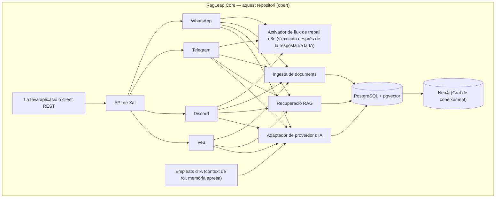
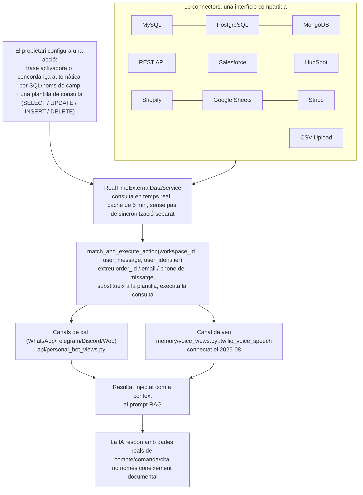

<div align="center">


# RagLeap Core

**Empleats d'IA de codi obert que pregunten abans d'actuar.**

[](../LICENSE) [](https://github.com/ragleap/ragleap-core/releases) [](https://github.com/ragleap/ragleap-core) [](https://github.com/ragleap/ragleap-core) [](https://github.com/ragleap/ragleap-core)
[](https://pypi.org/project/ragleap-rag/) [](https://pypi.org/project/ragleap-rag/)
[](https://pypi.org/project/ragleap-graph/) [](https://pypi.org/project/ragleap-graph/)
[](https://pypi.org/project/ragleap-vectorstores/) [](https://pypi.org/project/ragleap-vectorstores/)
[](https://pypi.org/project/ragleap-tools/) [](https://pypi.org/project/ragleap-tools/)
[](https://pypi.org/project/ragleap-integrations/) [](https://pypi.org/project/ragleap-integrations/)
[](https://pypi.org/project/ragleap-agents/) [](https://pypi.org/project/ragleap-agents/)
[](https://pypi.org/project/ragleap-ops/) [](https://pypi.org/project/ragleap-ops/)
[](https://pypi.org/project/ragleap-app-chart/) [](https://pypi.org/project/ragleap-app-chart/)
[](https://pypi.org/project/ragleap-observability/) [](https://pypi.org/project/ragleap-observability/)
[](https://pypi.org/project/ragleap-terraform/) [](https://pypi.org/project/ragleap-terraform/)
[](https://pypi.org/project/ragleap-ansible/) [](https://pypi.org/project/ragleap-ansible/)
[](https://pypi.org/project/ragleap-voice/) [](https://pypi.org/project/ragleap-voice/)
[)](https://central.sonatype.com/artifact/io.github.antonyrag/ragleap-rag)
[)](https://central.sonatype.com/artifact/io.github.antonyrag/ragleap-graph)
[](https://github.com/ragleap/ragleap-core) [](https://discord.gg/mQwJuQDVrA) [](https://github.com/ragleap/ragleap-core/pulse)

[English](../README.md) · [Afrikaans](README.af.md) · [العربية](README.ar.md) · [Български](README.bg.md) · [বাংলা](README.bn.md) · **Català** · [Čeština](README.cs.md) · [Cymraeg](README.cy.md) · [Dansk](README.da.md) · [Deutsch](README.de.md) · [Ελληνικά](README.el.md) · [Español](README.es.md) · [Eesti](README.et.md) · [فارسی](README.fa.md) · [Suomi](README.fi.md) · [Français](README.fr.md) · [ગુજરાતી](README.gu.md) · [עברית](README.he.md) · [हिन्दी](README.hi.md) · [Hrvatski](README.hr.md) · [Magyar](README.hu.md) · [Bahasa Indonesia](README.id.md) · [Italiano](README.it.md) · [日本語](README.ja.md) · [ಕನ್ನಡ](README.kn.md) · [한국어](README.ko.md) · [Lietuvių](README.lt.md) · [Latviešu](README.lv.md) · [Македонски](README.mk.md) · [മലയാളം](README.ml.md) · [मराठी](README.mr.md) · [नेपाली](README.ne.md) · [Nederlands](README.nl.md) · [Norsk](README.no.md) · [ਪੰਜਾਬੀ](README.pa.md) · [Polski](README.pl.md) · [Português](README.pt.md) · [Română](README.ro.md) · [Русский](README.ru.md) · [Slovenčina](README.sk.md) · [Slovenščina](README.sl.md) · [Soomaali](README.so.md) · [Shqip](README.sq.md) · [Svenska](README.sv.md) · [Kiswahili](README.sw.md) · [தமிழ்](README.ta.md) · [తెలుగు](README.te.md) · [ไทย](README.th.md) · [Tagalog](README.tl.md) · [Türkçe](README.tr.md) · [Українська](README.uk.md) · [اردو](README.ur.md) · [Tiếng Việt](README.vi.md) · [简体中文](README.zh-cn.md) · [繁體中文](README.zh-tw.md)

</div>

RagLeap Core és el motor de codi obert darrere de RagLeap — un sistema agèntic d'auto-allotjament que gestiona el teu negoci a partir dels teus propis documents, al teu propi servidor, sense dependències de proveïdor.

**46 empleats d'IA per rol:** 9 rols generalistes bàsics (gestor d'IA, secretari, CEO, vendes, suport, RRHH, finances, màrqueting, operacions) més 37 rols globals especialitzats (seleccionador, agent immobiliari, recepció legal, recepció sanitària, agent d'assegurances, i molts més) — llista completa a [`core/employees/defaults.py`](core/employees/defaults.py).

**Què fa:**
- Memòria autoaprenent ponderada per resultats
- Activació automàtica de fluxos de treball i escalada
- Modes d'autonomia: `off` (per defecte, la IA actua només quan tu l'inicies), `semi` (aprovació de cada acció) i `full` (opcional; els rols sensibles mai no són completament autònoms)
- Bucle de pensar-actuar-decidir, no només recuperació d'informació
- Bucle d'agència actua-observa (opcional): el model proposa una acció a la vegada, cada acció passa per la porta d'aprovació i el resultat torna com a text no fiable
- Eines segures, totes opcionals: Python i shell en un entorn aïllat sense xarxa, recuperació de pàgines en mode de sols lectura, client MCP amb llista d'autoritzats, tiquets de tasques i comprovacions periòdiques programades
- **Tauler AI Office** a `/office`: aprovacions, empleats per departament, tasques, execucions d'agents, activitat, configuració i una llista de comprovació d'instal·lació
- Pot funcionar completament en local amb Ollama per a xat i embeddings (els models petits en CPU són més lents i menys precisos que els allotjats), o amb qualsevol dels 19 proveïdors disponibles amb la teva clau
- Pressupostos de tokens opcionals, limitació d'intents de sessió fallits i un registre d'auditoria de cada acció

**Instal·la amb una sola comanda** (necessita Docker Desktop a macOS i Windows, o Docker Engine a Linux; el script pregunta quin model d'IA fer servir i no modifica mai un `.env` existent):

```bash
curl -fsSL https://raw.githubusercontent.com/ragleap/ragleap-core/main/install.sh | bash
```

Prefereixes llegir-ho primer? Consulta [install.sh](../install.sh). Per a una instal·lació completament local sense clau d'API, afegeix `bash -s -- --ollama` al final d'aquesta comanda.

**Windows:** instal·la [Docker Desktop](https://www.docker.com/products/docker-desktop) (requereix WSL 2 i virtualització de CPU activada) i [Git for Windows](https://git-scm.com/download/win), i escriu això en una finestra de PowerShell oberta:

```powershell
irm https://raw.githubusercontent.com/ragleap/ragleap-core/main/install.ps1 | iex
```

Pregunta quin model d'IA fer servir, compila i arrenca RagLeap, i obre el tauler al navegador sense mostrar la clau de sessió al terminal. Escriu-la directament a PowerShell: embolcallada dins de `powershell -c "..."`, Windows Defender va bloquejar aquesta forma a l'única màquina que hem provat. Per llegir el script primer, executa `$s = irm` amb la mateixa adreça, revisa `$s`, i després executa `iex $s`. Després de la instal·lació, executa les comandes de RagLeap des de Git Bash a la carpeta d'instal·lació, per exemple `bash scripts/ragleap key`.

Si el port 8000 o el 5433 ja està en ús al teu ordinador (per exemple, per un PostgreSQL local), una instal·lació nova tria el primer port lliure i l'escriu a `.env` (`APP_PORT`, `DB_PORT`, etc.). `ragleap key --rotate` reemplaça la teva clau d'API i reinicia l'aplicació; la clau antiga deixa de funcionar immediatament.

Sent honestos: l'instal·lador de Windows s'ha executat en una sola màquina Windows fins ara, i la seva opció d'Ollama local no s'ha provat a Windows.

[Inici ràpid](#inici-ràpid) · [Documentació](https://docs.ragleap.com) · [Web](https://ragleap.com) · [Paquets](https://packages.ragleap.com/)

---

> **Codi obert, auto-allotjat.** `ragleap-core` (aquest repositori) té llicència MIT, és completament gratuït i mai no requereix cap clau de llicència. Està prevista una versió al núvol gestionada de RagLeap; per ara, RagLeap és només de codi obert.

## Instal·lació

```bash
pip install ragleap-rag
```

> ⭐ Si t'és útil, considera posar-li una estrella al repositori — ajuda genuïnament a que més gent el trobi.

Prefereixes Java? `ragleap-rag` també és a Maven Central:
```xml
<dependency>
    <groupId>io.github.antonyrag</groupId>
    <artifactId>ragleap-rag</artifactId>
    <version>0.13.0</version>
</dependency>
```
Versionat de manera independent del paquet Python anterior — consulta [`java/ragleap-rag`](../java/ragleap-rag) per a l'abast actual.

L'índex de graf Neo4j també té un port Java, a través de l'API de consulta HTTP (regex o, opcionalment, extracció d'entitats i relacions per LLM, deduplicació, indexació de documents i cerques, `GraphRetriever`, backfills i migracions; l'escriptor d'auditoria de Postgres no s'ha portat encara):
```xml
<dependency>
    <groupId>io.github.antonyrag</groupId>
    <artifactId>ragleap-graph</artifactId>
    <version>0.2.0</version>
</dependency>
```
Consulta [`java/ragleap-graph`](../java/ragleap-graph) per a l'abast actual.

Afegeix `ragleap-graph` si vols recuperació amb graf de coneixement basat en Neo4j:
```bash
pip install ragleap-rag ragleap-graph
```

Afegeix `ragleap-vectorstores` si vols backends vectorials connectable més enllà dels sis integrats a ragleap-rag (Chroma, LanceDB, Redis, Upstash Vector i OpenSearch):
```bash
pip install ragleap-rag ragleap-vectorstores[chroma]
# o amb uv
uv add ragleap-rag ragleap-vectorstores[chroma]
```

Afegeix `ragleap-tools` si vols eines preparades per a la crida d'eines LLM (calculadora, operacions de fitxers en entorn aïllat, data/hora, conversió d'unitats, anàlisi de JSON/CSV, utilitats de text):
```bash
pip install ragleap-rag ragleap-tools
# o amb uv
uv add ragleap-rag ragleap-tools
```

Desplegant a Kubernetes? `ragleap-ops` inclou manifests provats en viu i un Helm chart per a la pila completa:

```bash
pip install ragleap-ops
# o amb uv
uv add ragleap-ops
```

Necessites un chart genèric i reutilitzable per a la teva pròpia aplicació (no específic de RagLeap)? `ragleap-app-chart` accepta una llista `services:` arbitrària, no noms codificats:

```bash
pip install ragleap-app-chart
# o amb uv
uv add ragleap-app-chart
```

Vols mètriques i registres per al teu desplegament `ragleap-ops`? `ragleap-observability` inclou Prometheus, Grafana, Loki + Promtail i AlertManager, verificat de cap a cap en un clúster real:

```bash
pip install ragleap-observability
# o amb uv
uv add ragleap-observability
```

Vols que els teus agents cridin eines en servidors MCP remots? `ragleap-integrations` és un client MCP que converteix les eines autoritzades de servidors remots en objectes Tool de `ragleap-tools` (només Streamable HTTP, alfa):

```bash
pip install ragleap-integrations
# o amb uv
uv add ragleap-integrations
```

Necessites un bucle d'agent petit per al teu propi model? `ragleap-agents` executa una acció proposada a la vegada sobre objectes Tool de `ragleap-tools`, amb portes d'aprovació, sense codi de proveïdor ni base de dades (alfa):

```bash
pip install ragleap-agents
# o amb uv
uv add ragleap-agents
```

Prefereixes Terraform per a un clúster local? `ragleap-terraform` és un mòdul Terraform que crea un clúster kind i instal·la els Helm charts de RagLeap (de moment, només clúster kind local):

```bash
pip install ragleap-terraform
# o amb uv
uv add ragleap-terraform
```

Prefereixes Ansible per a un servidor Ubuntu nou? `ragleap-ansible` és un conjunt de rols Ansible que creen un usuari de desplegament, configuren sudo i actualitzacions automàtiques, i opcionalment poden endurir SSH i activar un tallafocs. No instal·la k3s, Helm ni els charts, i s'ha provat només en un contenidor:

```bash
pip install ragleap-ansible
# o amb uv
uv add ragleap-ansible
```

Estàs explorant models de veu locals i oberts? `ragleap-voice` és un gestor de models en fase pre-alfa: un manifest de models candidats de veu a text i text a veu amb verificació de llicència, amb descàrregues verificades per hash des de Hugging Face. Encara no té motors de veu, de manera que no pot transcriure ni sintetitzar àudio, i cada entrada del manifest és encara no verificada:

```bash
pip install ragleap-voice
# o amb uv
uv add ragleap-voice
```

O bé executa l'aplicació completa auto-allotjada (canals, tauler AI Office, Docker Compose) — consulta [Inici ràpid](#inici-ràpid) a continuació. Navega per tots els paquets a [packages.ragleap.com](https://packages.ragleap.com). Prova-ho de primera mà amb els scripts executables a [examples/](../examples/) — `01_ingest_and_query.py` (puja un document i fes una pregunta via API) i `02_test_channel_directly.py` (prova la lògica de resposta del canal sense credencials reals de bot).

## Si un chatbot RAG respon preguntes, RagLeap gestiona el teu negoci

La majoria de projectes RAG de codi obert et donen un kit d'eines — tu encara has de construir l'aplicació, connectar la interfície, afegir memòria i connectar cada canal tu mateix. RagLeap Core et dona una sola IA a través de WhatsApp, Telegram, Discord i trucades de veu, en lloc d'un bot diferent i desconnectat per a cada canal. La memòria persisteix entre sessions i canals, de manera que no ha de tornar a aprendre qui és un client cada vegada. La veu és un gestor real i funcional de trucades entrants (Twilio Media Streams, Whisper STT, OpenAI TTS) — no simplement Q&A de documents amb un número de telèfon enganxat — i l'automatització de fluxos de treball n8n es pot activar directament des de qualsevol conversa.

El que no inclou aquest repositori: un tauler d'administrador multiinquilí (configuració, analítiques, equip, facturació) i una capa d'assistent executiu (Manager AI). Sí que inclou un tauler monoinquilí — l'AI Office a `/office` (aprovacions, empleats per departament, tasques, execucions d'agents, activitat, configuració i llista de comprovació d'instal·lació). El propi RagLeap Core és monoinquilí, auto-allotjat i configurat via `.env`.

## Què fa específicament diferent RagLeap Core

Aquest repositori no és un marc RAG d'ús general que tu muntes en quelcom — és un motor real i funcional que pots executar avui. El codi aquí és honest sobre el fet que és primerenc.

## Per què existeix RagLeap

Els projectes d'agents d'IA de codi obert com OpenClaw van despuntar per una raó concreta: la gent volia un assistent que funcioni a **la seva pròpia infraestructura**, amb **les seves pròpies claus**, que respongui des de **les aplicacions de xat que ja fan servir** — no una caixa negra allotjada per algú altre. Exactament aquest mateix principi és el que fonamenta RagLeap Core, però específicament per a la IA empresarial.

**Les teves claus, la teva infraestructura, les teves dades.** RagLeap Core mai no demana una clau d'API del sistema. Portes la teva pròpia clau d'IA (o fas servir Ollama local sense cap clau), executes la teva pròpia base de dades PostgreSQL, els teus documents s'emmagatzemen al teu propi servidor, i el text s'envia únicament als proveïdors d'IA que tu configures (el teu model de xat i el teu proveïdor d'embeddings; amb Ollama local per a tots dos, el text dels teus documents no surt del teu servidor).

**El xat és la interfície, no un tauler separat que has d'aprendre.** De la mateixa manera que OpenClaw troba la gent a WhatsApp, Telegram i Slack, la plataforma completa de RagLeap troba els empresaris als canals que ja fan servir — WhatsApp, Telegram, Discord i trucades de telèfon reals — no una aplicació nova que han d'anar a mirar.

**Un sistema real i funcional — no un marc abstracte.** Això no és un kit d'eines com LangChain on tu muntes la teva pròpia aplicació a partir de primitives. RagLeap Core és el pipeline real de fragmentació → embedding → recuperació → generació extret d'un sistema en producció que ja respon preguntes reals de clients, en una empresa que ja funciona amb ell.

**Construït en públic, amb honestedat.** Aquest repositori diu clarament què està fet i què no. Sense afirmacions inflades, sense comandes de Quickstart de vapor que encara no funcionen — el Full de ruta reflecteix l'estat real del codi i s'actualitza a mesura que avança.

## Què és RagLeap Core

RagLeap Core és un motor de xat basat en documents. Puja els teus documents, fes preguntes, rep respostes citades — auto-allotjat, a la teva pròpia infraestructura, amb la teva pròpia clau d'API.

Els bots de WhatsApp, Telegram i Discord també s'inclouen en aquest repositori — adaptadors de canal monoinquilí configurats per .env que responen des de la mateixa base de coneixement documental.

## RagLeap Core és adequat per a tu si

- ✅ Vols un chatbot RAG auto-allotjat amb control total sobre les teves dades
- ✅ Vols entendre exactament com funciona la recuperació de documents i les cites, no fer servir una caixa negra
- ✅ Et sents còmode executant el teu propi servidor i la teva pròpia clau de proveïdor d'IA
- ✅ Vols contribuir o estendre un motor de QA de documents obert
- ✅ Prefereixes veure el codi que fiar-te de la paraula d'un proveïdor sobre la privacitat de les dades

## Què no és RagLeap Core

| No és... | Sí que és... |
|---|---|
| Un producte allotjat | Programari auto-allotjat que executes tu mateix |
| Multiinquilí, amb memòria persistent entre sessions | Monoinquilí — un bot, un conjunt de documents, per desplegament |
| Una plataforma multiinquilí | Adaptadors de canal WhatsApp/Telegram/Discord/Voice inclosos, monoinquilí |
| Un tauler SaaS sense codi | Una base de codi que desplegues i configures |
| Amb funcionalitats completes | El subconjunt fundacional — consulta el [Full de ruta](#full-de-ruta) |

## Funcionalitats

| | |
|---|---|
| 📄 **Ingesta de documents** | Puja 28 tipus de fitxer (PDF, Word, Excel, PowerPoint, CSV, HTML, EPUB i més) o afegeix una pàgina web pública per adreça |
| 🔍 **Recuperació RAG** | Cerca vectorial sobre els teus documents via pgvector |
| 💬 **Xat amb cites** | Les respostes fan referència al document font, no a una caixa negra |
| 🔌 **Porta la teva pròpia clau d'IA** | OpenAI, Gemini, Anthropic, o qualsevol endpoint compatible amb OpenAI |
| 🌐 **Widget de xat web (previst)** | Encara no construït: un widget incrustable per a llocs web de clients és al [Full de ruta](#full-de-ruta) |
| 🐳 **Instal·lació basada en Docker** | Desplegament local amb una sola comanda |
| 🕸️ **Graf de coneixement (Neo4j)** | Extracció d'entitats i recuperació potenciada per graf al costat de la cerca vectorial |
| 🌍 **Detecció d'idioma** | Detecta automàticament l'idioma del document i de la consulta, aplicat a tots els canals |
| 🔗 **Integracions** | Connecta MySQL, PostgreSQL, MongoDB, APIs REST, Salesforce, HubSpot, Shopify, Google Sheets, Stripe |
| 🔀 **Cerca híbrida** | Combina recuperació densa (vectorial) i dispersa (text complet) via Reciprocal Rank Fusion |
| ⚡ **Respostes en flux** | Les respostes s'emeten token a token en lloc d'esperar la resposta completa |
| 🔁 **Proveïdor de reserva** | Reintenta automàticament amb un proveïdor LLM de reserva si el principal falla |
| 💰 **Informes d'ús de tokens** | Comptadors de tokens reals per crida des del proveïdor, més retallada de pressupost de mida de context |
| 🧑‍💼 **Empleats d'IA** | Agents per rol (46 rols per defecte) amb memòria persistent de context empresarial, connectats a `/chat` via `role=<rol>` |
| 🖥️ **Tauler AI Office** | Safata d'aprovacions, empleats per departament, tasques, execucions d'agents, activitat, Configuració (les claus estan xifrades i són de sols escriptura) i una llista de comprovació d'instal·lació a `/office` |
| 🛡️ **Autonomia amb porta d'aprovació** | Modes `off`, `semi` i `full`; els rols sensibles sempre requereixen aprovació; quan l'agent llegeix contingut web o MCP, les accions sortints requereixen aprovació fins i tot en mode `full`; totes les accions es registren |
| 🔁 **Bucle d'agència actua-observa** | Opcional: proposa una acció, aprova-la, observa el resultat, continua (fins a 4 passos per defecte) |
| 🧰 **Eines en entorn aïllat (opcionals)** | Python i shell en un contenidor sense xarxa, recuperació de pàgines de sols lectura amb protecció SSRF, client MCP amb llista d'autoritzats, tiquets de tasques |
| ⏰ **Comprovacions periòdiques programades** | Activadors proactius cada N minuts o per cron amb zona horària |
| 💸 **Pressupostos i límits** | Límits diaris i mensuals de tokens opcionals (globals o per rol) i limitació d'intents de sessió fallits |
| 🦙 **Mode local** | Xat i embeddings a través d'Ollama; `ragleap launch --ollama` |
| 🛠️ **Crea el teu propi empleat d'IA** | Defineix un rol completament personalitzat (qualsevol nom, personalitat, canals, etiquetes d'habilitat) via `PATCH /employees/{role}` — sense fork, sense canvi de codi. Verificat en viu: crea, recupera i llista un nou rol de cap a cap. |
| 🔗 **Automatització de fluxos de treball n8n** | Llança un webhook després que la IA respongui a WhatsApp/Telegram/Discord — automatitzacions sense codi activades directament des d'una conversa |

## Arquitectura

Com s'estructura RagLeap Core:



**Cua de treballs en segon pla opcional.** La tasca de sincronització periòdica d'integració s'executa en línia dins del procés API per defecte. Configurar `REDIS_URL` la commuta a una cua Redis real (RQ), processada per un o diversos processos `worker` separats que escalen de manera independent — horitzontalment via `docker compose up -d --scale worker=N`, o a Kubernetes amb un autoescalador basat en la profunditat de la cua com KEDA (consulta `examples/keda-scaledobject-worker.yaml` per a un `ScaledObject` de referència). Completament opcional — res canvia si `REDIS_URL` no es configura.

### Estructura del repositori

```
ragleap-core/
├── core/                  # Motor RAG — fragmentació, embedding, recuperació, generació
│   ├── chunker.py
│   ├── embedding.py       # Embeddings: Gemini (per defecte, 3072 dimensions) o Ollama/OpenAI/Mistral/...
│   ├── retrieval.py       # Cerca cosinus de pgvector
│   ├── generation.py      # Generació BYOK amb 19 proveïdors (Gemini, OpenAI, Anthropic, etc.)
│   ├── ingest.py          # Pipeline fragment -> embedding -> emmagatzematge
│   ├── parsers.py         # Extracció de text de PDF/DOCX/TXT
│   ├── employees/         # Empleats d'IA — rols, perfil empresarial, memòria apresa
│   ├── workflows.py       # Automatització de flux de treball n8n — activadors webhook
│   └── api.py             # Aplicació FastAPI — /health, /upload, /chat, /profile, /employees, /n8n-workflows, /webhook/*
├── channels/              # Adaptadors de canal de missatgeria i veu
│   ├── whatsapp/          # Twilio + Gupshup
│   ├── telegram/
│   ├── discord/
│   └── voice/             # Twilio Media Streams, servidor WebSocket
├── db/
│   └── schema.sql         # Taules documents + chunks, índex pgvector
├── examples/              # Scripts d'exemple executables
├── sandbox/               # Executor de codi i shell bloquejat (opcional)
├── scripts/               # La comanda `ragleap`
├── skills/ragleap/        # Habilitat de sols lectura per a agents de codificació
├── .codex-plugin/         # Manifest del connector per a aquesta habilitat
├── packages/              # Paquets pip independents (ragleap-rag, -graph, -tools, ...)
├── java/                  # Ports Java de ragleap-rag i ragleap-graph
├── .github/workflows/     # CI: comprovació de compilació, construcció Docker, proves de fum
├── docker-compose.yml     # app + db + voice, més perfils opcionals neo4j, redis, worker, sandbox i ollama
└── Dockerfile
```

## Inici ràpid

> ✅ **Estat: pipeline principal verificat i funcionant.** Ingesta → embedding → recuperació → generació funciona de cap a cap via Docker Compose, inclosa una prova de clonació en net. Consulta el [Full de ruta](#full-de-ruta) per al que ve (suport de PDF/DOCX, proveïdors BYOK alternatius).

**La manera més ràpida de provar-ho** — una sola comanda comprova Docker, clona el repositori i configura el `.env` per a tu:

```bash
curl -fsSL https://raw.githubusercontent.com/ragleap/ragleap-core/main/install.sh | bash
```

(Usuaris de Windows: executa-ho a Git Bash, no a Command Prompt ni PowerShell.)

L'instal·lador pregunta quin model d'IA fer servir (Gemini, o Ollama completament local sense clau d'API), genera la teva clau d'API i els secrets, ho arrenca tot i imprimeix un enllaç d'un clic al tauler. Per a IA local executa `curl -fsSL https://raw.githubusercontent.com/ragleap/ragleap-core/main/install.sh | bash -s -- --ollama` (els models locals petits en CPU són més lents i menys precisos que Gemini). Per a instal·lacions desateses, configura `RAGLEAP_PROVIDER` (`gemini`, `ollama` o `skip`) i `GEMINI_API_KEY`. Un `.env` existent mai no es modifica.

Després d'instal·lar, controla RagLeap amb la comanda `ragleap`: `ragleap launch` (arrenca; `--ollama` també executa el servei d'IA local i hi commuta), `ragleap stop`, `ragleap status`, `ragleap logs`, `ragleap update` (fa còpia de seguretat de la base de dades primer) i `ragleap key` (imprimeix el teu enllaç d'un clic al tauler).

**O bé, la manera manual** — millor si vols llegir el codi abans d'executar res:

```bash
git clone https://github.com/ragleap/ragleap-core.git
cd ragleap-core
cp .env.example .env
# afegeix la teva clau d'API de Gemini a .env
docker compose up --build -d
```

Requisits: Docker, Docker Compose, i o bé una clau d'API de Gemini (per defecte) o una instal·lació local d'Ollama sense clau (fes servir `ragleap launch --ollama`, o configura `EMBEDDING_PROVIDER=ollama` per a embeddings). Per al xat pots fer servir Gemini o qualsevol dels 19 proveïdors llistats a [Proveïdors LLM compatibles](#proveïdors-llm-compatibles-byok), inclòs un model local d'Ollama i qualsevol endpoint compatible amb OpenAI.

**Prova-ho en 30 segons** — amb la pila en marxa, consulta [examples/](../examples/) per a dos scripts verificats i executables:
- `examples/01_ingest_and_query.py` — puja un document i fes una pregunta via API
- `examples/02_test_channel_directly.py` — prova la lògica de resposta de WhatsApp/Telegram/Discord sense credencials reals de bot

## Només vols el motor RAG com a biblioteca Python?

Si no necessites l'aplicació Docker completa — adaptadors de WhatsApp/Telegram/Discord/Voice, el tauler AI Office, tot — el motor de recuperació principal també es publica com a paquets Python independents instal·lables via pip:

```bash
pip install ragleap-rag
```

- **`ragleap-rag`** — el pipeline de fragmentació → embedding → recuperació → generació com a biblioteca. Embeddings connectable (8 proveïdors: Gemini, OpenAI, Mistral, Together, Ollama, Cohere, Voyage i un endpoint personalitzat), 6 backends vectorials (FAISS, PgVector, Pinecone, Weaviate, Qdrant, Milvus), reclassificació amb cross-encoder, i més.
- **`ragleap-graph`** — recuperació de graf de coneixement basat en Neo4j, usable de manera independent o al costat de `ragleap-rag`.
- **`ragleap-vectorstores`** — backends vectorials connectable més enllà dels 6 del nucli de `ragleap-rag`. Backends: Chroma i LanceDB (incrustats/locals), Redis (RediSearch/Redis Stack), Upstash Vector (serverless gestionat) i OpenSearch (k-NN). Instal·la amb `pip install ragleap-vectorstores[chroma]` o `uv add ragleap-vectorstores[chroma]`.
- **`ragleap-tools`** — eines lleugeres i independents per a la crida d'eines LLM. 12 eines sense estat (calculadora, data/hora, conversió d'unitats, anàlisi de JSON/CSV, utilitats de text), operacions de fitxers en entorn aïllat (protegides contra escapada de symlink), `search_documents` (cerca híbrida vectorial+paraula clau), `search_web` (proveïdors BYOK connectable com Tavily i Serper), `search_github_repositories`, `describe_image` (proveïdors de visió BYOK per a Gemini i Anthropic; només Gemini s'ha comprovat en viu), i ingesta de documents opcional basada en `ragleap-rag`. Cada proveïdor HTTP té un límit de mida de resposta i un termini total rígid. No té un bucle d'execució de crida d'eines — proporciona objectes `Tool` per al teu propi bucle o per a `ragleap-agents`. Escriu les teves pròpies eines amb el decorador `@tool` i despatxa de manera segura la crida d'un model amb `Toolkit` (els arguments es validen abans que s'executi el teu codi). Instal·la amb `pip install ragleap-tools` o `uv add ragleap-tools`.
- **`ragleap-integrations`** — client MCP (Model Context Protocol) sobre Streamable HTTP que retorna objectes `Tool` de `ragleap-tools`. El propietari configura els servidors i una llista d'autoritzats exacta de `server.tool`; el model només proporciona arguments. Transport únicament HTTPS amb fixació DNS i un termini rígid de rellotge de paret. Comprovat en viu contra servidors públics: DeepWiki en el camí del protocol anterior, i els endpoints MCP de Google Cloud en la revisió més recent (2026-07-28; només descoberta, `tools/call` en aquell camí no es troba verificat en viu). El límit de resposta per defecte és 1 MiB (256 KiB a la versió 0.1.0, que l'endpoint MCP Pub/Sub de Google Cloud va superar); augmenta `max_response_bytes` si la descoberta falla. Encara no hi ha connectors empresarials curats ni bucle d'agent. Instal·la amb `pip install ragleap-integrations` o `uv add ragleap-integrations`.
- **`ragleap-ops`** — manifests de desplegament de Kubernetes per a RagLeap Core, provats de cap a cap en un clúster real. Instal·la amb `pip install ragleap-ops` o `uv add ragleap-ops`.
- **`ragleap-app-chart`** — Helm chart genèric i reutilitzable per desplegar serveis arbitraris a Kubernetes, no específic de RagLeap. Apunta'l a la teva pròpia aplicació via una llista `services:`. Instal·la amb `pip install ragleap-app-chart` o `uv add ragleap-app-chart`.
- **`ragleap-observability`** — Prometheus, Grafana, Loki + Promtail per a `ragleap-ops`, verificat de cap a cap en un clúster real (connexió real confirmada, mètriques reals no nul·les retornades; 21+ fluxos de registre reals amb etiquetes correctes de namespace/pod/container). AlertManager està connectat a Prometheus amb una primera regla d'alerta real, més receptors opcionals de Slack/correu electrònic (inactius per defecte; lliurament verificat contra un substitut, l'enviament real no s'ha confirmat yet). Instal·la amb `pip install ragleap-observability` o `uv add ragleap-observability`.
- **`ragleap-terraform`** — mòdul Terraform que crea un clúster kind local i instal·la els Helm charts de RagLeap, aplicat i destruït en un clúster real (cap mòdul al núvol de moment). Instal·la amb `pip install ragleap-terraform` o `uv add ragleap-terraform`.
- **`ragleap-ansible`** — rols Ansible que preparen i endureixen un servidor Ubuntu nou: usuari de desplegament, sudo, actualitzacions automàtiques, enduriment SSH opcional i tallafocs opcional (provat en un contenidor; no instal·la k3s, Helm ni els charts de moment). Instal·la amb `pip install ragleap-ansible` o `uv add ragleap-ansible`.
- **`ragleap-voice`** — gestor de models en fase pre-alfa per a models de veu a text i text a veu oberts i locals: manifest verificat de llicència, fitxers de bloqueig amb SHA-256 i descàrregues verificades per hash des de Hugging Face. Encara no té motors de veu, de manera que no pot transcriure ni sintetitzar àudio. Instal·la amb `pip install ragleap-voice` o `uv add ragleap-voice`.

Els dotze tenen llicència MIT. Navega per l'índex complet de paquets a [packages.ragleap.com](https://packages.ragleap.com).

## Utilitza RagLeap des d'un agent de codificació (connector de sols lectura)

Si ja executes un servidor RagLeap, una petita habilitat de sols lectura permet que un agent de codificació el comprovi i li faci preguntes. L'habilitat és a `skills/ragleap` i el manifest és a `.codex-plugin/plugin.json`. És un client per a un servidor que executes tu mateix, no una manera d'instal·lar RagLeap, i utilitza únicament la biblioteca estàndard de Python.

Configura l'URL del servidor i la teva clau d'API a l'entorn:

```bash
export RAGLEAP_URL=http://127.0.0.1:8000
export RAGLEAP_API_KEY=your-key-here
```

Comandes:

```bash
python3 skills/ragleap/scripts/ragleap_client.py health
python3 skills/ragleap/scripts/ragleap_client.py employees --active-only
python3 skills/ragleap/scripts/ragleap_client.py ask "Quina és la nostra política de devolucions?" --role support --top-k 5
```

Decisions de seguretat: és de sols lectura (sense pujada ni eliminació), la clau es llegeix únicament de l'entorn i s'envia com a capçalera, rebutja enviar la clau per `http` sense xifrar a un host no local, no segueix redireccions, i les respostes estan limitades a 2 MB. Tracta les respostes com a text no fiable. Consulta `skills/ragleap/SKILL.md` per a més detalls.

## Proveïdors LLM compatibles (BYOK)

RagLeap Core és exclusivament porta-la-teva-pròpia-clau — no hi ha cap clau proporcionada pel sistema per a cap proveïdor. Configura `LLM_PROVIDER` a `.env` per triar quin fer servir per al pas de generació (xat). Els embeddings es configuren per separat amb `EMBEDDING_PROVIDER` (per defecte `gemini`, que usa `gemini-embedding-001`; `ollama`, `openai`, `mistral`, `together`, `openrouter`, `qwen`, `zhipu` i `custom` també s'admeten). La mida del vector ha de coincidir amb el teu model d'embedding (`EMBEDDING_DIMENSIONS`): les taules buides es redimensionen a l'inici, les taules que ja contenen embeddings mai no es modifiquen.

| Valor de `LLM_PROVIDER` | Variables d'entorn requerides | Notes |
|---|---|---|
| `gemini` (per defecte) | `GEMINI_API_KEY` | Obtén una clau a aistudio.google.com/apikey |
| `anthropic` | `ANTHROPIC_API_KEY`, `ANTHROPIC_MODEL` (opcional) | Obtén una clau a console.anthropic.com |
| `openai` | `OPENAI_API_KEY`, `OPENAI_MODEL` | |
| `mistral` | `MISTRAL_API_KEY`, `MISTRAL_MODEL` | |
| `groq` | `GROQ_API_KEY`, `GROQ_MODEL` | Nivell gratuït disponible |
| `together` | `TOGETHER_API_KEY`, `TOGETHER_MODEL` | |
| `openrouter` | `OPENROUTER_API_KEY`, `OPENROUTER_MODEL` | |
| `ollama` | `OLLAMA_MODEL` (no cal clau d'API) | Auto-allotjat; requereix Ollama en marxa localment |
| `deepseek` | `DEEPSEEK_API_KEY`, `DEEPSEEK_MODEL` | |
| `demonroute` | `DEMONROUTE_API_KEY`, `DEMONROUTE_MODEL` | Models de pes obert allotjats; DemonRoute afirma que no conserven els prompts — [privacitat](https://demonroute.com/privacy) |
| `xai` | `XAI_API_KEY`, `XAI_MODEL` | |
| `cohere` | `COHERE_API_KEY`, `COHERE_MODEL` | |
| `perplexity` | `PERPLEXITY_API_KEY`, `PERPLEXITY_MODEL` | |
| `qwen` | `QWEN_API_KEY`, `QWEN_MODEL` | |
| `moonshot` | `MOONSHOT_API_KEY`, `MOONSHOT_MODEL` | |
| `zhipu` | `ZHIPU_API_KEY`, `ZHIPU_MODEL` | |
| `yi` | `YI_API_KEY`, `YI_MODEL` | |
| `baidu` | `BAIDU_API_KEY`, `BAIDU_MODEL` | |
| `minimax` | `MINIMAX_API_KEY`, `MINIMAX_MODEL` | |
| `custom` | `CUSTOM_API_KEY`, `CUSTOM_MODEL`, `CUSTOM_BASE_URL` | Qualsevol endpoint compatible amb OpenAI |

Exemple, canviant a Groq al fitxer `.env`:

```
LLM_PROVIDER=groq
GROQ_API_KEY=your-groq-key
GROQ_MODEL=llama-3.3-70b-versatile
```

### Ollama a Docker: problemes coneguts

Executar Ollama com a proveïdor de reserva/local des de dins del contenidor Docker d'aquesta aplicació (en lloc de directament al maquinari) té passos de configuració reals i verificats més enllà de simplement configurar `OLLAMA_MODEL`:

1. **`host.docker.internal` no és fiable al Docker Engine de Linux corrent** (a diferència de Docker Desktop) — pot resoldre a la passarel·la incorrecta de la xarxa de pont. Si les connexions d'Ollama fallen amb aquest àlies, substitueix `OLLAMA_BASE_URL` directament per la IP de la passarel·la de la xarxa compose del contenidor, per exemple `OLLAMA_BASE_URL=http://172.18.0.1:11434/v1` (troba la teva passarel·la real amb `docker network inspect <xarxa> | grep Gateway`).
2. **Ollama s'enllaça a `127.0.0.1` per defecte**, al qual un contenidor no pot arribar ni amb la IP de passarel·la correcta. Substitueix-ho perquè escolti a totes les interfícies:
```bash
   mkdir -p /etc/systemd/system/ollama.service.d
   cat > /etc/systemd/system/ollama.service.d/override.conf << 'EOF'
   [Service]
   Environment="OLLAMA_HOST=0.0.0.0:11434"
   EOF
   systemctl daemon-reload && systemctl restart ollama
```
3. **El tallafocs de l'amfitrió pot descartar silenciosament el tràfic contenidor→amfitrió** fins i tot després de l'anterior — el tràfic contenidor-a-passarel·la-de-pont activa la cadena `INPUT` d'ufw, no `FORWARD`/`DOCKER-USER`. Permet-ho explícitament: `ufw allow from 172.18.0.0/16 to any port 11434 proto tcp` (ajusta la subxarxa perquè coincideixi amb la teva xarxa Docker real).

## Canal de veu (Twilio)

RagLeap Core inclou un canal de veu en temps real: Twilio Media Streams es connecta via WebSocket, la teva parla es transcriu amb OpenAI Whisper, el pipeline RAG principal respon, i es reprodueix amb OpenAI TTS. La lògica de detecció d'activitat de veu i supressió d'eco es porta d'un sistema en producció ajustat amb tràfic real de trucades.

S'executa com a servei independent al port 8765 (consulta `docker-compose.yml`), ja que el protocol d'àudio en temps real de Twilio necessita un servidor WebSocket en brut, no una ruta HTTP.

**Configuració:**
1. Configura `OPENAI_API_KEY` a `.env` (s'utilitza tant per a Whisper STT com per a TTS a la v1)
2. Opcionalment configura `VOICE_BOT_NAME`, `VOICE_GREETING`, `VOICE_TTS_VOICE`
3. Apunta el TwiML `<Connect><Stream>` d'un número de telèfon de Twilio a `wss://el-teu-domini.com:8765`

**Estat honest:** el servidor WebSocket, la gestió del protocol d'esdeveniments de Twilio i la gestió d'errors s'han verificat i funcionen. El cicle complet de Whisper/TTS encara no s'ha provat de cap a cap en viu (requereix crèdits de l'API d'OpenAI). Si ho proves i et trobes amb problemes, obri un issue — exactament aquest tipus de proves al món real és el que necessita aquest projecte.

**Limitacions conegudes, provinents de producció i no resoltes aquí:**
- Només s'admeten OpenAI Whisper (STT) i OpenAI TTS a la v1 — Deepgram i ElevenLabs (suport multilingüe) són bons candidats per a una primera contribució
- La qualitat del TTS en idiomes que no siguin l'anglès varia, ja que les veus TTS d'OpenAI estan ajustades per a l'anglès
- La latència típica de cicle en producció era de 6-8 segons

## Graf de coneixement (Neo4j)

RagLeap Core construeix un graf lleuger de co-ocurrència d'entitats al costat del seu índex vectorial. Quan ingestes un document, les entitats (noms de productes, acrònims, noms propis) s'extreuen i s'enllaçen a Neo4j. Quan fas una pregunta, la mateixa extracció s'executa sobre la teva consulta, i qualsevol document enllaçat a entitats coincidents rep un impuls de similitud a la recuperació — a més de la cerca normal de pgvector, no en substitució.

S'executa com a quart servei de Docker Compose als ports `7475`/`7688` (remapats des dels valors per defecte de Neo4j per evitar col·lisions amb una altra instància de Neo4j al mateix amfitrió). Si Neo4j és inaccessible o `NEO4J_PASSWORD` no està configurat, el graf degrada de manera elegant — la recuperació torna a la cerca purament vectorial, la ingesta no es veu afectada.

**Configuració:**
1. Configura `NEO4J_URI`, `NEO4J_USER` i `NEO4J_PASSWORD` a `.env` (coincidint amb el valor `NEO4J_AUTH` a `docker-compose.yml`)
2. Opcionalment configura `DOMAIN_TERMS` — una llista de termes específics del domini separats per comes per impulsar durant l'extracció (p. ex. `DOMAIN_TERMS=API,SDK,RAG`)

**Estat honest:** l'extracció d'entitats, les escriptures al graf de documents, la cerca de documents basada en entitats i la recuperació de xat potenciada per graf s'han verificat tots de cap a cap, inclosos al CI (construcció neta, ingesta real, consulta real, cerca real al graf). L'impuls de graf és actualment un simple augment additiu de puntuació, no un reclassificador ponderat complet — un sistema de classificació híbrida més ric és un bon pas següent per a qui vulgui aprofundir.

**Limitacions conegudes:**
- L'extracció d'entitats es basa en regex (CamelCase, acrònims, frases en majúscules, més termes opcionals del domini) — no és un model NER entrenat, de manera que es perdran algunes entitats i de vegades inclourà soroll
- `search_related_entities()` (recorregut de graf de múltiples salts) està implementat però encara no connectat al pipeline de recuperació — bon candidat per a una primera contribució per a qui vulgui un projecte

## Detecció d'idioma

RagLeap Core detecta automàticament l'idioma durant la ingesta de documents (per fragment) i durant el xat (per consulta), fent servir la biblioteca `langdetect` més heurístiques basades en escriptura per a text CJK, Hangul i Kana. Com que cada canal (WhatsApp, Telegram, Discord, Veu i l'API directament) passa pel mateix pipeline central de xat, la detecció s'aplica de manera consistent arreu sense necessitat de connexió per canal.

**Configuració:** funciona de fàbrica sense cap configuració. Opcionalment configura `DEFAULT_LANGUAGE` (alternativa quan falla la detecció o el text és massa curt), `LANGUAGE_DETECTION_CONFIDENCE_THRESHOLD` (per defecte `0.7`) i `LANGUAGE_DETECTION_SUPPORTED_LANGUAGES` (llista d'autoritzats separada per comes, buida = sense restriccions).

**Estat honest:** verificat de cap a cap — la detecció a nivell de document s'ha provat amb alta confiança (0,9999) en un document real de llengua mixta, i la detecció a nivell de consulta s'ha confirmat funcionant via API i CLI.

**Limitacions conegudes:**
- `langdetect` cobreix aproximadament 55 idiomes — notablement menys que els 222+ de la plataforma allotjada, que afegeix detecció addicional i preferències d'idioma per usuari per sobre
- Les consultes curtes en idiomes estretament relacionats poden ser detectades incorrectament (en les proves, una consulta curta en francès es va detectar com a italià) — aquesta és una limitació inherent de la detecció estadística en text curt, no específica d'aquest port. Un bon candidat per a una primera contribució per a qui vulgui millorar la precisió en consultes curtes
- La detecció és unidireccional: RagLeap Core detecta l'idioma de la consulta i el mostra, però encara no dirigeix l'idioma de la resposta de la IA perquè coincideixi — un pas següent raonable per a un col·laborador

## Integracions



**Verificat en viu**, llegit des de `RealTimeExternalDataService` d'`api/addon_realtime.py`. Dues coses que val la pena dir directament: `match_and_execute_action` admet realment consultes d'escriptura (`UPDATE`/`INSERT`/`DELETE`), no només cerques de sols lectura — configurat pel propietari, de manera que el límit de seguretat és el SQL que el propietari escriu a la plantilla, no quelcom que el marc restringeix per si sol. I fins al 2026-08, aquest pas de concordança d'accions només s'executava en canals de xat; les trucades de veu no tenien equivalent, que és el buit tancat al diagrama de rutes del canal de veu anterior.

RagLeap Core es connecta a bases de dades externes i eines empresarials, sincronitzant context per usuari per personalitzar les respostes RAG. S'inclouen nou connectors: MySQL, PostgreSQL, MongoDB, API REST genèriques, Salesforce, HubSpot, Shopify, Google Sheets i Stripe. El codi de connectors més nous per a CSV Upload, Airtable, BigQuery, Snowflake, WooCommerce, Notion, Slack, Gmail i Razorpay també és al repositori; tracta'ls com a experimentals fins que els hagis verificat contra el teu propi compte (rastrejat a #27).

Cada connector CRM/SaaS utilitza les credencials que tu proporciones directament — un nom d'usuari/contrasenya, un token d'aplicació privada, un token d'API d'administrador, un fitxer JSON de compte de servei, o una clau secreta, depenent del servei. Cap requereix registrar una aplicació OAuth; res aquí depèn que RagLeap tingui cap compte de desenvolupador de tercers.

Les credencials s'xifren en repòs (Fernet/AES-128) abans d'emmagatzemar-les.

**Configuració:**
1. Genera una clau de xifratge: `python3 -c "from cryptography.fernet import Fernet; print(Fernet.generate_key().decode())"` i configura el resultat a `ENCRYPTION_KEY` al teu `.env`
2. Afegeix una integració: `POST /integrations/` amb el tipus de connector i les credencials corresponents
3. Sincronitza manualment: `POST /integrations/{id}/sync`

**Estat honest:** verificat de cap a cap contra una API pública real — prova de connexió, sincronització, concordança correcta del camp identificador i xifratge de credencials (comprovat com a text xifrat real a la base de dades, no simplement assumit) tot confirmat.

**Limitacions conegudes:**
- 9 dels 18 tipus de fonts llistats a la interfície de la plataforma allotjada tenen connectors reals aquí. CSV Upload, Snowflake, BigQuery, WooCommerce, Airtable, Notion, Razorpay, Slack i Gmail són bons candidats per a una primera contribució per a qui en vulgui afegir un
- La sincronització és únicament sota demanda (`POST /integrations/{id}/sync`) — no hi ha sincronització periòdica en segon pla de moment, tot i que l'esquema rastreja `sync_interval_minutes` per a un futur equivalent de Celery-beat
- El context sincronitzat encara no s'injecta automàticament a les respostes de xat — cada adaptador de canal haurà de conèixer primer l'identificador del seu propi usuari, la qual cosa és una contribució raonable com a pas següent

## Recuperació, generació i fiabilitat

Més enllà del pipeline RAG bàsic, `/chat` (i el `core.chat.ask()` subjacent) admeten diversos controls orientats a ús en producció: qualitat de recuperació, latència de resposta, fiabilitat del proveïdor i costos.

**Cerca híbrida (densa + dispersa).** Per defecte, la recuperació combina la similitud cosinus de pgvector amb la cerca de text complet de Postgres (`tsvector`/índex `GIN`), fusionats via Reciprocal Rank Fusion — captura tant concordances semàntiques com concordances exactes de paraula clau/identificador que la cerca purament vectorial podria perdre. Passa `hybrid=false` per usar únicament recuperació densa (més barat — una consulta en lloc de dues).

**Transmissió en flux.** `POST /chat/stream` transmet la resposta mentre es genera (`text/plain`, transferència per fragments) en lloc d'esperar la resposta completa. Implementat de manera nativa per a cada proveïdor (Gemini, Anthropic i els compatibles amb OpenAI cadascun té APIs de transmissió diferents — les tres són reals, cap no és un simulacre).

**Proveïdor de reserva.** Configura `LLM_FALLBACK_PROVIDERS` (separats per comes) per reintentar automàticament amb proveïdors de reserva si el principal falla — un límit de velocitat, una interrupció o una mala clau al proveïdor principal no ha de significar una petició fallida. Cada reserva necessita la seva pròpia clau d'API configurada normalment. La transmissió en flux només pot recórrer a la reserva *abans* que s'hagi enviat cap text a qui ha fet la crida — un fallo a mig flux es mostra com a error en lloc de canviar de proveïdor silenciosament i confondre la sortida.

**Controls de generació.** `temperature`, `system_prompt` i `max_tokens` són tots paràmetres reals per crida (no simplement valors per defecte d'env) — construeix el comportament del teu propi agent sobre la recuperació de RagLeap sense fer cap fork de la biblioteca.

**Ús de tokens i pressupost de context.** Cada crida de bloqueig a `/chat` retorna l'ús de tokens real (`prompt_tokens`, `completion_tokens`, `total_tokens`) extret directament de la resposta del proveïdor — no una estimació. El context recuperat també es retalla fins a `MAX_CONTEXT_CHARS` (per defecte 12000, aproximadament 4 caràcters per token per a text en anglès) abans d'enviar-lo, descartant primer els fragments de menor rang, de manera que no pagues per més context del necessari. Configura `MAX_CONTEXT_CHARS=0` per desactivar la retallada.

**Estat honest:** la matemàtica de fusió RRF de la cerca híbrida s'ha verificat manualment. La transmissió en flux s'ha verificat de cap a cap per al proveïdor per defecte. El proveïdor de reserva s'ha verificat amb una prova real de principal trencat — clau d'API invàlida intencionadament, reserva confirmada a un secundari funcional amb resposta correcta. L'ús de tokens i la retallada de context s'han verificat amb números reals: la recuperació de 3 fragments, retallada a 1 fragment amb un pressupost ajustat, va reduir els `prompt_tokens` reals en un 38% a la mateixa API en viu.

**Limitacions conegudes:**
- L'informe d'ús de tokens no està disponible per a respostes en flux — l'API de transmissió de cada proveïdor exposa l'ús de manera diferent, i gestionar-los correctament els tres és una tasca separada i no acabada
- `MAX_CONTEXT_CHARS` és una aproximació de recompte de caràcters (~4 caràcters/token per a l'anglès), no un recompte exacte del tokenitzador per a cada proveïdor
- La cerca híbrida no s'ha comparat amb una millora real en la qualitat de classificació sobre un corpus de múltiples documents amb classificacions realment contradictòries entre denses i disperses — només s'ha verificat la correcció (matemàtica de fusió, tokenització d'identificadors inusuals) fins ara

## Full de ruta

- [x] Repositori públic creat
- [x] El motor RAG principal s'ha extret i netejat de la base de codi en producció
- [x] Configuració autònoma de Docker Compose (sense dependència de projecte Django extern)
- [x] Ingesta de documents a l'aplicació: 28 tipus de fitxer i pàgines web per adreça
- [ ] Ingesta d'àudio, vídeo i imatges a l'aplicació (existeix al paquet `ragleap-rag`; àudio i vídeo necessiten un proveïdor d'allotjament per a la transcripció, ja que l'STT local no s'admet de moment)
- [ ] Widget de xat web incrustable (previst; encara no construït)
- [x] Suport porta-la-teva-pròpia-clau-API (20 proveïdors)
- [x] Adaptadors de canal WhatsApp, Telegram, Discord i Veu (monoinquilí)
- [x] Graf de coneixement (Neo4j), detecció d'idioma, integracions de base de dades/CRM
- [x] Guia de contribució i etiquetes de primera contribució — 8+ issues etiquetats, amb un col·laborador extern real actiu al #134
- [x] Comunitat de Discord
- [x] Tauler AI Office amb configuració i llista de comprovació d'instal·lació (v0.9.0)
- [x] Bucle d'agència amb portes d'aprovació, eines en entorn aïllat, client MCP i comprovacions periòdiques programades
- [x] Instal·lador d'una comanda i comanda `ragleap`, mode Ollama local (encara no provat en una màquina en net)
- [x] Limitació d'intents de sessió fallits i pressupostos de tokens opcionals
- [ ] Imatges Docker prefabricades (GHCR) per a una instal·lació més ràpida
- [ ] Activadors i controls d'autonomia al tauler
- [ ] Entrades de Slack i correu electrònic, SMS i widget web (necessiten una adreça HTTPS pública)
- [ ] Verificació en viu de més proveïdors LLM (consulta el #10)

Consulta [ROADMAP.md](../ROADMAP.md) per a la història completa fase per fase.

## Provat per altres

Considerem que una funcionalitat és provada únicament quan algú diferent dels mantenidors l'executa i informa del resultat. Aquesta taula comença intencionadament buida. S'omple a partir d'informes a l'[issue de proves de la comunitat](https://github.com/ragleap/ragleap-core/issues/787) i res no es considera provat fins que un informe estigui llistat aquí.

No has d'escriure codi per ajudar: tria una prova, executa uns quants passos en fitxers de mostra i comenta el que ha passat, fins i tot si tot ha funcionat. Si us plau, no comparteixis mai claus ni dades reals.

| Àrea | Provat per | SO / configuració | Resultat | Issue |
|---|---|---|---|---|
| (encara no hi ha informes) | | | | |

## Contribució

RagLeap Core funciona, és provat i està obert a contribucions ara. Consulta [CONTRIBUTING.md](../CONTRIBUTING.md) per saber com començar i comprova l'etiqueta [good first issue](../../issues?q=is%3Aissue+is%3Aopen+label%3A%22good+first+issue%22) per a tasques delimitades.

Vols veure exactament en què s'està treballant i el que està obert per agafar? Consulta el [tauler del projecte](https://github.com/users/antonyrag/projects/1) — els issues estan estrats com Good First Issue, Ready (Scoped) o Needs Scoping, de manera que pots triar quelcom que s'adapti a la quantitat de treball de disseny que vols fer davant de simplement construir.

**Ets estudiant, professor, o estàs buscant un projecte de fi de carrera/tesi?** Consulta [STUDENT_PROJECTS.md](../STUDENT_PROJECTS.md) per a idees de projectes delimitades en nivells d'iniciació, de semestre i de recerca.

## Comunitat

- [GitHub Issues](../../issues) — errors i sol·licituds de funcionalitats
- [GitHub Discussions](../../discussions) — idees i preguntes
- [ragleap.com](https://ragleap.com) — el lloc web del projecte

## Llicència

MIT © 2026 RagLeap

## Resolució de problemes

**Error "could not translate host name 'db'" després d'un `docker compose up` fallit:**
Si el teu primer intent amb `docker compose up` falla (per exemple, un conflicte de port al 5433 o 8000), tornar-ho a intentar de vegades pot deixar el contenidor de base de dades lligat a una xarxa Docker obsoleta i orfe. La solució:
```bash
docker compose down
docker network prune -f
docker compose up --build -d
```

**El port 5433 o 8000 ja està en ús:**
Una altra instància d'aquest projecte (o quelcom altre, com PostgreSQL local al 5433) utilitza el port. Una instal·lació nova amb `install.sh` o `install.ps1` tria automàticament el primer port lliure i l'escriu a `.env`. Si has iniciat tu sol amb `docker compose up`, o estàs reutilitzant un `.env` existent, configura el port de l'amfitrió allà: `APP_PORT` (per defecte 8000), `DB_PORT` (5433), `VOICE_PORT` (8766), `NEO4J_HTTP_PORT` (7475), `NEO4J_BOLT_PORT` (7688) o `REDIS_PORT` (6380), per exemple `DB_PORT=5434`, i torna a executar `docker compose up -d`. L'adreça del tauler segueix `APP_PORT`, per exemple `http://localhost:8001/office`.
